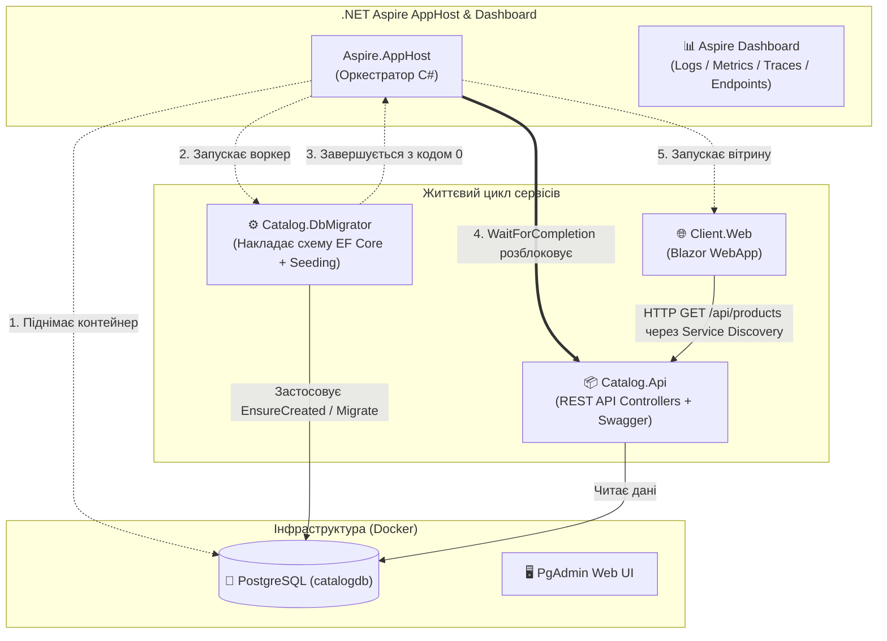

# 01. Aspire Fundamentals & Database Migrations Pattern

> **Основи .NET Aspire, оркестрація сервісів, Service Discovery та виробничий патерн безпечних міграцій бази даних `DbMigrator` з `.WaitForCompletion()`.**

---

## 🏛️ Архітектурна схема модуля



---

## 📂 Склад проєктів та їх взаємодія

| Проєкт | Тип | Роль в архітектурі |
| :--- | :--- | :--- |
| **`Aspire.AppHost`** | .NET Aspire Host | Точка входу оркестрації. Описує топологію всієї системи: PostgreSQL, порядок запуску сервісів (`WaitFor`, `WaitForCompletion`), прокидання рядків підключення. |
| **`Aspire.ServiceDefaults`** | Shared Library | Встановлює базові стандарти для всіх сервісів: OpenTelemetry (траси, метрики), Health Checks (`/health`, `/alive`), Service Discovery та HTTP Resilience. |
| **`Catalog.DbMigrator`** | Console App | **Виробничий патерн міграцій:** ізольований воркер, який ініціалізує схему БД у PostgreSQL, наповнює її початковими товарами та штатно завершує процес з кодом `0`. |
| **`Catalog.Api`** | Web API | REST-сервіс каталогу товарів на базі PostgreSQL (EF Core). Надає ендпоінти `GET /api/products`, `GET /api/products/{id}`, `POST /api/products`. |
| **`Client.Web`** | Blazor WebApp | Клієнтський інтерфейс. Звертається до API через `HttpClient` з логічною адресою `https+http://catalog-api`, яку Aspire автоматично резолвить у фізичний порт. |

---

## ⚡ Чому патерн `DbMigrator` з `WaitForCompletion` критично важливий?

В типових початкових проєктах розробники часто пишуть `dbContext.Database.Migrate()` прямо всередині `Program.cs` основного Web API.

### ❌ Проблема старого підходу:
1. Якщо мікросервіс масштабується (наприклад, 3 репліки API в кластері), всі три екземпляри одночасно починають накладати міграції до однієї бази даних, що призводить до дедлоків, блокувань таблиць або збоїв.
2. Web API починає приймати HTTP-трафік ще до того, як міграція завершилась, повертаючи клієнтам `500 Internal Server Error`.

### ✅ Рішення в .NET Aspire:
Ми виносимо міграції в окремий одноразовий процес `Catalog.DbMigrator`, а в `AppHost.cs` вказуємо чітку залежність:

```csharp
// 1. Запускаємо мігратор після старту PostgreSQL
var migrator = builder.AddProject<Projects.Catalog_DbMigrator>("catalog-migrator")
    .WithReference(catalogDb)
    .WaitFor(catalogDb);

// 2. API стартує ТІЛЬКИ ПІСЛЯ ТОГО, як мігратор завершив роботу (WaitForCompletion)
var catalogApi = builder.AddProject<Projects.Catalog_Api>("catalog-api")
    .WithReference(catalogDb)
    .WaitForCompletion(migrator);
```

---

## 🚀 Як запустити та перевірити

1. Переконайтеся, що **Docker Desktop** запущений.
2. Перейдіть до теки модуля та запустіть `AppHost`:
   ```bash
   cd 01-Aspire-Fundamentals-And-DbMigrations/Aspire.AppHost
   dotnet run
   ```
3. У терміналі відкриється посилання на **Aspire Dashboard** (наприклад, `http://localhost:15000`).
4. На панелі Aspire ви побачите:
   - Контейнер `postgres` у стані **Running**.
   - Проєкт `catalog-migrator` у стані **Finished** (Exit Code 0).
   - Проєкт `catalog-api` у стані **Running**.
   - Проєкт `client-web` у стані **Running**.
5. Натисніть на посилання `client-web` $\to$ перейдіть на сторінку **«Каталог товарів»** і переконайтеся, що товари успішно завантажені з PostgreSQL через Service Discovery!
