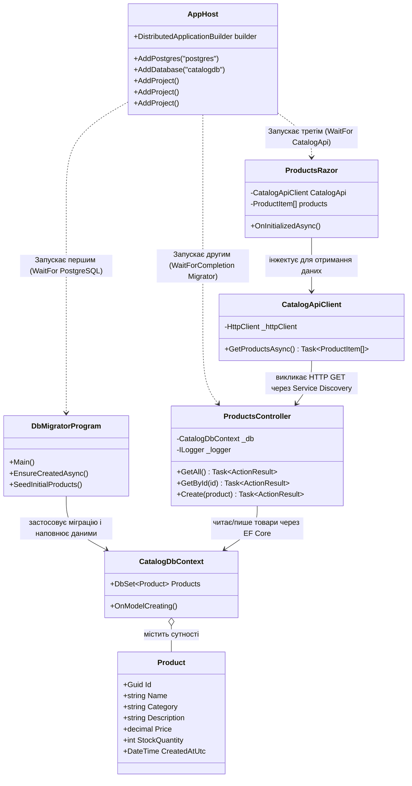
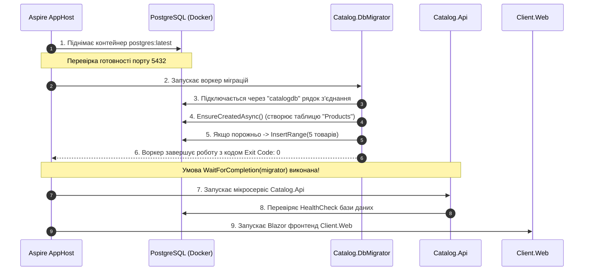
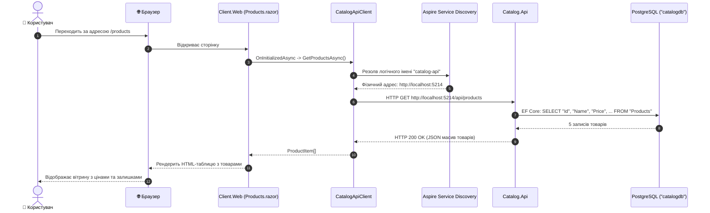

# 01. Архітектура, структура проєктів та рух даних: Aspire Fundamentals & DbMigrator

> **Детальний технічний опис структури модулю, дерева файлів, життєвого циклу процесів, взаємодії класів та збереження стану в PostgreSQL.**

---

## 🌲 Дерево файлової структури модуля

```text
01-Aspire-Fundamentals-And-DbMigrations/
├── 01-Aspire-Fundamentals.slnx           # Рішення .NET 10, що об'єднує всі проєкти модуля
├── README.md                              # Оглядовий посібник модуля
├── STRUCTURE-AND-DATA-FLOW.md             # ЦЕЙ ДОКУМЕНТ: повна технічна специфікація
│
├── Aspire.AppHost/                        # Точка входу оркестрації .NET Aspire
│   ├── AppHost.cs                         # Конфігурація топології: PostgreSQL, черговість запуску (WaitFor/WaitForCompletion)
│   ├── Aspire.AppHost.csproj              # Залежності від Aspire.Hosting.AppHost та Aspire.Hosting.PostgreSQL
│   └── appsettings.json                   # Налаштування хоста та логування
│
├── Aspire.ServiceDefaults/                # Загальні бібліотечні стандарти для всіх мікросервісів
│   ├── Extensions.cs                      # Налаштування OpenTelemetry, HealthChecks (/health, /alive), ServiceDiscovery, Resiliency
│   └── Aspire.ServiceDefaults.csproj      # Пакетні посилання на OpenTelemetry та розширення хостингу
│
├── Catalog.DbMigrator/                    # Виробничий воркер безпечних міграцій БД
│   ├── Program.cs                         # Застосування EnsureCreated/Migrate, сідинг 5 початкових товарів, код виходу 0
│   └── Catalog.DbMigrator.csproj          # Посилання на Catalog.Api (доступ до DbContext) та Npgsql
│
├── Catalog.Api/                           # Мікросервіс каталогу товарів (REST API)
│   ├── Program.cs                         # Налаштування DI, Controllers, Swagger, підключення PostgreSQL
│   ├── Catalog.Api.csproj                 # Web SDK, Aspire.Npgsql.EntityFrameworkCore.PostgreSQL, Swagger, лінк на Docs
│   ├── Controllers/
│   │   └── ProductsController.cs          # ASP.NET Core контролер (GET /api/products, POST /api/products)
│   └── Data/
│       └── CatalogDbContext.cs            # EF Core DbContext та сутність Product для PostgreSQL
│
└── Client.Web/                            # Клієнтський веб-застосунок (Blazor WebApp)
    ├── Program.cs                         # Налаштування Blazor Server, Razor Components, реєстрація CatalogApiClient
    ├── CatalogApiClient.cs                # HTTP-клієнт, що звертається до "https+http://catalog-api" через Service Discovery
    ├── Client.Web.csproj                  # Web SDK, посилання на ServiceDefaults
    └── Components/
        ├── App.razor                      # Кореневий HTML-шаблон Blazor
        ├── Routes.razor                   # Маршрутизація сторінок
        ├── Layout/
        │   ├── MainLayout.razor           # Основна розмітка вітрини
        │   └── NavMenu.razor              # Бокове меню з посиланням на /products
        └── Pages/
            ├── Home.razor                 # Головна сторінка
            ├── Products.razor             # Таблиця товарів, завантажених з Catalog.Api
            └── Counter.razor              # Інтерактивний лічильник
```

---

## 🧩 Взаємодія класів та сервісів (Dependency Graph)



---

## 🔄 Покроковий рух даних (Data Flow)

### Фаза 1: Запуск та ініціалізація кластера (Життєвий цикл)


### Фаза 2: Обробка користувацького запиту (Runtime Flow)


---

## 💾 Де і що зберігається (Storage & State)

| Рівень збереження | Технологія / Носій | Назва та структура | Опис даних |
| :--- | :--- | :--- | :--- |
| **База даних** | PostgreSQL 16/17 (Docker) | База: `catalogdb`<br>Схема: `public` | Персистентні реляційні дані каталогу товарів e-commerce. |
| **Таблиця** | PostgreSQL Table | Таблиця: `"Products"` | Стовпці:<br>• `"Id"` (UUID, Primary Key)<br>• `"Name"` (VARCHAR 150, Not Null)<br>• `"Category"` (VARCHAR 50, Not Null)<br>• `"Description"` (TEXT)<br>• `"Price"` (NUMERIC 18, 2)<br>• `"StockQuantity"` (INTEGER)<br>• `"CreatedAtUtc"` (TIMESTAMP WITH TIME ZONE) |
| **Фізичний том** | Docker Data Volume | Persistent Volume у Docker | Гарантує збереження бази даних між перезапусками контейнерів Aspire (`WithDataVolume()`). |
| **Клієнтський стан** | Blazor Server Memory | Сигнали SignalR / DOM | Кешування результату рендеру на 5 секунд директивою `@attribute [OutputCache(Duration = 5)]`. |

---

## ⚠️ Критичні точки та архітектурні нюанси

1. **Чому не `dbContext.Database.Migrate()` у `Program.cs` API?**
   * При горизонтальному масштабуванні (наприклад, запуск 3-5 реплік `catalog-api` у Kubernetes/Docker) екземпляри почнуть конкурувати за блокування схеми БД, викликаючи дедлоки (`DeadlockDetectedException`) або падіння частини реплік.
   * Винесення в `Catalog.DbMigrator` гарантує виконання міграцій строго в **одному** процесі **до** того, як API почне приймати трафік.
2. **Як працює резолв `https+http://catalog-api`?**
   * Префікс `https+http://` вказує бібліотеці `Microsoft.Extensions.ServiceDiscovery` спочатку спробувати знайти захищений HTTPS ендпоінт сервісу з ім'ям `catalog-api`, а за його відсутності — перемкнутися на HTTP.
   * Номер порту призначається оркестратором динамічно, тому в коді сервісів немає жодного жорстко закодованого `localhost:5001`.
