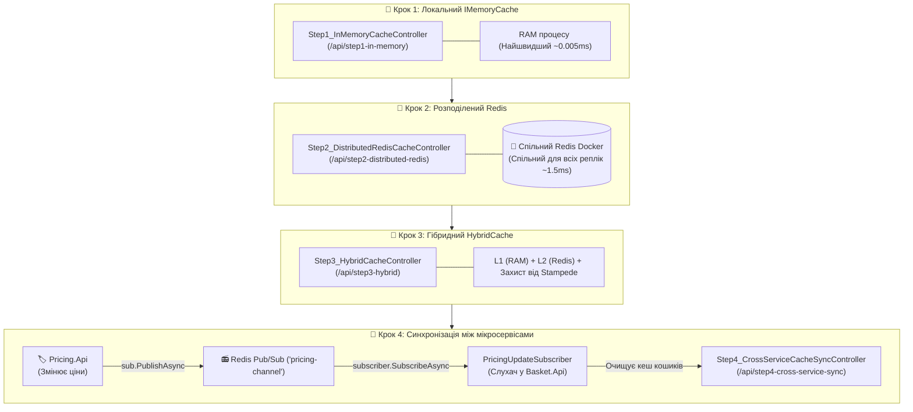

# 02. Покроковий майстер-клас із кешування: In-Memory, Redis, HybridCache та Pub/Sub

> **Навчальний посібник із кешування у розподілених системах .NET Aspire: покрокова еволюція від локального `IMemoryCache` (Крок 1) до централізованого `IDistributedCache` (Крок 2), сучасного `HybridCache` (Крок 3) та міжсервісної інвалідації через `Redis Pub/Sub` (Крок 4).**

---

## 🎯 Чому не можна одразу звалювати все в одну купу?

Кешування в мікросервісах вирішує різні проблеми на різних рівнях. Щоб розібратися, де який підхід потрібен, модуль розділено на 4 чіткі навчальні контролери:



---

## 📻 Що таке `subscriber.SubscribeAsync` у Redis і навіщо він потрібен?

Більшість розробників знають Redis виключно як сховище **ключ-значення** (`SET key value` / `GET key`).
Але Redis має вбудовану систему повідомлень — **Pub/Sub (Publish / Subscribe)**.

### Проблема з реального життя:
1. Клієнт поклав у кошик смарт-годинник за ціною 199.99 грн. Сервіс `Basket.Api` закешував цей кошик.
2. Через 5 хвилин менеджер у сервісі `Pricing.Api` встановлює знижку — нова ціна 149.99 грн.
3. **Питання:** Звідки `Basket.Api` дізнатися, що його кеш застарів?
   - Якщо `Basket.Api` буде щосекунди надсилати HTTP-запити в `Pricing.Api` з питанням "Чи змінилася ціна?", це створить тисячі непотрібних запитів (Polling) і перевантажить мережу.
   - Якщо `Pricing.Api` надішле прямий HTTP POST у `Basket.Api`, він потрапить **лише на 1 репліку** з 5 запущених за балансувальником! Інші 4 репліки кошика показуватимуть стару ціну.

### Рішення — Радіостанція Redis Pub/Sub:
* `Pricing.Api` стає **радіоведучим (Publisher)**. Він кричить у радіоефір на спільній хвилі `'pricing-channel'`: *"Ціна товару 1111-1111 змінилася на 149.99!"*.
* `Basket.Api` вмикає **радіоприймач (Subscriber)**:
  ```csharp
  var subscriber = _redis.GetSubscriber();
  await subscriber.SubscribeAsync("pricing-channel", (channel, message) =>
  {
      // Цей код викликається МИТТЄВО, коли прилітає сигнал із радіо!
      _cache.RemoveByTagAsync("baskets"); // Скидаємо старий кеш!
  });
  ```
* **Результат:** УСІ репліки `Basket.Api` одночасно чують повідомлення і миттєво скидають кеш. Коли покупець оновлює сторінку — сума кошика перераховується за новою ціною!

---

## 📂 Склад проєктів та контролерів

| Проєкт / Контролер | Маршрут (Route) | Що демонструє |
| :--- | :--- | :--- |
| **`Step1_InMemoryCacheController`** | `/api/step1-in-memory` | Локальне кешування в пам'яті процесу (`IMemoryCache`). Найшвидший доступ, але пам'ять не ділиться між репліками. |
| **`Step2_DistributedRedisCacheController`** | `/api/step2-distributed-redis` | Розподілений кеш у Redis (`IDistributedCache`). Спільний для всіх інстансів, але має мережеву затримку та серіалізацію в JSON. |
| **`Step3_HybridCacheController`** | `/api/step3-hybrid` | Новітній .NET `HybridCache`. Поєднує L1 RAM + L2 Redis та захищає базу від "ефекту стада бізонів" (Cache Stampede). |
| **`Step4_CrossServiceCacheSyncController`** | `/api/step4-cross-service-sync` | Перевірка оновленого кошика після надходження сигналу від `Pricing.Api` через Redis Pub/Sub. |
| **`PricingController` (в `Pricing.Api`)** | `/api/pricing` | Управління цінами та відправка сигналів інвалідації у канал `'pricing-channel'`. |

---

## 🧪 Покроковий сценарій тестування у Swagger

### Крок 1: Тестуємо локальну пам'ять (In-Memory)
1. Відкрийте Swagger для `Basket.Api`.
2. Викличте `GET /api/step1-in-memory/john`.
   - **Перший виклик:** `DataSource: Database (Cache MISS -> Saved to RAM)` — час ~20 мс.
   - **Другий виклик:** `DataSource: In-Memory RAM (Поточний процес)` — час **~0.05 мс**!

### Крок 2: Тестуємо централізований Redis
1. Викличте `GET /api/step2-distributed-redis/john`.
   - Перший виклик завантажує з бази та записує в Redis.
   - Другий виклик повертає `DataSource: Redis Distributed Cache` (час ~1.5 мс).
2. Відкрийте **RedisInsight Web UI** у браузері: ви побачите створений ключ `distributed:basket:john` із серіалізованим JSON.

### Крок 3: Тестуємо гібридний HybridCache
1. Викличте `GET /api/step3-hybrid/john`.
   - `HybridCache` спочатку перевіряє власну L1 пам'ять, потім L2 Redis, а до бази звертається лише якщо запису немає ніде.
   - Спробуйте надіслати 10 паралельних запитів: жодного перевантаження бази не відбудеться завдяки вбудованому блокуванню Stampede Guard.

### Крок 4: Тестуємо міжсервісну синхронізацію через Redis Pub/Sub
1. У `Basket.Api` викличте `GET /api/step4-cross-service-sync/basket/john` — сума до сплати: **359.97 грн**.
2. Перейдіть у Swagger для **`Pricing.Api`**.
3. Викличте `POST /api/pricing/update-price`:
   ```json
   {
     "productId": "11111111-1111-1111-1111-111111111111",
     "newPrice": 99.99,
     "reason": "Знижка вихідного дня"
   }
   ```
4. Поверніться у Swagger для **`Basket.Api`** і знову натисніть `GET /api/step4-cross-service-sync/basket/john` — сума кошика автоматично стала **259.97 грн**! Кеш скинуто автоматично без рестарту!
