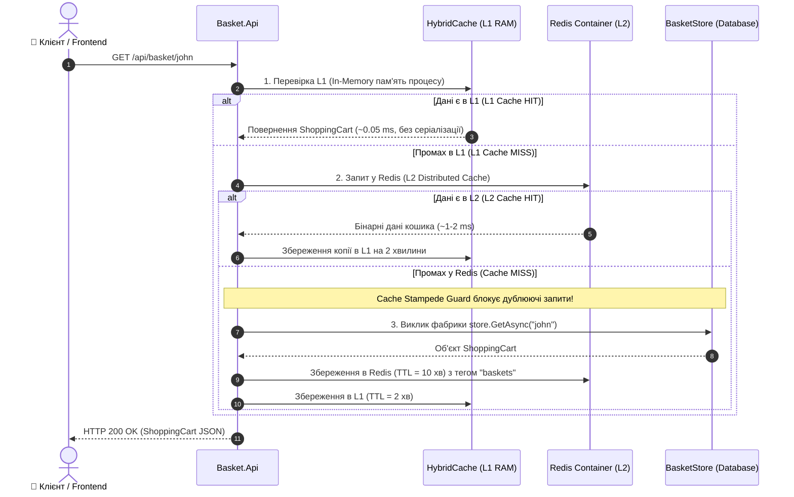
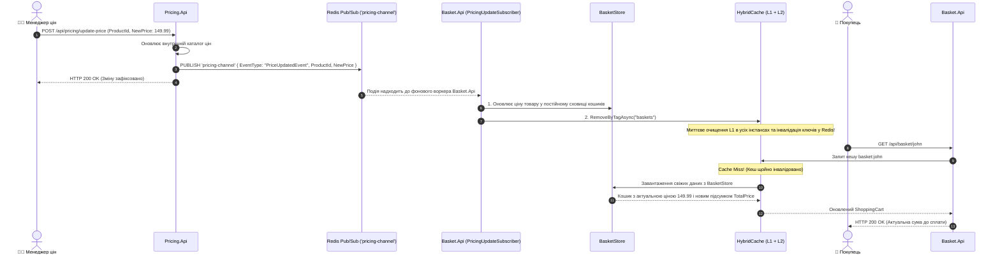

# 02. Архітектура, структура проєктів та рух даних: Centralized Caching (Redis & HybridCache)

> **Детальний технічний опис багаторівневого кешування (L1/L2), взаємодії мікросервісів через Redis Pub/Sub, захисту від Cache Stampede та життєвого циклу стану кошиків користувачів.**

---

## 🌲 Дерево файлової структури модуля

```text
02-Centralized-Caching-Redis/
├── 02-Centralized-Caching.slnx              # Рішення .NET 10 для модуля кешування
├── README.md                                 # Посібник користувача та огляд сценаріїв
├── STRUCTURE-AND-DATA-FLOW.md                # ЦЕЙ ДОКУМЕНТ: повна технічна специфікація
│
├── Aspire.AppHost/                           # Оркестратор .NET Aspire
│   ├── AppHost.cs                            # Реєстрація Redis-контейнера "cache", RedisInsight GUI та залежностей
│   ├── Aspire.AppHost.csproj                 # Aspire.Hosting.AppHost + Aspire.Hosting.Redis
│   └── appsettings.json                      # Конфігурація хоста
│
├── Aspire.ServiceDefaults/                   # Спільні стандарти надійності
│   ├── Extensions.cs                         # OpenTelemetry (метрики кешу, трейсинг), HealthChecks, Service Discovery
│   └── Aspire.ServiceDefaults.csproj         # Пакетні посилання на спільні компоненти
│
├── Basket.Api/                               # Мікросервіс кошика покупця (Consumer кешу)
│   ├── Program.cs                            # Minimal API (/api/basket/{userName}), конфігурація HybridCache та L1/L2 TTL
│   ├── Basket.Api.csproj                     # Aspire.StackExchange.Redis.DistributedCaching, HybridCache
│   ├── Models/
│   │   └── BasketModels.cs                   # Сутності ShoppingCart, ShoppingCartItem, PriceUpdatedEvent, DiscountAppliedEvent
│   └── Services/
│       ├── BasketStore.cs                    # Backing Database (імітація сховища БД) з потокобезпечним ConcurrentDictionary
│       └── PricingUpdateSubscriber.cs        # Фоновий IHostedService: слухає Redis Pub/Sub 'pricing-channel' та інвалідує кеш
│
└── Pricing.Api/                              # Мікросервіс цін та акцій (Producer змін цін)
    ├── Program.cs                            # Minimal API (/api/pricing/update-price, apply-discount), публікація в Pub/Sub
    └── Pricing.Api.csproj                    # StackExchange.Redis, Swagger, ServiceDefaults
```

---

## 🧩 Взаємодія класів та сервісів (Dependency Graph)

```mermaid
classDiagram
    class AppHost {
        +DistributedApplicationBuilder builder
        +AddRedis("cache")
        +WithRedisInsight()
        +AddProject<Basket_Api>()
        +AddProject<Pricing_Api>()
    }

    class HybridCache {
        +GetOrCreateAsync~T~(key, factory, tags)
        +SetAsync~T~(key, value, tags)
        +RemoveByTagAsync(tag)
        +RemoveAsync(key)
    }

    class BasketStore {
        -ConcurrentDictionary _baskets
        +GetAsync(userName) Task~ShoppingCart~
        +SaveAsync(cart) Task
        +DeleteAsync(userName) Task~bool~
        +UpdateProductPrice(productId, newPrice)
        +ApplyGlobalDiscount(discountPercent)
    }

    class PricingUpdateSubscriber {
        -IConnectionMultiplexer _redis
        -BasketStore _store
        -HybridCache _cache
        -ILogger _logger
        #ExecuteAsync(cancellationToken) Task
    }

    class ShoppingCart {
        +string UserName
        +List~ShoppingCartItem~ Items
        +decimal DiscountPercent
        +decimal TotalPrice
        +DateTime LastUpdatedAtUtc
    }

    class BasketApiProgram {
        +MapGet("/api/basket/{userName}")
        +MapPost("/api/basket")
        +MapDelete("/api/basket/{userName}")
        +MapPost("/api/basket/clear-cache")
    }

    class PricingApiProgram {
        +MapGet("/api/pricing")
        +MapPost("/api/pricing/update-price")
        +MapPost("/api/pricing/apply-discount")
    }

    class RedisMultiplexer {
        +GetSubscriber() ISubscriber
        +GetDatabase() IDatabase
    }

    AppHost ..> RedisMultiplexer : Запускає Redis контейнер (cache)
    AppHost ..> BasketApiProgram : Інжектує connectionString 'cache'
    AppHost ..> PricingApiProgram : Інжектує connectionString 'cache'

    BasketApiProgram --> HybridCache : Читання/Запис кошиків з L1/L2
    BasketApiProgram --> BasketStore : Запасне сховище (Backing Store при Cache Miss)
    HybridCache --> RedisMultiplexer : Використовує Redis як L2 Distributed Cache

    PricingUpdateSubscriber --> RedisMultiplexer : Підписка на 'pricing-channel'
    PricingUpdateSubscriber --> BasketStore : Оновлення цін в об'єктах сховища
    PricingUpdateSubscriber --> HybridCache : Виклик RemoveByTagAsync("baskets")

    PricingApiProgram --> RedisMultiplexer : Публікація PriceUpdatedEvent у 'pricing-channel'
    ShoppingCart *-- BasketStore : Зберігається в пам'яті
```

---

## 🔄 Покроковий рух даних (Data Flow)

### Сценарій 1: Читання кошика з багаторівневим кешуванням (L1 -> L2 -> Backing Store)



---

### Сценарій 2: Cross-Service Cache Invalidation через Redis Pub/Sub



---

## 💾 Де та що зберігається (Storage & State Persistence)

| Рівень сховища | Носій / Технологія | Що зберігається | Формат ключа / Канал | Час життя (TTL) / Очищення |
| :--- | :--- | :--- | :--- | :--- |
| **L1 Кеш** | RAM процесу `Basket.Api` | Десеріалізовані об'єкти C# `ShoppingCart` | Внутрішній хеш HybridCache | `2 хвилини` або за тегом `baskets` |
| **L2 Кеш** | Docker-контейнер Redis (`cache`) | Серіалізовані байти стану кошиків | Ключ: `basket:{userName}` (напр. `basket:john`) | `10 хвилин`, оновлюється при зміні |
| **Теги кешу** | Redis / HybridCache Metadata | Зв'язок ключів із тегами інвалідації | Теги: `baskets`, `user:{userName}` | Очищується через `RemoveByTagAsync()` |
| **Pub/Sub Канал** | Redis In-Memory Bus | Повідомлення про зміну цін та знижок | Канал: `pricing-channel` | Без збереження (волатильний транспорт) |
| **Backing Store** | Пам'ять `BasketStore` (демо БД) | Повна історія кошиків і товарів | `ConcurrentDictionary<string, ShoppingCart>` | Постійно (імітація PostgreSQL/Cosmos) |

---

## ⚙️ Критичні архітектурні рішення та "підводні камені"

1. **Захист від Cache Stampede (Dog-piling):**
   - У класичному `IDistributedCache`, якщо ключ закінчується за TTL, 1000 одночасних клієнтів зроблять 1000 паралельних важких запитів у БД.
   - Метод `HybridCache.GetOrCreateAsync` блокує конкурентні запити на рівні конкретного ключа: фабричний делегат виконується **лише один раз**, а результат роздається всім очікуючим потокам.
2. **Інвалідація за тегами (Tag-based Invalidation):**
   - Замість ітерування по тисячах ключів `KEYS basket:*` (що блокує Redis single-thread event loop), використовується тег `"baskets"`. Метод `RemoveByTagAsync("baskets")` видаляє всі залежні записи атомарно.
3. **Дворівнева когерентність (L1 vs L2):**
   - Локальний L1 кеш не має прямого зв'язку з іншими інстансами додатку. Завдяки підписці кожного інстансу на `pricing-channel` через Redis Pub/Sub, сигнал про скидання тегу отримують **усі запущені репліки**, запобігаючи читанню застарілих цін (Stale Data).
4. **RedisInsight GUI в Aspire:**
   - AppHost автоматично налаштовує зв'язок між Redis сервером та вебінтерфейсом RedisInsight (`.WithRedisInsight()`), дозволяючи візуально інспектувати ключі, споживану пам'ять та Pub/Sub трафік.
