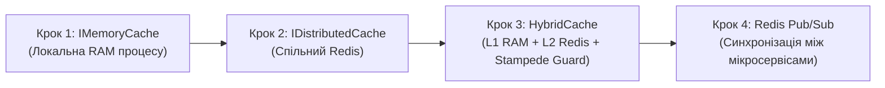
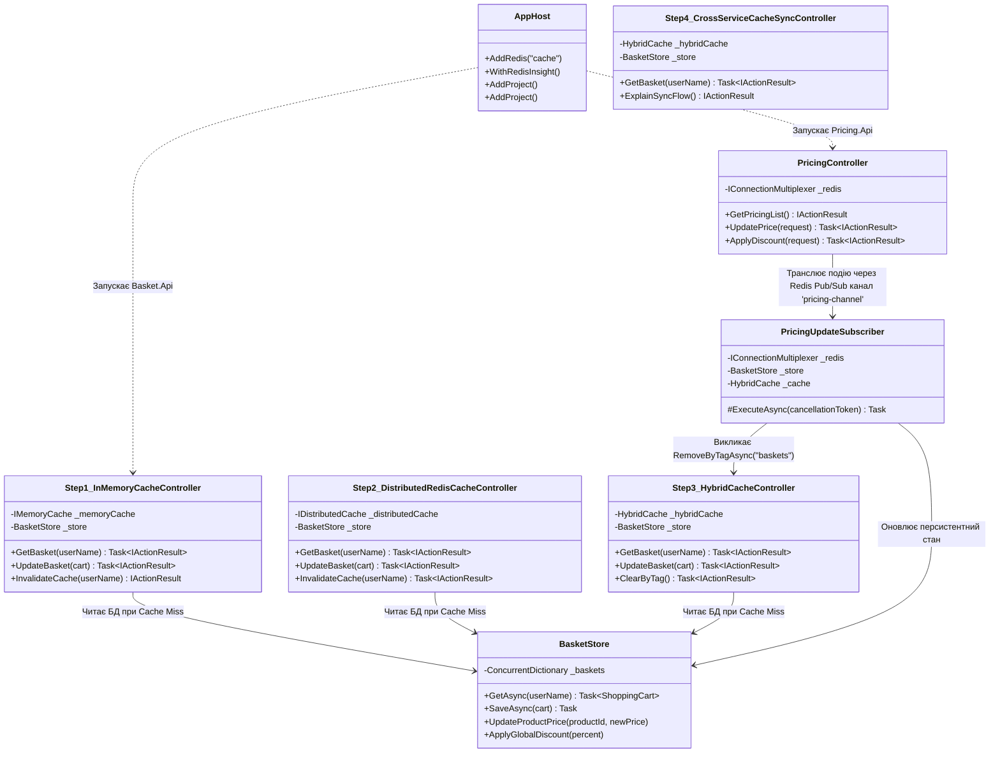
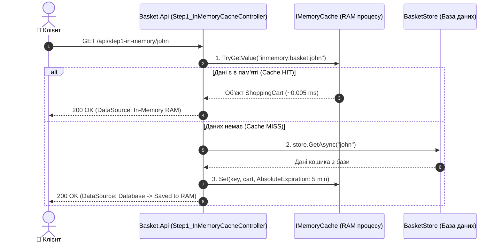
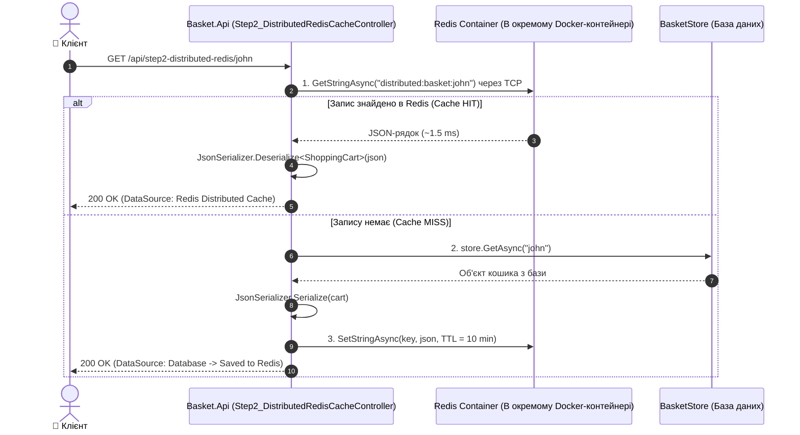
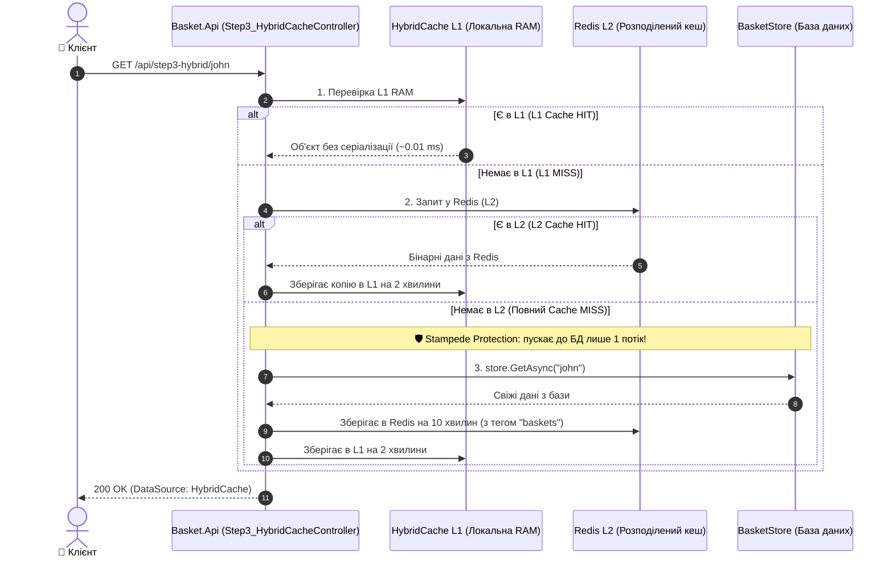
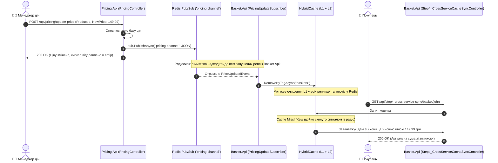

# 02. Архітектура, покрокова структура та рух даних: Централізоване кешування (Redis & HybridCache)

> **Покроковий навчальний майстер-клас: від найпростішого локального кешу в оперативній пам'яті (`IMemoryCache`) до розподіленого Redis (`IDistributedCache`), гібридного кешу (`HybridCache`) та подієвої синхронізації між мікросервісами через `Redis Pub/Sub`.**

---

## 🎯 Преамбула: Навіщо потрібне кешування та яка еволюція підходів?

У мікросервісній архітектурі база даних — це найвужче місце (bottleneck). Якщо кожен запит користувача йде напряму в базу даних, під час пікових навантажень (Чорна п'ятниця, розпродажі) сервер бази даних неминуче вичерпує пул з'єднань і падає.

Кешування — це збереження результатів важких запитів у швидкому сховищі (у пам'яті), щоб наступні звернення отримували результат за частки мілісекунди без навантаження на БД.

Але в мікросервісах кешування проходить 4 послідовні еволюційні етапи:



---

## 🌲 Покрокова файлова структура модуля

```text
02-Centralized-Caching-Redis/
├── 02-Centralized-Caching.slnx              # Рішення .NET 10 для модуля кешування
├── README.md                                 # Посібник користувача з тестування в Swagger
├── STRUCTURE-AND-DATA-FLOW.md                # ЦЕЙ ДОКУМЕНТ: повна технічна специфікація
│
├── Aspire.AppHost/                           # Оркестратор .NET Aspire
│   ├── AppHost.cs                            # Конфігурація Redis-контейнера "cache" та RedisInsight GUI
│   ├── Aspire.AppHost.csproj                 # Aspire.Hosting.AppHost + Aspire.Hosting.Redis
│   └── appsettings.json                      # Конфігурація хоста
│
├── Aspire.ServiceDefaults/                   # Спільні стандарти
│   ├── Extensions.cs                         # OpenTelemetry трейсинг кешу, метрики, HealthChecks
│   └── Aspire.ServiceDefaults.csproj         # Пакетні посилання
│
├── Basket.Api/                               # Мікросервіс кошика (Лабораторія кешування)
│   ├── Program.cs                            # Реєстрація IMemoryCache, IDistributedCache, HybridCache, Swagger
│   ├── Basket.Api.csproj                     # Aspire.StackExchange.Redis, HybridCache, лінк на Docs
│   ├── Controllers/
│   │   ├── Step1_InMemoryCacheController.cs  # КРОК 1: Локальний IMemoryCache у пам'яті поточного процесу
│   │   ├── Step2_DistributedRedisCacheController.cs # КРОК 2: Чистий розподілений кеш Redis (IDistributedCache)
│   │   ├── Step3_HybridCacheController.cs    # КРОК 3: Дворівневий HybridCache (L1 + L2 + Cache Stampede Protection)
│   │   └── Step4_CrossServiceCacheSyncController.cs # КРОК 4: Читання кошика після інвалідації через Pub/Sub
│   ├── Models/
│   │   └── BasketModels.cs                   # Моделі ShoppingCart, ShoppingCartItem, події зміни цін
│   └── Services/
│       ├── BasketStore.cs                    # Імітація бази даних кошиків (Backing Database)
│       └── PricingUpdateSubscriber.cs        # Фоновий IHostedService: слухає Redis Pub/Sub канал 'pricing-channel'
│
└── Pricing.Api/                              # Мікросервіс управління цінами (Джерело подій)
    ├── Program.cs                            # Налаштування DI, Controllers, Swagger, Redis Pub/Sub
    ├── Pricing.Api.csproj                    # StackExchange.Redis, Swagger, ServiceDefaults, лінк на Docs
    ├── Controllers/
    │   └── PricingController.cs              # Контролер зміни цін: публікує сигнали у 'pricing-channel'
    └── Models/
        └── PricingModels.cs                  # DTO запитів зміни ціни та промокодів
```

---

## 🧩 Взаємодія класів та контролерів (Dependency Graph)



---

## 🔄 Покроковий рух даних: 4 навчальні етапи

---

### 📘 КРОК 1: Локальне кешування в пам'яті (`IMemoryCache`)

> **Життєва аналогія:** Офіціант записує ціну страви на клаптику паперу і кладе собі в кишеню. Коли клієнт запитує ціну — офіціант дістає її за частку секунди.



* **Чому це найшвидше:** Немає мережевих запитів, немає серіалізації/десеріалізації JSON.
* **Чому цього замало в мікросервісах:** Якщо ми піднімемо **2 або 3 репліки** `Basket.Api`, кожен інстанс матиме свою ізольовану пам'ять. Користувач додасть товар на репліці 1, а наступний запит балансувальник направить на репліку 2 — і там кошик буде порожнім! Крім того, при перезапуску або деплої контейнера пам'ять стирається.

---

### 📘 КРОК 2: Чистий розподілений кеш (`IDistributedCache` + Redis)

> **Життєва аналогія:** Щоб усі офіціанти бачили однакове замовлення, на кухні повісили спільне електронне табло (сервер Redis). Тепер будь-який офіціант бачить актуальний стан.



* **Плюси:** Усі 10 реплік мікросервісу бачать один і той самий стан. При падінні сервісу дані в Redis зберігаються.
* **Ціна компромісу:**
  1. З'являється затримка мережі (TCP Network Latency ~1–3 мс замість 0.005 мс у RAM).
  2. Процесор витрачає час на серіалізацію та десеріалізацію JSON при кожному запиті.

---

### 📘 КРОК 3: Сучасне гібридне кешування (.NET `HybridCache`)

> **Життєва аналогія:** Офіціант має і клаптик у кишені (L1), і спільне табло на кухні (L2). Він зазирає спочатку в кишеню (0.01 мс). Якщо там немає — дивиться на спільне табло (1 мс) і ПЕРЕПИСУЄ собі в кишеню на наступні 2 хвилини!



#### 🛡️ Що таке Cache Stampede (Ефект стада бізонів)?
Уявіть популярний товар під час акції. Його час життя в кеші закінчився о 12:00:00.
В ту саму мілісекунду надходить **2000 запитів від покупців**.
* **У звичайному кеші (Крок 2):** Усі 2000 запитів побачать "Cache Miss" і одночасно вдарять по базі даних. База перевантажується або падає!
* **У `HybridCache`:** Метод `GetOrCreateAsync` атомарно блокує паралельні виклики фабрики. До бази даних піде **рівно 1 запит**. Інші 1999 запитів зачекають частку мілісекунди і отримають готовий результат із пам'яті.

---

### 📘 КРОК 4: Синхронізація між мікросервісами через Redis Pub/Sub

> **Проблема:** Бухгалтерія (`Pricing.Api`) змінила ціну на товар зі 199 до 149 грн. Але кошик покупця (`Basket.Api`) вже закешував стару ціну 199 грн. Як змусити кошик дізнатися, що треба скинути свій кеш, якщо сервіси розділені?

#### 📻 Аналогія з радіостанцією:
* `Pricing.Api` — це **радіоведучий (Publisher)**. Він кричить у мікрофон на хвилі `'pricing-channel'`: *"Ціна товару X змінилася!"*.
* `PricingUpdateSubscriber` у `Basket.Api` — це **радіоприймач (Subscriber)**. Він постійно слухає хвилю `'pricing-channel'`.



#### ❓ Чому саме Redis Pub/Sub, а не звичайний HTTP POST?
Якщо в продакшені `Basket.Api` запущений у **5 репліках** за балансувальником навантаження (Nginx, Kubernetes Ingress):
* Звичайний HTTP-запит від `Pricing.Api` потрапить лише на **одну випадкову репліку**. Інші 4 репліки залишаться зі старим кешем і продаватимуть товар за неправильною ціною!
* Через `Redis Pub/Sub` сигнал отримують **ВСІ 5 реплік одночасно**.

---

## 💾 Де та що зберігається (Storage, Keys & Lifetime)

| Етап | Рівень сховища | Носій / Технологія | Формат ключа / Канал | Час життя (TTL) | Коли очищується |
| :--- | :--- | :--- | :--- | :--- | :--- |
| **Крок 1** | In-Memory Cache | RAM процесу Kestrel | `inmemory:basket:{userName}` | 5 хв (Sliding: 1 хв) | При перезапуску процесу або `DELETE` |
| **Крок 2** | Розподілений кеш | Redis Docker Container | `distributed:basket:{userName}` | 10 хв (Sliding: 2 хв) | За таймером TTL або `DELETE` |
| **Крок 3** | Дворівневий кеш | L1 (RAM) + L2 (Redis) | `hybrid:basket:{userName}` | L1: 2 хв, L2: 10 хв | За тегом `"baskets"` або за TTL |
| **Крок 4** | Радіоканал зв'язку | Redis In-Memory Bus | Канал: `pricing-channel` | Миттєвий (без збереження) | Доставляється всім підписникам наживо |

---

## 🧪 Як протестувати всі 4 кроки власноруч у Swagger

1. **Запустіть оркестратор AppHost:**
   ```powershell
   dotnet run --project 02-Centralized-Caching-Redis/Aspire.AppHost/Aspire.AppHost.csproj
   ```
2. **Відкрийте Swagger для `Basket.Api`:**
   - **Крок 1 (In-Memory):**
     - Викличте `GET /api/step1-in-memory/john` двічі. Перший запит покаже `Database (~20ms)`, другий — `In-Memory RAM (~0.05ms)`.
   - **Крок 2 (Redis):**
     - Викличте `GET /api/step2-distributed-redis/john`. Дані підуть у Docker-контейнер Redis. Відкрийте панель **RedisInsight** і подивіться на реальний збережений JSON-рядок.
   - **Крок 3 (HybridCache):**
     - Викличте `GET /api/step3-hybrid/john`. Спробуйте виконати 10 паралельних запитів: жодного перевантаження бази не буде.
   - **Крок 4 (Міжсервісна синхронізація):**
     - Перевірте суму кошика: `GET /api/step4-cross-service-sync/basket/john` (Сума: 359.97 грн).
     - Перейдіть у Swagger `Pricing.Api` і викличте `POST /api/pricing/update-price` для товару `11111111-1111-1111-1111-111111111111` з новою ціною `99.99`.
     - Поверніться у `Basket.Api` і знову викличте `GET /api/step4-cross-service-sync/basket/john` — сума кошика миттєво змінилася на меншу!
