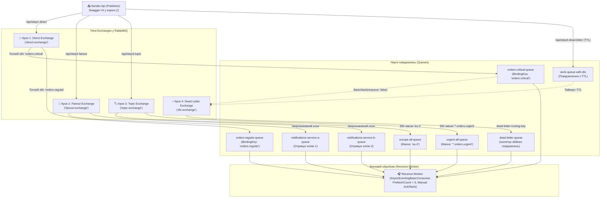

# 03. Покроковий майстер-клас із RabbitMQ Low-Level Mechanics (.NET 10 & RabbitMQ.Client v7)

> **Глибокий практичний розбір низькорівневих механізмів брокера повідомлень RabbitMQ без додаткових абстракцій:** робота з новим асинхронним API `RabbitMQ.Client v7` (`IChannel`), 4 покрокові контролери для всіх типів бірж (`Direct`, `Fanout`, `Topic`), керування підтвердженнями (`ACK`/`NACK`), захист пам'яті через QoS (`PrefetchCount`) та ізоляція збійних і прострочених повідомлень у **Dead Letter Exchange (DLX)**.

---

## 🎯 Чому важливо розуміти низькорівневий RabbitMQ перед використанням шин?

Перш ніж переходити до високорівневих фреймворків на кшталт MassTransit або NServiceBus, кожен архітектор має розуміти, як працює сам протокол **AMQP 0-9-1** під капотом:
- Продюсер **ніколи не відправляє повідомлення напряму в чергу** — він завжди публікує його в **Exchange (Біржу / Обмінник)**.
- Біржа за допомогою правил прив'язки (**Bindings**) та ключів маршрутизації (**Routing Keys**) вирішує, у які саме черги (**Queues**) покласти копію повідомлення (або відкинути його).

Модуль розділено на **4 покрокові навчальні контролери** у сервісі `Sender.Api` (Swagger відкривається одразу в корені `/`):



---

## ⚡ Три фундаментальні правила RabbitMQ.Client v7

### 1. `IConnection` проти `IChannel` (Золоте правило продуктивності)
* **`IConnection`** — це фізичний TCP-сокет із брокером, захищений TLS та механізмом Heartbeat. Його відкриття вимагає мережевих рукостискань (TCP + AMQP Handshake), тому в межах мікросервісу створюється **рівно один `IConnection` як Singleton**.
* **`IChannel`** — це віртуальний мультиплексований потік усередині TCP-з'єднання. У новітньому `RabbitMQ.Client v7` застарілий синхронний інтерфейс `IModel` повністю видалено, а створення та робота з каналами стали 100% асинхронними (`await connection.CreateChannelAsync()`).
* **Важливо:** Екземпляр `IChannel` **не є потокобезпечним**! Для кожної паралельної операції публікації в HTTP-запиті створюється власний короткоживучий канал (`await using var channel = await _connection.CreateChannelAsync()`).

### 2. Ручне підтвердження (`autoAck: false`) проти `autoAck: true`
* При **`autoAck: true`** RabbitMQ видаляє повідомлення з черги в ту саму мить, коли відправив байти в мережеву карту воркера. Якщо за мілісекунду потому процес воркера впаде або світло вимкнеться — замовлення клієнта **зникне назавжди**.
* При **`autoAck: false`** брокер тримає повідомлення в стані `Unacked`, доки воркер явно не відповість:
  * `await channel.BasicAckAsync(deliveryTag, multiple: false)` — обробка завершена, запис можна видалити з диска.
  * `await channel.BasicNackAsync(deliveryTag, multiple: false, requeue: true)` — тимчасовий збій мережі/БД, повернути повідомлення в чергу для повторної спроби.
  * `await channel.BasicNackAsync(deliveryTag, multiple: false, requeue: false)` — фатальна помилка формату або бізнес-правил («отруйне» повідомлення). Не повертати в чергу, а перенаправити в **Dead Letter Exchange (DLX)**!

### 3. Backpressure та захист від OutOfMemory (`BasicQosAsync`)
Уявіть, що під час нічного розпродажу в черзі накопичилося `100 000` повідомлень. Коли вранці стартує `Receiver.Worker`, без обмежень RabbitMQ миттєво виштовхне всі `100 000` повідомлень у буфер оперативної пам'яті воркера, викликавши аварійне падіння `OutOfMemoryException`.
* Виклик `await channel.BasicQosAsync(prefetchSize: 0, prefetchCount: 5, global: false)` встановлює жорстку квоту: воркер отримує **максимум 5 повідомлень одночасно**. Шосте повідомлення брокер видасть лише тоді, коли воркер надішле `BasicAck` за одне з попередніх п'яти!

---

## 📂 Склад покрокових контролерів продюсера (`Sender.Api`)

| Контролер | Маршрути (Routes) | Що демонструє |
| :--- | :--- | :--- |
| **`Step1_DirectExchangeController`** | `POST /api/step1-direct/send`<br>`POST /api/step1-direct/send-critical`<br>`POST /api/step1-direct/send-regular` | Пряма адресна доставка за точним збігом ключа (`orders.critical` або `orders.regular`). |
| **`Step2_FanoutExchangeController`** | `POST /api/step2-fanout/broadcast` | Широкомовна розсилка (Broadcast) усім підписаним чергам одночасно; ключ маршрутизації ігнорується. |
| **`Step3_TopicExchangeController`** | `POST /api/step3-topic/send` | Гнучка маршрутизація за шаблонами слів через крапку: `*` (рівно одне слово) та `#` (будь-яка кількість слів). |
| **`Step4_DeadLetterAndResilienceController`** | `POST /api/step4-dead-letter/send-with-ttl`<br>`POST /api/step4-dead-letter/send-poison-message` | Механіка відмовостійкості: автоматичне списання прострочених за TTL повідомлень та ізоляція Poison Messages у чергу `dead-letter-queue`. |

---

## 🧪 Покроковий сценарій тестування у Swagger та RabbitMQ UI

1. **Запустіть оркестратор AppHost:**
   ```powershell
   dotnet run --project 03-RabbitMQ-LowLevel/Aspire.AppHost/Aspire.AppHost.csproj
   ```
2. Відкрийте **Aspire Dashboard**:
   * Натисніть на посилання `sender-api` — у браузері одразу відкриється **Swagger UI**.
   * Натисніть на посилання **RabbitMQ Management UI** (логін: `guest`, пароль: `guest`) — перейдіть на вкладку **Exchanges** та **Queues**, щоб бачити рух повідомлень наживо.

### Крок 1: Тестуємо Direct Exchange (Точний ключ)
1. У Swagger викличте `POST /api/step1-direct/send-critical` з текстом `"Термінове VIP-замовлення #101"`.
2. У логах `receiver-worker` миттєво з'явиться запис від `[Critical Consumer]`.
3. Викличте `POST /api/step1-direct/send-regular` — повідомлення піде в окрему чергу `orders-regular-queue` і буде оброблене `[Regular Consumer]`.

### Крок 2: Тестуємо Fanout Exchange (Широкомовне радіо)
1. Викличте `POST /api/step2-fanout/broadcast` з тілом:
   ```json
   {
     "broadcastText": "Планове оновлення сервісів о 03:00 UTC"
   }
   ```
2. Перевірте логи `receiver-worker`: **обидва** консьюмери (`[Notification Service A]` та `[Notification Service B]`) одночасно отримали власну копію повідомлення!

### Крок 3: Тестуємо Topic Exchange (Маски `*` та `#`)
1. Викличте `POST /api/step3-topic/send`:
   * Із ключем `"eu.orders.urgent"` — повідомлення потрапить **одразу у дві черги**: `europe-all-queue` (бо підходить під маску `eu.#`) та `urgent-all-queue` (бо підходить під маску `*.orders.urgent`).
   * Із ключем `"us.orders.urgent"` — повідомлення потрапить **тільки** в `urgent-all-queue`.
   * Із ключем `"eu.payments.regular"` — повідомлення потрапить **тільки** в `europe-all-queue`.

### Крок 4: Тестуємо Dead Letter Exchange (TTL та Poison Message)
1. **Сценарій А (Таймаут TTL):** Викличте `POST /api/step4-dead-letter/send-with-ttl` із `ttlMilliseconds: 4000`. Повідомлення ляже в чергу `work-queue-with-dlx` (яку ніхто не читає). Рівно через 4 секунди брокер сам вилучить прострочений запис і перекине його через `dlx-exchange` у `dead-letter-queue`, де його перехопить `[DLX DEAD LETTER CONSUMER]`!
2. **Сценарій Б (Отруйне повідомлення):** Викличте `POST /api/step4-dead-letter/send-poison-message`. Воркер прочитає повідомлення, побачить маркер `"simulate-poison"` і замість нескінченного циклу повторів виконає `BasicNackAsync(requeue: false)`, безпечно ізолювавши збійний пакет.
