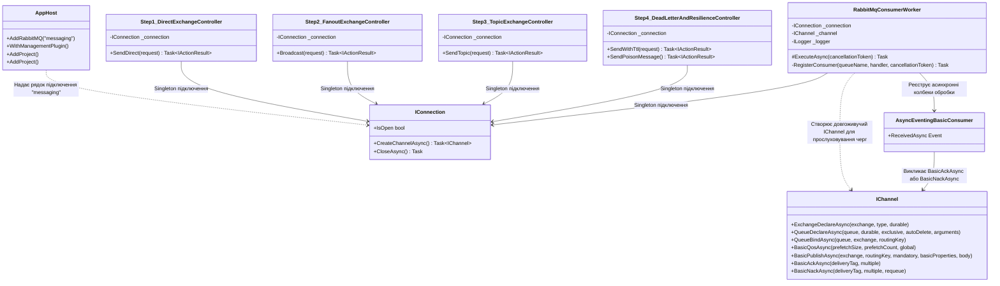
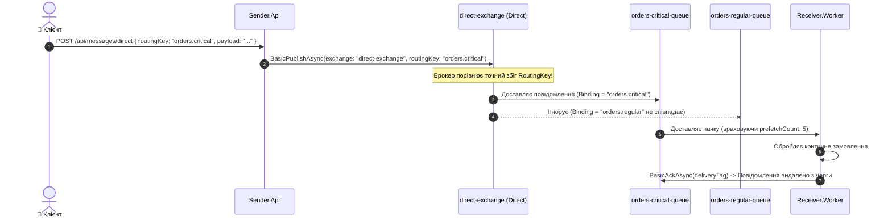
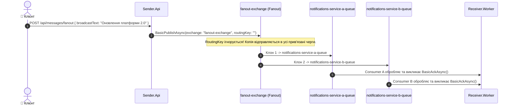
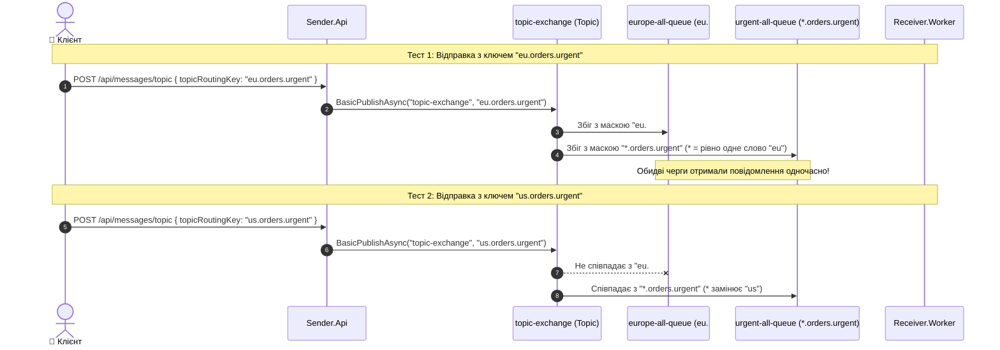
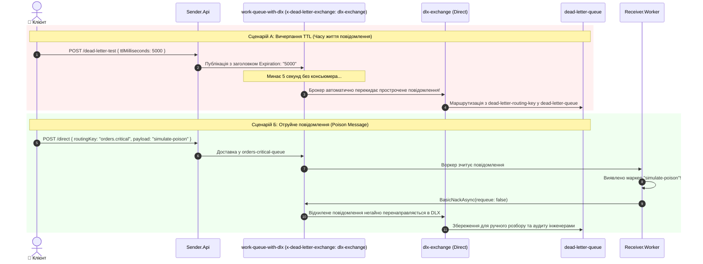

# 03. Архітектура, структура проєктів та рух даних: RabbitMQ Low-Level Mechanics

> **Детальний технічний опис низькорівневої AMQP-топології на базі RabbitMQ.Client v7: пряма, широкомовна та шаблонна маршрутизація (Direct, Fanout, Topic), керування навантаженням (QoS Prefetch), черги збоїв (Dead Letter Exchange) та захист від "отруйних" повідомлень.**

---

## 🌲 Дерево файлової структури модуля

```text
03-RabbitMQ-LowLevel/
├── 03-RabbitMQ-LowLevel.slnx                # Рішення .NET 10 для модуля низькорівневого RabbitMQ
├── README.md                                 # Посібник з тестування ендпоінтів та огляд сценаріїв
├── STRUCTURE-AND-DATA-FLOW.md                # ЦЕЙ ДОКУМЕНТ: повна технічна специфікація
│
├── Aspire.AppHost/                           # Оркестратор .NET Aspire
│   ├── AppHost.cs                            # Запуск RabbitMQ з менеджмент-плагіном (.WithManagementPlugin())
│   ├── Aspire.AppHost.csproj                 # Aspire.Hosting.RabbitMQ
│   └── appsettings.json                      # Конфігурація
│
├── Aspire.ServiceDefaults/                   # Спільні стандарти мікросервісів
│   ├── Extensions.cs                         # Метрики брокера, HealthChecks, Service Discovery
│   └── Aspire.ServiceDefaults.csproj         # Пакетні посилання
│
├── Sender.Api/                               # Producer (Відправник повідомлень)
│   ├── Program.cs                            # Налаштування DI, Controllers, Swagger, підключення RabbitMQ v7
│   ├── Sender.Api.csproj                     # RabbitMQ.Client v7.x, Swagger, ServiceDefaults, лінк на Docs
│   ├── Controllers/
│   │   ├── Step1_DirectExchangeController.cs # КРОК 1: Direct Exchange (точний збіг ключа)
│   │   ├── Step2_FanoutExchangeController.cs # КРОК 2: Fanout Exchange (широкомовна розсилка)
│   │   ├── Step3_TopicExchangeController.cs  # КРОК 3: Topic Exchange (маски та шаблони * та #)
│   │   └── Step4_DeadLetterAndResilienceController.cs # КРОК 4: Dead Letter Exchange, TTL та Poison Messages
│   ├── Models/
│   │   └── RabbitModels.cs                   # DTO-моделі для різних бірж
│   └── Properties/launchSettings.json        # Профілі запуску
│
└── Receiver.Worker/                          # Consumer (Фоновий обробник)
    ├── Program.cs                            # Оголошення топології (Exchanges, Queues, Bindings), QoS та обробники
    └── Receiver.Worker.csproj                # Background Worker, RabbitMQ.Client v7.x
```

---

## 🧩 Взаємодія класів та компонентів (Dependency Graph)



---

## 🔄 Покроковий рух даних за типами бірж (Data Flow)

### 1. Direct Exchange (Точна маршрутизація за ключем)



---

### 2. Fanout Exchange (Широкомовна розсилка / Broadcast)



---

### 3. Topic Exchange (Маршрутизація за масками `*` та `#`)



---

### 4. Dead Letter Exchange (DLX), TTL та Poison Message Handling



---

## 💾 Де та що зберігається (Storage, Topology & Durability)

| Сутність RabbitMQ | Ім'я в системі | Тип / Специфікація | Прапорець Durability | Аргументи (x-arguments) | Призначення |
| :--- | :--- | :--- | :--- | :--- | :--- |
| **Exchange** | `direct-exchange` | Direct | `durable: true` | — | Маршрутизація за точним співпадінням routingKey |
| **Exchange** | `fanout-exchange` | Fanout | `durable: true` | — | Широкомовна розсилка повідомлень без аналізу ключів |
| **Exchange** | `topic-exchange` | Topic | `durable: true` | — | Маршрутизація за масками слів через крапку (`*`, `#`) |
| **Exchange** | `dlx-exchange` | Direct | `durable: true` | — | Dead Letter біржа для ізоляції помилкових та прострочених даних |
| **Queue** | `orders-critical-queue` | FIFO Queue | `durable: true` | — | Черга критичних замовлень (`orders.critical`) |
| **Queue** | `orders-regular-queue` | FIFO Queue | `durable: true` | — | Черга стандартних замовлень (`orders.regular`) |
| **Queue** | `notifications-service-a-queue` | FIFO Queue | `durable: true` | — | Сервіс сповіщень А (підписник Fanout) |
| **Queue** | `notifications-service-b-queue` | FIFO Queue | `durable: true` | — | Сервіс сповіщень Б (підписник Fanout) |
| **Queue** | `europe-all-queue` | FIFO Queue | `durable: true` | — | Підписник Topic за маскою `eu.#` |
| **Queue** | `urgent-all-queue` | FIFO Queue | `durable: true` | — | Підписник Topic за маскою `*.orders.urgent` |
| **Queue** | `work-queue-with-dlx` | FIFO Queue | `durable: true` | `x-dead-letter-exchange: dlx-exchange`, `x-dead-letter-routing-key: dead-letter-routing-key` | Демонстрація TTL тайм-аутів та перекидання в DLX |
| **Queue** | `dead-letter-queue` | FIFO Queue | `durable: true` | — | Кінцеве сховище недоставлених та отруйних повідомлень |

---

## ⚙️ Критичні низькорівневі механіки та рекомендації

1. **Революція RabbitMQ.Client v7 (Повна асинхронність):**
   - У новітньому SDK v7 старий синхронний інтерфейс `IModel` видалено.
   - Усі виклики топології та публікації здійснюються через `IChannel` та методи `CreateChannelAsync()`, `ExchangeDeclareAsync()`, `BasicPublishAsync()`, `BasicAckAsync()`.
2. **Управління з'єднаннями (Connection vs Channel):**
   - `IConnection` — це важке довгоживуче TCP-з'єднання. Воно реєструється як **Singleton** на весь застосунок.
   - `IChannel` — це легковаговий віртуальний потік (мультиплексування всередині TCP). Для публікації використовується патерн `await using var channel = await connection.CreateChannelAsync()`. Канали **не можна** ділити між паралельними потоками!
3. **QoS (Quality of Service) та Backpressure:**
   - Якщо консьюмер не обмежує потік, брокер кине в нього всю чергу (наприклад, 100 000 повідомлень), що викличе аварійне завершення `OutOfMemoryException`.
   - Виклик `await channel.BasicQosAsync(0, prefetchCount: 5, false)` змушує RabbitMQ надсилати наступні повідомлення **тільки після того**, як воркер надішле `BasicAckAsync` за попередні.
4. **Гарантія збереження даних (Message Durability):**
   - Щоб повідомлення не зникло під час рестарту брокера або Docker-контейнера, одночасно мають виконуватися 2 умови:
     1. Черга та біржа створені як `durable: true`.
     2. Повідомлення опубліковано з атрибутом `DeliveryMode = DeliveryModes.Persistent` (записується на диск).
5. **Обробка Poison Messages:**
   - При виникненні непереборної помилки бізнес-логіки не можна викликати `BasicNack(requeue: true)`, оскільки це призведе до нескінченного циклу зависання процесора (Retry Storm).
   - Завжди використовуйте `BasicNackAsync(deliveryTag, multiple: false, requeue: false)` у поєднанні з DLX.
