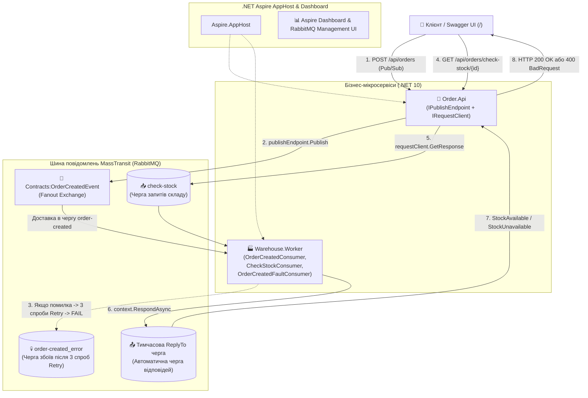

# 04. Event-Driven Architecture з MassTransit та RabbitMQ (.NET 10)

> **Побудова подієво-орієнтованої мікросервісної архітектури на .NET 10 за допомогою сервісної шини MassTransit поверх RabbitMQ:** патерни `Publish/Subscribe`, асинхронний діалог `Request/Response` через брокер без блокування потоків, автоматичне керування топологією, політики повторних спроб (`Retry Policies`), консьюмери компенсації `Fault<T>` та черги помилок `_error`.

---

## 🏛️ Архітектурна схема модуля



---

## ⚡ Чому MassTransit замість «сирого» `RabbitMQ.Client`?

У попередньому модулі (`03-RabbitMQ-LowLevel`) ми бачили, скільки низькорівневого інфраструктурного коду доводиться писати вручну:
* Створення каналів (`CreateChannelAsync`), ручне оголошення `ExchangeDeclareAsync`, `QueueDeclareAsync` та `QueueBindAsync`.
* Ручна серіалізація в JSON та кодування в `byte[]`.
* Ручний виклик `BasicAckAsync` / `BasicNackAsync` та конфігурація заголовків `x-dead-letter-exchange`.

**Шина MassTransit автоматизує всю цю рутину за стандартами Enterprise Integration Patterns:**

| Можливість | Сирий `RabbitMQ.Client` | Сервісна шина `MassTransit` |
| :--- | :--- | :--- |
| **Топологія бірж і черг** | Ручне оголошення кожного exchange, queue і binding у коді. | Автоматичне створення бірж за іменем C#-типу (`Contracts:OrderCreatedEvent`) та черг у стилі `kebab-case` (`order-created`). |
| **Серіалізація та метадані** | Голий масив байтів без контексту. | Автоматичний **Message Envelope** з `MessageId`, `CorrelationId`, `ConversationId`, `SourceAddress`, `SentTime` та заголовками W3C-трасування. |
| **Повторні спроби (Retries)** | Потрібно писати власні таймери або складні TTL-черги. | Один рядок: `cfg.UseMessageRetry(r => r.Interval(3, TimeSpan.FromSeconds(2)))`. |
| **Обробка Poison Messages** | Ручне налаштування DLX та `BasicNack(requeue: false)`. | Автоматичне переміщення у чергу `<queue>_error` зі збереженням повного StackTrace у заголовках + публікація події `Fault<T>`. |
| **Діалог Запит-Відповідь** | Потрібно вручну створювати тимчасову чергу `ReplyTo` і зіставляти `CorrelationId`. | Типізований `IRequestClient<TRequest>` з підтримкою поліморфних відповідей `(available, unavailable)`. |

---

## 📂 Склад проєктів та компонентів

| Проєкт | Тип | Роль в архітектурі |
| :--- | :--- | :--- |
| **`Contracts`** | Class Library | Спільні незмінні C# `record`-контракти: `OrderCreatedEvent`, `CheckStockRequest`, `StockAvailableResponse`, `StockUnavailableResponse`. |
| **`Order.Api`** | Web API (Swagger у `/`) | Мікросервіс замовлень (`OrdersController`). Публікує події через `IPublishEndpoint` та перевіряє залишки через `IRequestClient<CheckStockRequest>`. |
| **`Warehouse.Worker`** | Background Worker | Мікросервіс складу. Містить три консьюмери: `OrderCreatedConsumer`, `CheckStockConsumer` та компенсаційний `OrderCreatedFaultConsumer`. |
| **`Aspire.AppHost`** | .NET Aspire Host | Оркестратор, що піднімає RabbitMQ з Management Plugin і передає рядок з'єднання обом сервісам. |
| **`Aspire.ServiceDefaults`** | Shared Library | Єдині стандарти OpenTelemetry, HealthChecks (`/health`, `/alive`) та Service Discovery. |

---

## 🧪 Покроковий сценарій тестування у Swagger

1. **Запустіть оркестратор AppHost:**
   ```powershell
   dotnet run --project 04-Event-Driven-MassTransit/Aspire.AppHost/Aspire.AppHost.csproj
   ```
2. Відкрийте **Aspire Dashboard** і натисніть на посилання `order-api` — одразу відкриється **Swagger UI**.

### Сценарій 1: Патерн Publish / Subscribe (Щасливий шлях)
1. У Swagger викличте `POST /api/orders` з тілом:
   ```json
   {
     "customerName": "Олександр Коваленко",
     "productId": "11111111-1111-1111-1111-111111111111",
     "productName": "Смарт-годинник Pro Pulse",
     "price": 199.99,
     "quantity": 2
   }
   ```
2. API миттєво поверне статус `202 Accepted` із номером замовлення.
3. Перегляньте логи `warehouse-worker` у панелі Aspire:
   * `📦 [OrderCreatedConsumer] Отримано замовлення ...`
   * `✅ [OrderCreatedConsumer] Товар 'Смарт-годинник Pro Pulse' успішно зарезервовано на складі!`

### Сценарій 2: Демонстрація Retry Policy, черги `_error` та `Fault<T>`
1. Викличте `POST /api/orders`, вказавши в полі `customerName` маркер **`SimulateError`**:
   ```json
   {
     "customerName": "Іван-SimulateError",
     "productId": "11111111-1111-1111-1111-111111111111",
     "productName": "Смарт-годинник Pro Pulse",
     "price": 199.99,
     "quantity": 1
   }
   ```
2. Спостерігайте за логами `warehouse-worker` у реальному часі:
   * MassTransit перехоплює виняток `InvalidOperationException` і автоматично виконує **3 повторні спроби з інтервалом 2 секунди**.
   * Після вичерпання ліміту спроб повідомлення переміщується в чергу `order-created_error`.
   * Автоматично спрацьовує компенсаційний консьюмер `💀 [FAULT CONSUMER]`, який логує причину аварії та запускає процедуру скасування замовлення!
3. Відкрийте **RabbitMQ Management UI** (вкладка **Queues**): ви побачите 1 збережене повідомлення у черзі `order-created_error`.

### Сценарій 3: Асинхронний Request / Response через брокер
1. Викличте `GET /api/orders/check-stock/11111111-1111-1111-1111-111111111111?quantity=2`:
   * Запит летить через RabbitMQ у `Warehouse.Worker`, який перевіряє залишок і відповідає у тимчасову чергу.
   * Ви отримуєте `200 OK` із кодом підтвердження `STOCK-OK-...` та залишком `50 шт.`
2. Викличте `GET /api/orders/check-stock/11111111-1111-1111-1111-111111111111?quantity=999` (більше, ніж є на складі):
   * Консьюмер повертає тип `StockUnavailableResponse`, а контролер транслює його у відповідь `400 Bad Request` із поясненням дефіциту.
