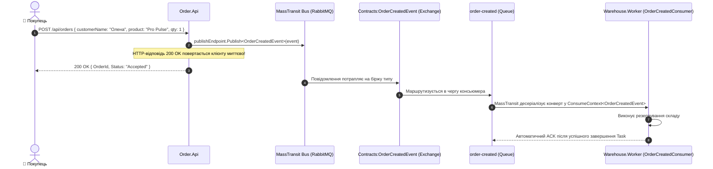
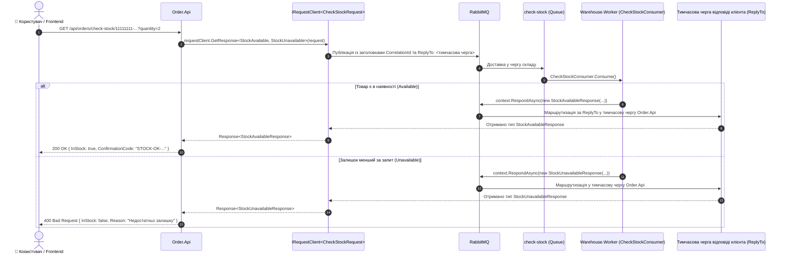
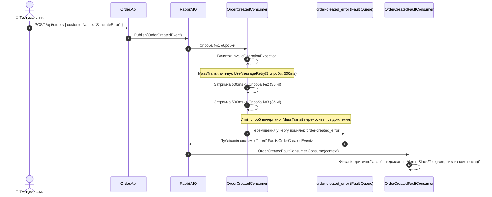

# 04. Архітектура, структура проєктів та рух даних: Event-Driven Architecture з MassTransit

> **Детальний технічний опис подієво-орієнтованої взаємодії мікросервісів на базі MassTransit та RabbitMQ: патерни Publish/Subscribe, Request/Response без HTTP-блокування, політики повторів (Retry Policy), консьюмери компенсації `Fault<T>` та топологія бірж і черг.**

---

## 🌲 Дерево файлової структури модуля

```text
04-Event-Driven-MassTransit/
├── 04-Event-Driven-MassTransit.slnx          # Рішення .NET 10 для модуля MassTransit
├── README.md                                 # Посібник користувача та перевірка сценаріїв
├── STRUCTURE-AND-DATA-FLOW.md                # ЦЕЙ ДОКУМЕНТ: повна технічна специфікація
│
├── Aspire.AppHost/                           # Оркестратор .NET Aspire
│   ├── AppHost.cs                            # Конфігурація RabbitMQ та реєстрація залежностей мікросервісів
│   ├── Aspire.AppHost.csproj                 # Aspire.Hosting.RabbitMQ
│   └── appsettings.json                      # Конфігурація хоста
│
├── Aspire.ServiceDefaults/                   # Спільні стандарти
│   ├── Extensions.cs                         # Метрики шини, OpenTelemetry трейсинг MassTransit, HealthChecks
│   └── Aspire.ServiceDefaults.csproj         # Пакетні посилання
│
├── Contracts/                                # Спільна збірка типізованих контрактів повідомлень (Pure DTOs)
│   ├── Messages.cs                           # OrderCreatedEvent, CheckStockRequest, StockAvailable/UnavailableResponse
│   └── Contracts.csproj                      # Чиста бібліотека класів без зовнішніх залежностей
│
├── Order.Api/                                # Producer подій та клієнт запитів (Order Microservice)
│   ├── Program.cs                            # Ендпоінти створення замовлень та перевірки наявності через шину
│   ├── Order.Api.csproj                      # MassTransit.RabbitMQ, Swagger, ServiceDefaults, посилання на Contracts
│   └── Properties/launchSettings.json        # Профілі запуску
│
└── Warehouse.Worker/                         # Подієвий обробник складу (Warehouse Microservice)
    ├── Program.cs                            # Налаштування консьюмерів, Retry-політики (3 спроби) та топології
    ├── Warehouse.Worker.csproj               # MassTransit.RabbitMQ, посилання на Contracts
    └── Consumers/
        └── Consumers.cs                      # OrderCreatedConsumer, CheckStockConsumer, OrderCreatedFaultConsumer
```

---

## 🧩 Взаємодія класів та контрактів (Dependency Graph)

```mermaid
classDiagram
    class OrderCreatedEvent {
        +Guid OrderId
        +string CustomerName
        +Guid ProductId
        +string ProductName
        +decimal TotalAmount
        +int Quantity
        +DateTime CreatedAtUtc
    }

    class CheckStockRequest {
        +Guid ProductId
        +int RequestedQuantity
    }

    class StockAvailableResponse {
        +Guid ProductId
        +int AvailableQuantity
        +decimal UnitPrice
        +string ConfirmationCode
    }

    class StockUnavailableResponse {
        +Guid ProductId
        +int RequestedQuantity
        +int CurrentStock
        +string Reason
    }

    class IPublishEndpoint {
        +Publish~T~(message, cancellationToken) Task
    }

    class IRequestClient~TRequest~ {
        +GetResponse~T1, T2~(request, cancellationToken) Task~Response~
    }

    class OrderCreatedConsumer {
        +Consume(ConsumeContext~OrderCreatedEvent~) Task
    }

    class CheckStockConsumer {
        -Dictionary Inventory
        +Consume(ConsumeContext~CheckStockRequest~) Task
    }

    class OrderCreatedFaultConsumer {
        +Consume(ConsumeContext~Fault~OrderCreatedEvent~~) Task
    }

    class OrderApiProgram {
        +MapPost("/api/orders")
        +MapGet("/api/orders/check-stock/{productId}")
    }

    OrderApiProgram --> IPublishEndpoint : Публікує OrderCreatedEvent
    OrderApiProgram --> IRequestClient~CheckStockRequest~ : Відправляє асинхронний запит до складу
    
    OrderCreatedConsumer ..|> OrderCreatedEvent : Обробляє подію
    CheckStockConsumer ..|> CheckStockRequest : Отримує запит
    CheckStockConsumer ..> StockAvailableResponse : Відповідає при наявності
    CheckStockConsumer ..> StockUnavailableResponse : Відповідає при дефіциті
    OrderCreatedFaultConsumer ..|> OrderCreatedEvent : Ловить остаточний збій (Fault)
```

---

## 🔄 Покроковий рух даних та патерни повідомлень (Data Flow)

### 1. Патерн Publish / Subscribe (Асинхронне сповіщення про замовлення)



---

### 2. Патерн Request / Response через шину (Синхронний діалог без блокування)



---

### 3. Механізм повторів (Retry Policy) та обробка збоїв (Fault Pipeline)



---

## 💾 Де та що зберігається (Topology, Envelopes & Exchanges)

| Сутність брокера | Назва в RabbitMQ | Тип | Автоматично створено | Призначення |
| :--- | :--- | :--- | :--- | :--- |
| **Exchange** | `Contracts:OrderCreatedEvent` | Fanout | Так (MassTransit) | Топологічна точка публікації для всіх підписників `OrderCreatedEvent` |
| **Exchange** | `Contracts:CheckStockRequest` | Fanout | Так (MassTransit) | Маршрутизація запитів перевірки наявності |
| **Exchange** | `Contracts:StockAvailableResponse` | Direct / Temp | Так (MassTransit) | Маршрутизація відповідей наявності до конкретного екземпляра запиту |
| **Exchange** | `Contracts:StockUnavailableResponse` | Direct / Temp | Так (MassTransit) | Маршрутизація відповідей відмови до клієнта |
| **Queue** | `order-created` | FIFO Queue | Так (ReceiveEndpoint) | Черга підписника `OrderCreatedConsumer` на складі |
| **Queue** | `order-created_error` | FIFO Queue | Так (MassTransit Error) | Черга збоїв, куди скидаються повідомлення після вичерпання 3 спроб retry |
| **Queue** | `check-stock` | FIFO Queue | Так (ReceiveEndpoint) | Черга обробника перевірки залишків `CheckStockConsumer` |
| **Queue** | `check-stock_error` | FIFO Queue | Так (MassTransit Error) | Черга помилок запитів наявності |

---

## ⚙️ Критичні архітектурні переваги MassTransit над низькорівневим кодом

1. **MassTransit Message Envelope (Метадані повідомлення):**
   - MassTransit автоматично упаковує будь-яке повідомлення в багатий JSON-конверт, що містить `MessageId`, `CorrelationId`, `ConversationId`, `InitiatorId`, `SourceAddress`, `DestinationAddress` та `SentTime`. Це забезпечує повний розподілений аудит без ручного коду.
2. **Типобезпечний Request / Response через черги:**
   - На відміну від HTTP, де з'єднання тримається відкритим і вразливим до таймаутів шлюзів, MassTransit генерує короткоживучі тимчасові черги (`ReplyTo`) та підтримує патерн-матчинг результатів (`GetResponse<TSuccess, TFailure>`), гарантуючи відсутність блокування серверних потоків.
3. **Політика відновлення (Resilience & Retry):**
   - Замість створення власних циклів `try/catch/thread.sleep`, конфігурація `cfg.UseMessageRetry(r => r.Interval(3, TimeSpan.FromMilliseconds(500)))` виконує спроби з інтервалами прямо в конвеєрі обробки.
4. **Компенсаційний консьюмер (`Fault<T>`):**
   - Якщо повідомлення остаточно падає, воно не просто зникає чи блокує систему: публікується повідомлення `Fault<T>`, на яке можна повісити компенсаційний консьюмер (наприклад, для повернення коштів або сповіщення оператора).
