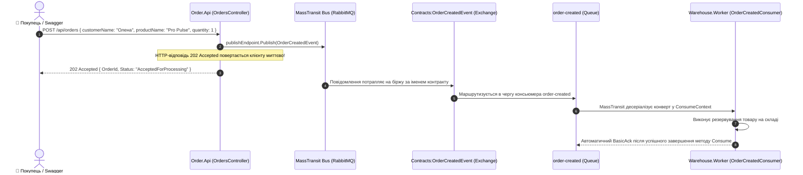
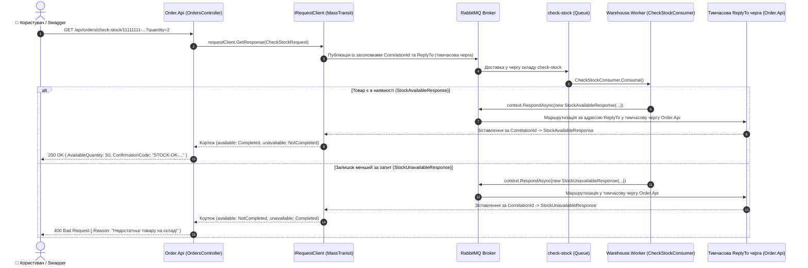
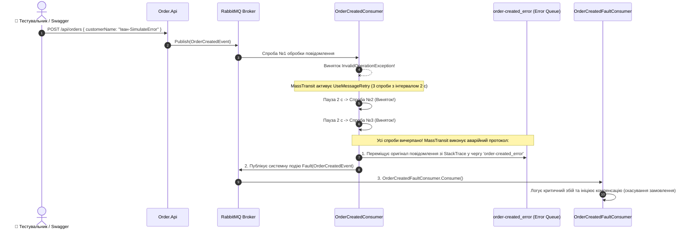

# 04. Архітектура, структура проєктів та рух даних: Event-Driven Architecture з MassTransit

> **Детальна технічна специфікація подієво-орієнтованої взаємодії мікросервісів на базі MassTransit та RabbitMQ: патерни `Publish/Subscribe`, асинхронний діалог `Request/Response`, політики повторів (`Retry Policy`), консьюмери компенсації `Fault<T>` та автоматична топологія бірж і черг.**

---

## 🌲 Дерево файлової структури модуля

```text
04-Event-Driven-MassTransit/
├── 04-Event-Driven-MassTransit.slnx          # Рішення .NET 10 для модуля MassTransit
├── README.md                                 # Посібник користувача та перевірка сценаріїв у Swagger
├── STRUCTURE-AND-DATA-FLOW.md                # ЦЕЙ ДОКУМЕНТ: повна технічна специфікація
│
├── Aspire.AppHost/                           # Оркестратор .NET Aspire
│   ├── AppHost.cs                            # Конфігурація RabbitMQ та реєстрація залежностей мікросервісів
│   ├── Aspire.AppHost.csproj                 # Aspire.Hosting.RabbitMQ
│   └── appsettings.json                      # Конфігурація хоста
│
├── Aspire.ServiceDefaults/                   # Спільні стандарти мікросервісів
│   ├── Extensions.cs                         # Метрики шини, OpenTelemetry трейсинг MassTransit, HealthChecks
│   └── Aspire.ServiceDefaults.csproj         # Пакетні посилання
│
├── Contracts/                                # Спільна збірка типізованих контрактів повідомлень (Pure DTOs)
│   ├── Messages.cs                           # OrderCreatedEvent, CheckStockRequest, StockAvailable/UnavailableResponse
│   └── Contracts.csproj                      # Чиста бібліотека класів без зовнішніх залежностей
│
├── Order.Api/                                # Producer подій та клієнт запитів (Swagger UI у корені /)
│   ├── Program.cs                            # Налаштування DI, Controllers, Swagger UI, конфігурація MassTransit
│   ├── Order.Api.csproj                      # MassTransit.RabbitMQ, Swashbuckle, ServiceDefaults, лінк на Docs
│   ├── Controllers/
│   │   └── OrdersController.cs               # ASP.NET Core контролер (POST /api/orders, GET /api/orders/check-stock/{id})
│   ├── Models/
│   │   └── OrderModels.cs                    # DTO-моделі замовлень (CreateOrderRequest, OrderCreationResult)
│   └── Properties/launchSettings.json        # Профілі запуску
│
└── Warehouse.Worker/                         # Подієвий обробник складу (Warehouse Microservice)
    ├── Program.cs                            # Налаштування консьюмерів, Retry-політики (3 спроби по 2с) та топології
    ├── Warehouse.Worker.csproj               # MassTransit.RabbitMQ, посилання на Contracts
    └── Consumers/
        └── Consumers.cs                      # OrderCreatedConsumer, CheckStockConsumer, OrderCreatedFaultConsumer
```

---

## 🧩 Взаємодія класів та контрактів (Dependency Graph)

```mermaid
classDiagram
    class OrderCreatedEvent {
        +Guid OrderId
        +string CustomerName
        +Guid ProductId
        +string ProductName
        +decimal TotalAmount
        +int Quantity
        +DateTime CreatedAtUtc
    }

    class CheckStockRequest {
        +Guid ProductId
        +int RequestedQuantity
    }

    class StockAvailableResponse {
        +Guid ProductId
        +int AvailableQuantity
        +decimal UnitPrice
        +string ConfirmationCode
    }

    class StockUnavailableResponse {
        +Guid ProductId
        +int RequestedQuantity
        +int CurrentStock
        +string Reason
    }

    class IPublishEndpoint {
        +Publish~T~(message, cancellationToken) Task
    }

    class IRequestClient~TRequest~ {
        +GetResponse~T1, T2~(request, cancellationToken) Task~Response~
    }

    class OrderCreatedConsumer {
        +Consume(ConsumeContext~OrderCreatedEvent~) Task
    }

    class CheckStockConsumer {
        -Dictionary Inventory
        +Consume(ConsumeContext~CheckStockRequest~) Task
    }

    class OrderCreatedFaultConsumer {
        +Consume(ConsumeContext~Fault_OrderCreatedEvent~) Task
    }

    class OrdersController {
        -IPublishEndpoint _publishEndpoint
        -IRequestClient~CheckStockRequest~ _requestClient
        -ILogger _logger
        +CreateOrder(request, cancellationToken) Task~IActionResult~
        +CheckStock(productId, quantity, cancellationToken) Task~IActionResult~
    }

    OrdersController --> IPublishEndpoint : Публікує OrderCreatedEvent
    OrdersController --> IRequestClient~CheckStockRequest~ : Відправляє асинхронний запит до складу
    
    OrderCreatedConsumer ..|> OrderCreatedEvent : Обробляє подію
    CheckStockConsumer ..|> CheckStockRequest : Отримує запит
    CheckStockConsumer ..> StockAvailableResponse : Відповідає при наявності
    CheckStockConsumer ..> StockUnavailableResponse : Відповідає при дефіциті
    OrderCreatedFaultConsumer ..|> OrderCreatedEvent : Ловить остаточний збій Fault
```



---

## 🔄 Покроковий рух даних та патерни повідомлень (Data Flow)

### 1. Патерн Publish / Subscribe (Асинхронне сповіщення про замовлення)



---

### 2. Патерн Request / Response через шину (Діалог з поліморфною відповіддю)



---

### 3. Механізм повторів (Retry Policy) та обробка збоїв (`_error` + `Fault<T>`)



---

## 💾 Де та що зберігається (Topology, Envelopes & Exchanges)

| Сутність брокера | Назва в RabbitMQ | Тип | Автоматично створено | Призначення |
| :--- | :--- | :--- | :--- | :--- |
| **Exchange** | `Contracts:OrderCreatedEvent` | Fanout | Так (`MassTransit`) | Топологічна точка публікації для всіх підписників `OrderCreatedEvent` |
| **Exchange** | `Contracts:CheckStockRequest` | Fanout | Так (`MassTransit`) | Маршрутизація запитів перевірки наявності до черги складу |
| **Exchange** | `Contracts:Fault--Contracts:OrderCreatedEvent--` | Fanout | Так (`MassTransit`) | Маршрутизація подій аварії `Fault<OrderCreatedEvent>` |
| **Queue** | `order-created` | FIFO Queue | Так (`KebabCase`) | Робоча черга підписника `OrderCreatedConsumer` |
| **Queue** | `order-created_error` | FIFO Queue | Так (`MassTransit Error`) | Ізолятор збійних повідомлень після вичерпання всіх спроб Retry |
| **Queue** | `order-created_skipped` | FIFO Queue | Так (`MassTransit DeadLetter`) | Черга повідомлень, які надійшли у чергу без активного обробника потрібного типу |
| **Queue** | `check-stock` | FIFO Queue | Так (`KebabCase`) | Черга обробника перевірки залишків `CheckStockConsumer` |
| **Queue** | `order-created-fault` | FIFO Queue | Так (`KebabCase`) | Черга компенсаційного консьюмера `OrderCreatedFaultConsumer` |

---

## ⚙️ Критичні архітектурні переваги MassTransit у Production

1. **MassTransit Message Envelope (Конверт метаданих):**
   - Замість відправки «голого» JSON-об'єкта, MassTransit загортає кожне повідомлення у стандартизований конверт із полями `messageId`, `correlationId`, `conversationId`, `initiatorId`, `sourceAddress`, `destinationAddress`, `messageType`, `sentTime` та `host` (ім'я машини, версія ОС та SDK). Це дає повну картину розслідування інцидентів.
2. **Поліморфний Request / Response через черги:**
   - Метод `_requestClient.GetResponse<StockAvailableResponse, StockUnavailableResponse>()` дозволяє консьюмеру повернути різні типи відповідей залежно від бізнес-результату без викидання винятків і без блокування потоків веб-сервера Kestrel.
3. **Розділення тимчасових і постійних помилок:**
   - Тимчасові мережеві моргання вирішуються в пам'яті через `UseMessageRetry`.
   - Постійні помилки бізнес-логіки не блокують чергу: вони переносяться в `_error` (звідки їх можна перевідправити після виправлення багу) та викликають `Fault<T>` для автоматичної бізнес-компенсації.
