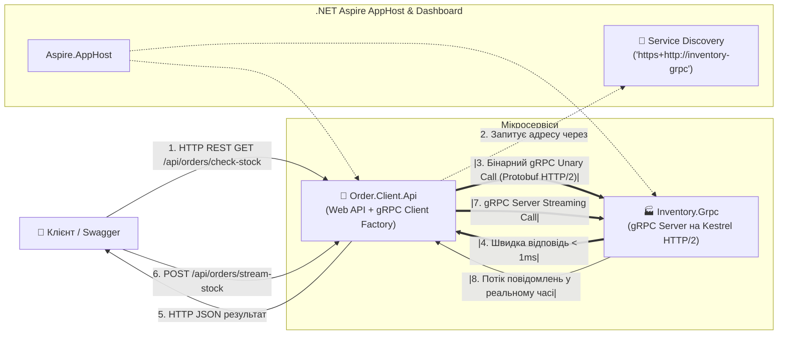

# 05. High-Performance Synchronous Transport: gRPC vs REST

> **Високошвидкісна синхронна взаємодія між мікросервісами за допомогою gRPC та Protobuf у .NET 10 & .NET Aspire:** одноточковий виклик (Unary Call), серверний стрімінг (Server Streaming), мультиплексування HTTP/2 та автоматичний резолв gRPC каналів через Aspire Service Discovery.

---

## 🏛️ Архітектурна схема модуля



---

## ⚡ Чому gRPC для внутрішніх синхронних викликів?

| Критерій | Звичайний HTTP REST (JSON) | gRPC (Protobuf over HTTP/2) |
| :--- | :--- | :--- |
| **Формат даних** | Текстовий JSON (багатослівний, накладні витрати на парсинг рядків). | Бінарний Protobuf (у 5-10 разів менший розмір пакету). |
| **Протокол** | HTTP/1.1 (одне з'єднання на запит, блокування черги Head-of-Line). | HTTP/2 (мультиплексування сотень запитів в одному TCP-з'єднанні). |
| **Типізація** | Слабко типізований, небезпека зміни полів при релізах. | Строгий контракт `.proto`, автогенерація C# класів. |
| **Швидкість (Latency)** | Середня (10-50ms залежно від розміру JSON). | Екстремальна (< 1-3ms), ідеально для high-load backend. |
| **Стрімінг** | Складний (WebSockets або SSE). | Вбудований «з коробки» (Client, Server, Bi-directional). |

---

## 📂 Склад проєктів

| Проєкт | Стек | Опис |
| :--- | :--- | :--- |
| **`Inventory.Grpc`** | Kestrel + `Grpc.AspNetCore` | gRPC сервер складу. Реалізує контракт `inventory.proto`: `GetProductStock` (наявність), `ReserveStock` (атомарне резервування), `GetStockStream` (потокова видача статусів). |
| **`Order.Client.Api`** | ASP.NET Core Controllers + `Grpc.Net.ClientFactory` | Клієнтський Web API з `OrdersController`. Впроваджує типізований `InventoryServiceClient`, підключений до сервера через Aspire Service Discovery (`https+http://inventory-grpc`). |
| **`Aspire.AppHost`** | .NET Aspire | Точка входу: оркеструє gRPC сервер та клієнтський API, автоматично налаштовуючи HTTP/2 ендпоінти. |
| **`Aspire.ServiceDefaults`** | Shared Library | Встановлює базові стандарти метрик і трасування OpenTelemetry. |

---

## 🧪 Практичний сценарій тестування через Swagger

1. **Запустіть AppHost:**
   ```bash
   cd 05-Synchronous-Transport-gRPC/Aspire.AppHost
   dotnet run
   ```
2. Відкрийте **Aspire Dashboard** та перейдіть у Swagger `order-client-api`.

### Тест 1: Unary Call (Перевірка залишку через gRPC)
* Виконайте `GET /api/orders/check-stock/11111111-1111-1111-1111-111111111111`.
* У логах ви побачите:
  * `Order.Client`: `📞 Виклик gRPC GetProductStock...`
  * `Inventory.Grpc`: `⚡ [gRPC Server] Запит залишку для товару 11111111...`
  * Відповідь отримана практично миттєво (`RoundTripTimeMs: < 2ms`), статус `InStock: true`, залишок `50 шт.`

### Тест 2: Атомарна резервація залишку
* Виконайте `POST /api/orders/reserve`:
  ```json
  {
    "productId": "22222222-2222-2222-2222-222222222222",
    "quantity": 5
  }
  ```
* Отримано статус `200 OK`, `ReservationId: "RES-..."`, залишок зменшився з 12 до 7!
* Якщо спробувати зарезервувати більше, ніж є на складі (наприклад, 100 шт.), сервіс поверне `409 Conflict` із зрозумілим повідомленням від gRPC сервера.

### Тест 3: Серверний стрімінг (Server Streaming)
* Виконайте `POST /api/orders/stream-stock` зі списком із 3 товарів:
  ```json
  {
    "productIds": [
      "11111111-1111-1111-1111-111111111111",
      "22222222-2222-2222-2222-222222222222",
      "33333333-3333-3333-3333-333333333333"
    ]
  }
  ```
* Сервер Kestrel через HTTP/2 стрім видає елементи по мірі готовності через `IServerStreamWriter`, а клієнт читає їх асинхронно через `await foreach`!
