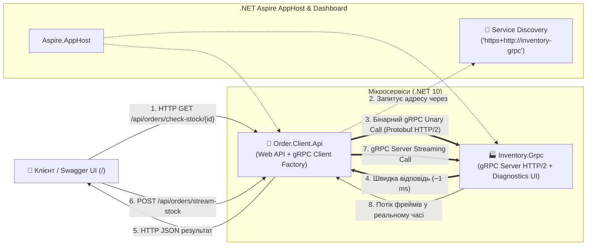

# 05. High-Performance Synchronous Transport: gRPC vs REST (.NET 10 & Aspire)

> **Високошвидкісна синхронна взаємодія між мікросервісами за допомогою gRPC та Protobuf у .NET 10 & .NET Aspire:** миттєвий одноточковий виклик (`Unary RPC`), атомарне резервування залишків, серверний стрімінг (`Server Streaming RPC`), мультиплексування HTTP/2 та автоматичний резолв gRPC-каналів через Aspire Service Discovery (`https+http://inventory-grpc`).

---

## 🏛️ Архітектурна схема модуля



---

## ⚡ Коли потрібен gRPC замість REST або RabbitMQ?

Не кожну операцію в мікросервісах можна зробити асинхронною через брокер повідомлень. Коли покупець натискає кнопку «Купити» або переглядає картку товару, система повинна **прямо зараз** перевірити точний залишок на складі та зарезервувати товар.

Для таких внутрішніх синхронних викликів між мікросервісами (`Service-to-Service`) стандарт **gRPC** значно перевершує текстовий REST/JSON:

| Критерій | Класичний HTTP REST (JSON) | gRPC (Protobuf over HTTP/2) |
| :--- | :--- | :--- |
| **Формат передачі даних** | Текстовий JSON (повторення назв полів у кожному пакеті, витрати CPU на парсинг рядків). | Бінарний **Protocol Buffers (Protobuf)** — передаються лише числові теги полів (`1`, `2`, `3`) та стислі байти. Розмір менший у 5–10 разів. |
| **Мережевий протокол** | Переважно HTTP/1.1 (блокування Head-of-Line, потреба у пулі TCP-з'єднань). | Строго **HTTP/2**: мультиплексування сотень паралельних запитів через **одне-єдине постійне TCP-з'єднання**. |
| **Контракт і типізація** | Неформальна документація OpenAPI; ризик розсинхронізації типів між командами. | Єдиний строгий файл `.proto`, з якого компілятор автоматично генерує C#-класи сервера та клієнта під час `dotnet build`. |
| **Затримка (Latency)** | Середня (`5–30 мс` залежно від розміру JSON). | Наднизька (`0.5–2 мс`), ідеально для високочастотних внутрішніх запитів. |
| **Потокова передача** | Складна реалізація (WebSockets або SSE). | Нативна підтримка `Server Streaming`, `Client Streaming` та `Bi-directional Streaming`. |

---

## 📂 Склад проєктів та контролерів

| Проєкт | Стек та роль | Доступні ендпоінти у Swagger UI (`/`) |
| :--- | :--- | :--- |
| **`Order.Client.Api`** | ASP.NET Core Controllers + `Grpc.Net.ClientFactory` | • `GET /api/orders/check-stock/{productId}` — Unary gRPC виклик із заміром `RoundTripTimeMs`.<br>• `POST /api/orders/reserve` — Unary gRPC атомарне резервування.<br>• `POST /api/orders/stream-stock` — Server Streaming gRPC читання потоку через `await foreach`. |
| **`Inventory.Grpc`** | Kestrel HTTP/2 + `Grpc.AspNetCore` + Діагностичний Swagger UI | • Бінарний gRPC-сервіс `InventoryService` (`inventory.proto`).<br>• `GET /api/grpc-diagnostics/stock-snapshot` — огляд поточного стану складу.<br>• `GET /api/grpc-diagnostics/proto-contract` — опис методів Protobuf-контракту. |
| **`Aspire.AppHost`** | .NET Aspire Host | Оркеструє обидва сервіси та зв'язує їх через `.WithReference(inventoryGrpc)`. |
| **`Aspire.ServiceDefaults`** | Shared Library | Наскрізний OpenTelemetry трейсинг gRPC-викликів, метрики та HealthChecks. |

---

## 🧪 Покроковий сценарій тестування через Swagger

1. **Запустіть оркестратор AppHost:**
   ```powershell
   dotnet run --project 05-Synchronous-Transport-gRPC/Aspire.AppHost/Aspire.AppHost.csproj
   ```
2. У панелі **Aspire Dashboard** обидва сервіси (`order-client-api` та `inventory-grpc`) мають клікабельні URL, які одразу відкривають **Swagger UI**!
3. Відкрийте Swagger для **`order-client-api`**:

### Крок 1: Unary Call (Миттєва перевірка залишку через gRPC)
1. Викличте `GET /api/orders/check-stock/11111111-1111-1111-1111-111111111111`.
2. Зверніть увагу на відповідь:
   * Перший виклик встановлює HTTP/2 канал, а кожен наступний виклик виконується за **`RoundTripTimeMs: 0–2 ms`**!
   * Повертається інформація: `"Смарт-годинник Pro Pulse"`, залишок `50 шт.`, ціна `199.99`.

### Крок 2: Unary Call (Атомарне резервування товару на складі)
1. Викличте `POST /api/orders/reserve`:
   ```json
   {
     "productId": "22222222-2222-2222-2222-222222222222",
     "quantity": 5
   }
   ```
2. Сервер `Inventory.Grpc` атомарно зменшить залишок миші `"UltraGlide 4K"` з `12` до `7` і поверне код резервації `RES-...`.
3. Спробуйте повторно зарезервувати `100` одиниць того ж товару — ви отримаєте `400 Bad Request` із повідомленням про недостатній залишок.

### Крок 3: Server Streaming RPC (Асинхронний потік даних по HTTP/2)
1. Викличте `POST /api/orders/stream-stock` зі списком усіх трьох товарів:
   ```json
   {
     "productIds": [
       "11111111-1111-1111-1111-111111111111",
       "22222222-2222-2222-2222-222222222222",
       "33333333-3333-3333-3333-333333333333"
     ]
   }
   ```
2. Сервер по черзі записує кожен товар у потік `IServerStreamWriter`, а клієнт вичитує фрейми в реальному часі через `await foreach (var item in call.ResponseStream.ReadAllAsync())`.
3. Відкрийте вкладку **Traces** в Aspire Dashboard: ви побачите єдиний розподілений трейс, що проходить від HTTP-контролера `Order.Client.Api` крізь gRPC-виклик до `Inventory.Grpc`!
