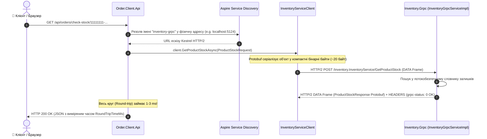
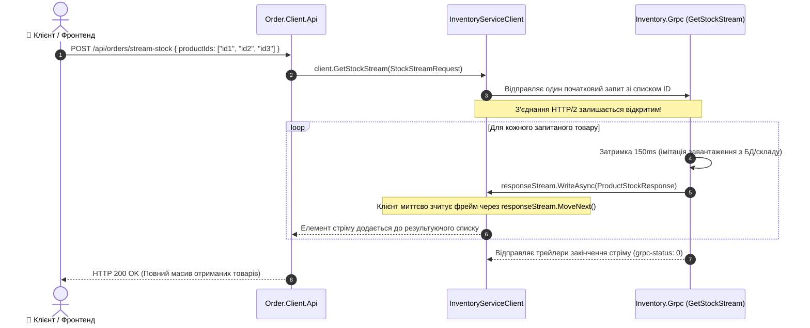

# 05. Архітектура, структура проєктів та рух даних: Синхронний транспорт через gRPC & HTTP/2

> **Детальний технічний опис високоефективного міжсервісного зв'язку через бінарний протокол gRPC (HTTP/2): Unary-виклики, серверний стрімінг (Server Streaming), контрактне проєктування Protobuf та динамічне визначення адрес (Service Discovery) в Aspire.**

---

## 🌲 Дерево файлової структури модуля

```text
05-Synchronous-Transport-gRPC/
├── 05-Synchronous-Transport-gRPC.slnx        # Рішення .NET 10 для модуля gRPC
├── README.md                                 # Посібник користувача та порівняння швидкодії REST vs gRPC
├── STRUCTURE-AND-DATA-FLOW.md                # ЦЕЙ ДОКУМЕНТ: повна технічна специфікація
│
├── Aspire.AppHost/                           # Оркестратор .NET Aspire
│   ├── AppHost.cs                            # Конфігурація зв'язку між gRPC сервером та клієнтом через WithReference
│   ├── Aspire.AppHost.csproj                 # Aspire.Hosting.AppHost
│   └── appsettings.json                      # Налаштування
│
├── Aspire.ServiceDefaults/                   # Спільні стандарти
│   ├── Extensions.cs                         # Метрики HTTP/2, трейсинг gRPC запитів, HealthChecks
│   └── Aspire.ServiceDefaults.csproj         # Пакетні посилання
│
├── Inventory.Grpc/                           # gRPC Сервер (Kestrel HTTP/2)
│   ├── Program.cs                            # Реєстрація gRPC сервера (builder.Services.AddGrpc(), app.MapGrpcService)
│   ├── Inventory.Grpc.csproj                 # Grpc.AspNetCore, компіляція ProtoRoot GrpcServices="Server"
│   ├── Protos/
│   │   └── inventory.proto                   # Protobuf v3 контракт сервісу (Unary + Streaming методи)
│   └── Services/
│       └── InventoryGrpcServiceImpl.cs       # Реалізація GetProductStock, ReserveStock, GetStockStream
│
└── Order.Client.Api/                         # gRPC Клієнт (Minimal API Gateway)
    ├── Program.cs                            # Інжекція типізованого gRPC-клієнта через Service Discovery (https+http://inventory-grpc)
    ├── Order.Client.Api.csproj               # Grpc.Net.ClientFactory, компіляція ProtoRoot GrpcServices="Client"
    └── Properties/launchSettings.json        # Профілі запуску
```

---

## 🧩 Взаємодія класів та сервісів (Dependency Graph)

```mermaid
classDiagram
    class AppHost {
        +AddProject<Inventory_Grpc>("inventory-grpc")
        +AddProject<Order_Client_Api>("order-client-api")
            .WithReference(inventoryGrpc)
    }

    class InventoryServiceBase {
        <<abstract>>
        +GetProductStock(request, context) Task~ProductStockResponse~
        +ReserveStock(request, context) Task~ReserveStockResponse~
        +GetStockStream(request, responseStream, context) Task
    }

    class InventoryGrpcServiceImpl {
        -ConcurrentDictionary _inventory
        +GetProductStock(request, context) Task~ProductStockResponse~
        +ReserveStock(request, context) Task~ReserveStockResponse~
        +GetStockStream(request, responseStream, context) Task
    }

    class InventoryServiceClient {
        +GetProductStockAsync(request) AsyncUnaryCall~ProductStockResponse~
        +ReserveStockAsync(request) AsyncUnaryCall~ReserveStockResponse~
        +GetStockStream(request) AsyncServerStreamingCall~ProductStockResponse~
    }

    class OrderClientApiProgram {
        +MapGet("/api/orders/check-stock/{productId}")
        +MapPost("/api/orders/reserve")
        +MapPost("/api/orders/stream-stock")
    }

    AppHost ..> InventoryGrpcServiceImpl : Запускає сервер на динамічному HTTP/2 порті
    AppHost ..> OrderClientApiProgram : Резолвить адресу "https+http://inventory-grpc"
    
    InventoryGrpcServiceImpl --|> InventoryServiceBase : Реалізує згенерований C# базовий клас
    OrderClientApiProgram --> InventoryServiceClient : Використовує згенерований типізований клієнт
    InventoryServiceClient ..> InventoryGrpcServiceImpl : Двійковий HTTP/2 зв'язок (Protobuf Wire Format)
```

---

## 🔄 Покроковий рух даних (Data Flow)

### 1. Unary RPC (Миттєвий запит-відповідь для критичних операцій)



---

### 2. Server Streaming RPC (Асинхронний потік оновлень за одним запитом)



---

## 💾 Де та що зберігається (Protobuf Контракти та Стан)

### 1. Protobuf v3 Специфікація (`inventory.proto`)

```protobuf
syntax = "proto3";

option csharp_namespace = "Inventory.Grpc.Protos";
package inventory;

service InventoryService {
  rpc GetProductStock (ProductStockRequest) returns (ProductStockResponse);
  rpc ReserveStock (ReserveStockRequest) returns (ReserveStockResponse);
  rpc GetStockStream (StockStreamRequest) returns (stream ProductStockResponse);
}

message ProductStockRequest {
  string product_id = 1;
}

message ProductStockResponse {
  string product_id = 1;
  string product_name = 2;
  int32 available_quantity = 3;
  double unit_price = 4;
  bool in_stock = 5;
}

message ReserveStockRequest {
  string product_id = 1;
  int32 quantity = 2;
  string order_id = 3;
}

message ReserveStockResponse {
  bool success = 1;
  string message = 2;
  string reservation_id = 3;
  int32 remaining_stock = 4;
}

message StockStreamRequest {
  repeated string product_ids = 1;
}
```

### 2. Стан даних та сховище

| Носій | Сутність | Формат / Тип | Опис |
| :--- | :--- | :--- | :--- |
| **Kestrel In-Memory** | `InventoryGrpcServiceImpl._inventory` | `ConcurrentDictionary<string, StockItem>` | Атомарний стан залишків на складі з потокобезпечним зменшенням залишку |
| **HTTP/2 Transport** | Protobuf Wire Format | Двійковий потік байтів | Нумерація полів (Tag 1, Tag 2) замість імен ключів економить 70-80% мережевого трафіку |
| **Service Discovery** | Aspire Service Registry | `https+http://inventory-grpc` | Автоматичне виявлення динамічних портів Kestrel без hardcoded URL |

---

## ⚙️ Критичні переваги gRPC над звичайним REST/JSON

1. **Екстремальна продуктивність і компактність:**
   - JSON вимагає передачі імен полів текстовими символами у кожному запиті (`"product_name": "Смарт-годинник"`). Protobuf кодує кожне поле як двійковий тег (1-2 байти) та значення, що у 5-10 разів зменшує обсяг корисного навантаження.
2. **Мультиплексування через одне TCP-з'єднання:**
   - Протокол HTTP/2 дозволяє виконувати сотні одночасних Unary або Streaming викликів через **одне-єдине постійне TCP-з'єднання**, виключаючи накладні витрати на повторний TCP Handshake та TLS Negotiate.
3. **Строга типізація та контрактне проєктування (Schema-First):**
   - Файл `.proto` є єдиним джерелом правди (Single Source of Truth). Будь-яка невідповідність типів між мікросервісами виявляється ще на етапі компіляції (`dotnet build`).
4. **Вбудований стрімінг (Streaming):**
   - У REST для передачі частин даних зазвичай використовують складні рішення (WebSockets, SSE або Polling). У gRPC серверний і клієнтський стрімінг є нативною частиною стандарту.
