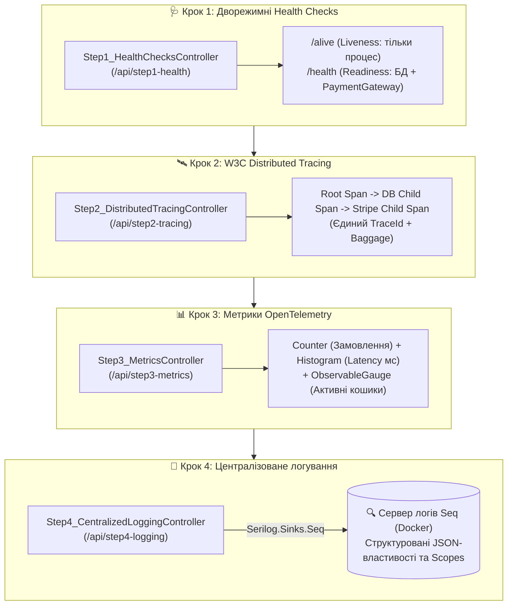

# 06. Покроковий майстер-клас зі спостережуваності та логування: Health Checks, W3C Tracing, Metrics та Seq (.NET 10 & Aspire)

> **Повноцінний практичний посібник зі спостережуваності (Observability) розподілених систем на .NET 10:** дворежимні перевірки живучості (`/alive` Liveness vs `/health` Readiness — Крок 1), наскрізне розподілене трасування за стандартом **W3C TraceContext** (Крок 2), числові метрики **OpenTelemetry** (`Counter`, `Histogram`, `ObservableGauge` — Крок 3) та централізоване структуроване логування у **Seq** через **Serilog** (Крок 4).

---

## 🎯 Чому спостережуваність — це «очі та прилади» мікросервісів?

Коли моноліт падає з помилкою, достатньо відкрити один лог-файл на сервері. Коли ж клієнтський запит проходить через 6 мікросервісів, брокер повідомлень та дві бази даних, без централізованої телеметрії інженер стає сліпим:
- Як балансувальнику дізнатися, чи треба перезапустити завислий контейнер, чи просто зачекати, поки відновиться база даних?
- На якому саме кроці із 6 сервісів виникла затримка у 2 секунди?
- Як відфільтрувати всі події конкретного клієнта або орендаря (`TenantId`) серед мільйонів рядків тексту за мілісекунди?

Щоб дати вичерпну відповідь на кожне з цих питань, сервіс `Orders.Api` розділено на **4 покрокові навчальні контролери**:



---

## 🔍 Три стовпи Observability + Health Probes: у чому різниця?

| Інструмент | На яке питання відповідає? | Технологія у .NET 10 | Куди експортується в модулі |
| :--- | :--- | :--- | :--- |
| **1. Health Checks** | Чи живий процес (`/alive`) і чи готовий він приймати трафік (`/health`)? | `Microsoft.Extensions.Diagnostics.HealthChecks` | Оркестратор `.NET Aspire` / Kubernetes Probes |
| **2. Distributed Traces** | Який точний шлях пройшов один конкретний запит і скільки мілісекунд зайняв кожен крок? | `System.Diagnostics.ActivitySource` (W3C `traceparent`) | **Aspire Dashboard** (вкладка *Traces*) по протоколу OTLP |
| **3. Metrics** | Скільки замовлень за секунду (RPS) обробляє система і який 95-й перцентиль затримки? | `System.Diagnostics.Metrics.Meter` (`Counter`, `Histogram`, `Gauge`) | **Aspire Dashboard** (вкладка *Metrics*) / Prometheus |
| **4. Structured Logs** | Що саме сталося всередині коду з конкретним `OrderId` та яким був StackTrace помилки? | **Serilog** + `ILogger.BeginScope` | Централізований сервер **Seq** + Aspire *Structured Logs* |

---

## 📂 Склад проєктів та контролерів

| Проєкт / Контролер | Маршрути (Routes) | Що демонструє |
| :--- | :--- | :--- |
| **`Step1_HealthChecksController`** | `GET /api/step1-health/status`<br>`POST /api/step1-health/simulate-status` | Перегляд детального звіту проб та жива симуляція падіння платіжного шлюзу (`Healthy` $\to$ `Degraded` $\to$ `Unhealthy`). |
| **`Step2_DistributedTracingController`** | `POST /api/step2-tracing/start-trace` | Генерація ієрархічного дерева трасування (`PlaceCustomerOrder` $\to$ `QueryDatabase.SaveOrder` $\to$ `ExternalCall.StripeCharge`) зі спільним `TraceId` та `Baggage`. |
| **`Step3_MetricsController`** | `POST /api/step3-metrics/record-order`<br>`POST /api/step3-metrics/adjust-cart-gauge` | Запис вимірів у `Counter<long>` (з тегами валюти й тарифу), `Histogram<double>` та зміна `ObservableGauge<int>`. |
| **`Step4_CentralizedLoggingController`** | `POST /api/step4-logging/log-event`<br>`POST /api/step4-logging/simulate-error` | Відправка семантичних логів, збагачених контекстним `BeginScope` (`CorrelationId`, `TenantId`), та структурованих винятків у **Seq**. |

---

## 🧪 Покроковий сценарій тестування у Swagger, Aspire Dashboard та Seq

1. **Запустіть оркестратор AppHost:**
   ```powershell
   dotnet run --project 06-Observability-And-Centralized-Logging/Aspire.AppHost/Aspire.AppHost.csproj
   ```
2. У панелі **Aspire Dashboard**:
   * Натисніть на URL сервісу `orders-api` — одразу відкриється **Swagger UI** у корені (`/`).
   * Натисніть на URL контейнера `seq` — відкриється веб-інтерфейс пошуку логів **Seq**.

### Крок 1: Тестуємо Liveness (`/alive`) проти Readiness (`/health`)
1. У Swagger викличте `GET /api/step1-health/status` — статус `Healthy`. Перевірте у браузері `/alive` та `/health` (обидва повертають `200 OK Healthy`).
2. Симулюйте відмову зовнішнього платіжного шлюзу через `POST /api/step1-health/simulate-status`:
   ```json
   {
     "newStatus": "Unhealthy",
     "reason": "Таймаут з'єднання з еквайрингом банку"
   }
   ```
3. Тепер відкрийте `/health` — він поверне **`503 Service Unavailable (Unhealthy)`** (балансувальник припинить слати трафік). Але відкрийте `/alive` — він продовжує повертати **`200 OK Healthy`**, бо сам процес Kestrel живий і не потребує перезапуску!

### Крок 2: Тестуємо W3C Distributed Tracing
1. Викличте `POST /api/step2-tracing/start-trace`:
   ```json
   {
     "orderId": "ORD-2026-777",
     "customerId": "CUST-99",
     "amount": 450.00
   }
   ```
2. Відповідь поверне згенерований W3C-заголовок `traceparent` та ідентифікатори трьох Spans.
3. Перейдіть у **Aspire Dashboard $\to$ Traces** і відкрийте останній трейс `PlaceCustomerOrder`: ви побачите каскадну діаграму Ганта (Waterfall) із двома дочірніми операціями (`QueryDatabase.SaveOrder` та `ExternalCall.StripeCharge`), усіма тегами та подіями!

### Крок 3: Тестуємо Метрики OpenTelemetry
1. Викличте 5 разів `POST /api/step3-metrics/record-order` із різними значеннями `currency` (`"USD"`, `"EUR"`) та `tier` (`"Standard"`, `"VIP"`).
2. Викличте `POST /api/step3-metrics/adjust-cart-gauge?delta=12`.
3. Перейдіть у **Aspire Dashboard $\to$ Metrics $\to$ orders-api** та оберіть розділ `Orders.Api.Meters`: ви побачите живі графіки лічильника `shop.orders.placed`, гістограму перцентилів `shop.order.duration.ms` та датчик `shop.active_carts`!

### Крок 4: Тестуємо Структуроване логування в Seq
1. Викличте `POST /api/step4-logging/log-event`:
   ```json
   {
     "orderId": "ORD-9001",
     "customerId": "USR-42",
     "tenantId": "enterprise-eu",
     "amount": 2500.00,
     "currency": "EUR"
   }
   ```
2. Викличте `POST /api/step4-logging/simulate-error?orderId=ORD-9001`.
3. Відкрийте веб-інтерфейс **Seq** і введіть у рядку фільтрації:
   ```sql
   OrderId = 'ORD-9001' and TenantId = 'enterprise-eu'
   ```
   Seq за частку мілісекунди відфільтрує всі події саме цього замовлення разом із контекстом Scope та розгорнутим деревом винятку!
