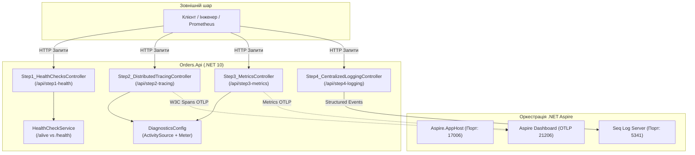

# 📐 Модуль 06: Архітектурна структура та рух даних (Observability & Logging)

> **Мета модуля:** Навчитись керувати трьома стовпами спостережуваності (Metrics, Traces, Logs) та дворівневими перевірками живучості в мікросервісному середовищі .NET 10 та .NET Aspire за допомогою OpenTelemetry та Seq.

---

## 🏛️ Загальна схема архітектури та потоку даних



---

## 🪜 Покрокова методологія: Від простого до складного

### 🔹 Крок 1: Дворежимні перевірки здоров'я (`Step1_HealthChecksController`)
- **Маршрут:** `/api/step1-health`
- **Проблема:** Якщо впала база даних, перезапуск контейнера сервісу нічого не дасть, а лише завантажить процесор.
- **Рішення:**
  - `/alive` (Liveness) — перевіряє тільки сам процес. Якщо завис потік — перезапустити.
  - `/health` (Readiness) — перевіряє зовнішні залежності (PostgreSQL, платіжний шлюз). Якщо вони не відповідають — вивести інстанс з балансувальника трафіку.

### 🔹 Крок 2: Розподілене трасування W3C (`Step2_DistributedTracingController`)
- **Маршрут:** `/api/step2-tracing`
- **Проблема:** Запит проходить 4 мікросервіси. Де саме сталася затримка на 500 мс?
- **Рішення:** Стандарт W3C TraceContext:
  - Спільний `TraceId` крізь усі сервіси через HTTP-заголовок `traceparent`.
  - Окремі `SpanId` для кожної підоперації (збереження в БД, виклик Stripe API).

### 🔹 Крок 3: Агреговані метрики OpenTelemetry (`Step3_MetricsController`)
- **Маршрут:** `/api/step3-metrics`
- **Проблема:** Текстові логи занадто дорогі для розрахунку загальної кількості замовлень та середнього часу відповіді.
- **Рішення:** Метрики:
  - `Counter<long>`: монотонно зростаючий лічильник замовлень.
  - `Histogram<double>`: гістограма тривалості для обчислення перцентилів p50, p95, p99.
  - `ObservableGauge<int>`: датчик динамічних значень (активні кошики).

### 🔹 Крок 4: Структуроване семантичне логування (`Step4_CentralizedLoggingController`)
- **Маршрут:** `/api/step4-logging`
- **Проблема:** Звичайний текст `Order 123 failed` неможливо фільтрувати у величезній базі даних.
- **Рішення:** Семантичні шаблони Serilog, що транслюються у поля JSON в сервері **Seq**:
  - Можливість запитів типу `OrderId = 'ORD-100' and Amount > 500`.

---

## 🚀 Як протестувати самостійно

1. **Запуск через .NET CLI:**
   ```powershell
   dotnet run --project 06-Observability-And-Centralized-Logging/Aspire.AppHost/Aspire.AppHost.csproj
   ```
2. **Панель Aspire Dashboard:** `https://localhost:17006`
3. **Swagger UI:** `http://localhost:порт/`
4. **Seq Web UI:** `http://localhost:5341`
