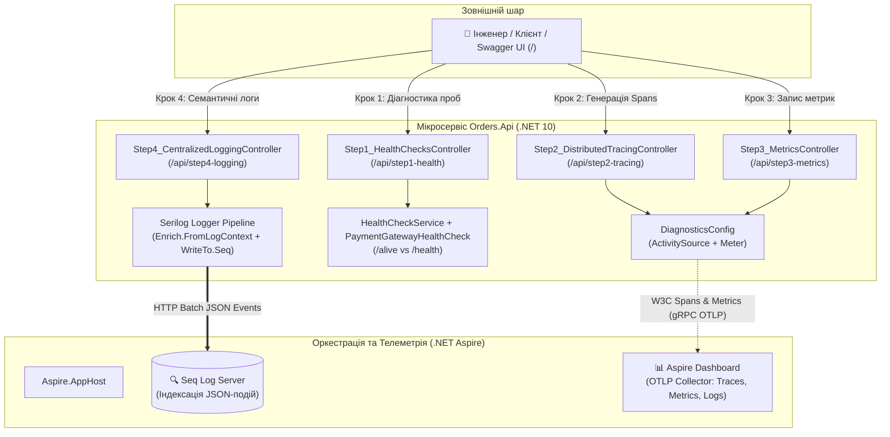
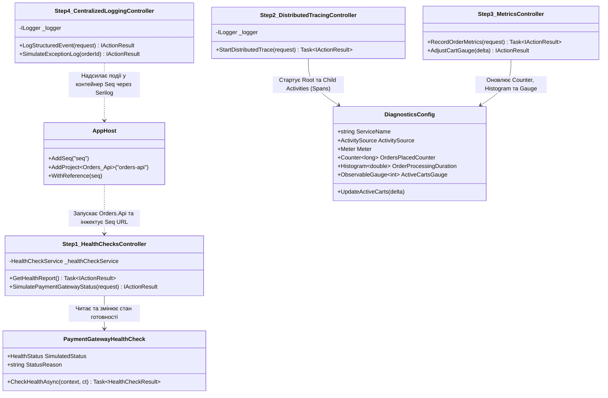
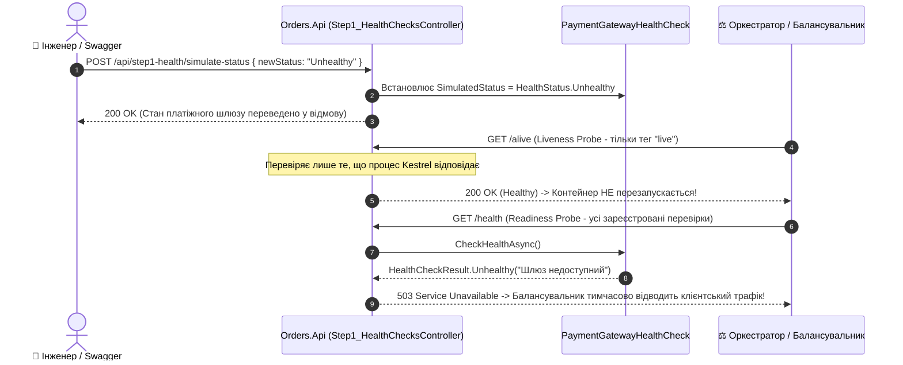
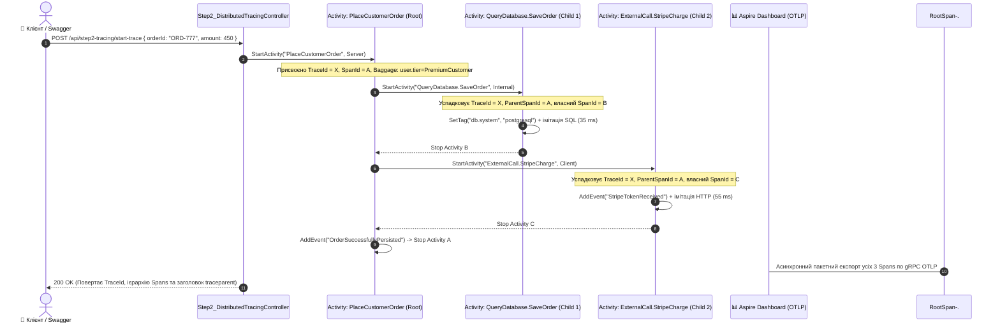
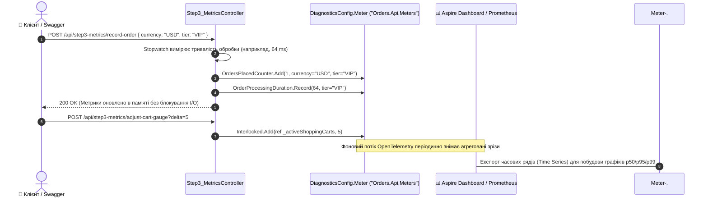
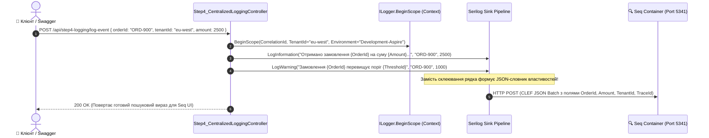

# 06. Архітектура, структура проєктів та рух даних: Спостережуваність та Централізоване Логування

> **Повна технічна специфікація чотирьох стовпів діагностики мікросервісів на .NET 10 та .NET Aspire: дворежимні перевірки здоров'я (`Liveness` vs `Readiness`), розподілене трасування за стандартом `W3C TraceContext`, високошвидкісні метрики `System.Diagnostics.Metrics` та семантичне логування `Serilog + Seq`.**

---

## 🏛️ Загальна архітектурна схема та потоки телеметрії



---

## 🌲 Дерево файлової структури модуля

```text
06-Observability-And-Centralized-Logging/
├── 06-Observability-And-Centralized-Logging.slnx # Рішення .NET 10 для модуля спостережуваності
├── README.md                                     # Посібник користувача з покроковими тестами
├── STRUCTURE-AND-DATA-FLOW.md                    # ЦЕЙ ДОКУМЕНТ: повна технічна специфікація
│
├── Aspire.AppHost/                               # Оркестратор .NET Aspire
│   ├── Program.cs                                # Підняття контейнера Seq (builder.AddSeq("seq")) та Orders.Api
│   ├── Aspire.AppHost.csproj                     # Aspire.Hosting.AppHost + Aspire.Hosting.Seq
│   └── appsettings.json                          # Налаштування оркестратора
│
├── Aspire.ServiceDefaults/                       # Єдиний стандарт телеметрії мікросервісів
│   ├── Extensions.cs                             # Налаштування OpenTelemetry (Tracing, Metrics, OTLP) та /alive, /health
│   └── Aspire.ServiceDefaults.csproj             # Пакетні посилання OpenTelemetry
│
└── Orders.Api/                                   # Доменний сервіс замовлень (Swagger UI у корені /)
    ├── Program.cs                                # Конфігурація Serilog + Seq, HealthChecks, Controllers та Swagger UI
    ├── Orders.Api.csproj                         # Serilog.AspNetCore, Serilog.Sinks.Seq, Swashbuckle
    ├── Controllers/
    │   ├── Step1_HealthChecksController.cs       # КРОК 1: Управління та моніторинг проб Liveness (/alive) та Readiness (/health)
    │   ├── Step2_DistributedTracingController.cs # КРОК 2: Побудова дерева Spans (ActivitySource), Тегів та Baggage
    │   ├── Step3_MetricsController.cs            # КРОК 3: Лічильники (Counter), Гістограми (Histogram) та Датчики (Gauge)
    │   └── Step4_CentralizedLoggingController.cs # КРОК 4: Структуроване логування зі Scopes у централізований Seq
    ├── Diagnostics/
    │   └── DiagnosticsConfig.cs                  # Реєстрація доменних ActivitySource та Meter інструментів
    └── Health/
        └── PaymentGatewayHealthCheck.cs          # Кастомна проба готовності платіжного шлюзу з тегом "ready"
```

---

## 🧩 Взаємодія класів та діагностичних компонентів (Dependency Graph)



---

## 🔄 Покроковий рух даних: 4 навчальні етапи

### 📘 КРОК 1: Дворежимні перевірки здоров'я (`Liveness` vs `Readiness`)

> **Чому не можна вішати перевірку БД на Liveness-пробу?** Якщо база даних перезавантажується протягом 10 секунд, а перевірка БД підключена до `/alive`, Kubernetes вирішить, що всі 20 реплік вашого мікросервісу «зависли», і одночасно вб'є їх усі, спричинивши тотальний даунтайм!



---

### 📘 КРОК 2: Наскрізне трасування за стандартом `W3C TraceContext`

> **Структура заголовка `traceparent`:** `00-4bf92f3577b34da6a3ce929d0e0e4736-00f067aa0ba902b7-01`, де `00` — версія, `32 hex-символи` — наскрізний `TraceId`, `16 hex-символів` — поточний `SpanId`, `01` — прапорець запису (`Sampled`).



---

### 📘 КРОК 3: Числові метрики OpenTelemetry (`Counter`, `Histogram`, `ObservableGauge`)



---

### 📘 КРОК 4: Семантичне логування у централізований сервер `Seq`



---

## 💾 Де та що зберігається (Telemetry Sinks & Instruments)

| Сутність / Інструмент | Ім'я в системі | Тип даних | Де зберігається / Візуалізується | Призначення |
| :--- | :--- | :--- | :--- | :--- |
| **Liveness Probe** | `/alive` | HTTP 200 / 503 | Пам'ять процесу Kestrel | Сигнал для оркестратора, що процес не завис у Deadlock |
| **Readiness Probe** | `/health` (`payment_gateway`) | HTTP 200 / 503 + JSON | `PaymentGatewayHealthCheck` | Сигнал для балансувальника, чи готовий сервіс приймати замовлення |
| **ActivitySource** | `Orders.Api.Tracing` | W3C Spans (`Activity`) | Aspire Dashboard $\to$ **Traces** | Побудова дерева викликів `PlaceCustomerOrder` та його дочірніх операцій |
| **Counter** | `shop.orders.placed` | `Counter<long>` | Aspire Dashboard $\to$ **Metrics** | Монотонно зростаючий лічильник замовлень у розрізі валют і тарифів |
| **Histogram** | `shop.order.duration.ms` | `Histogram<double>` | Aspire Dashboard $\to$ **Metrics** | Розподіл часу обробки для обчислення медіани (`p50`) та хвостів (`p95`, `p99`) |
| **ObservableGauge** | `shop.active_carts` | `ObservableGauge<int>` | Aspire Dashboard $\to$ **Metrics** | Поточна кількість активних кошиків у реальному часі |
| **Structured Logs** | `Application = "Orders.Api"` | CLEF JSON Document | Контейнер **Seq** (`http://localhost:5341`) | Повнотекстовий та індексований пошук за полями `OrderId`, `TenantId`, `CorrelationId` |
