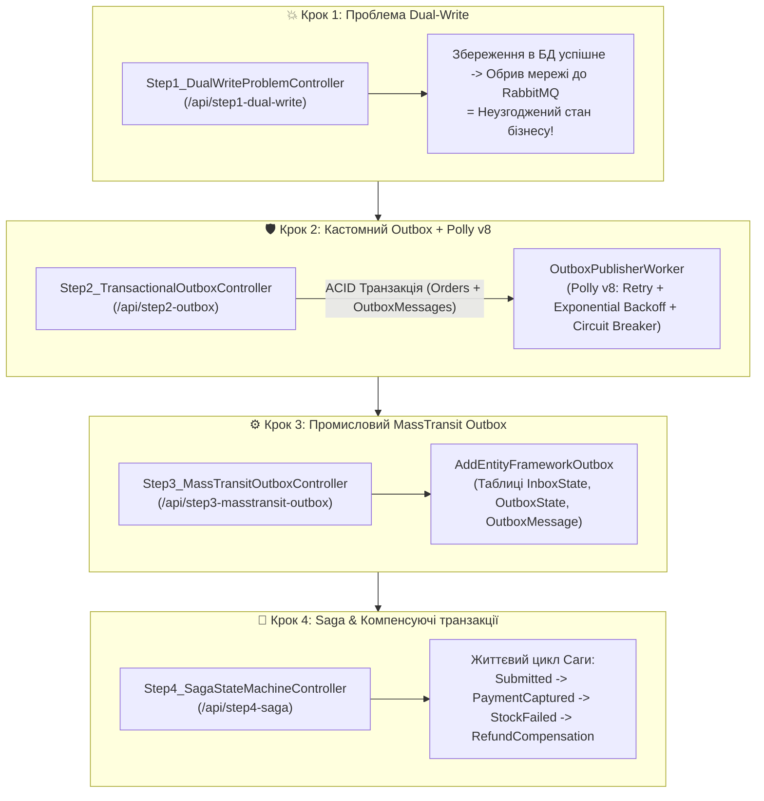

# 07. Покроковий майстер-клас із транзакційних патернів та Саг: Dual-Write, Transactional Outbox, Polly v8 та Sagas (.NET 10 & Aspire)

> **Виробничий посібник із забезпечення узгодженості даних у розподілених системах .NET 10:** демонстрація катастрофи подвійного запису (**Dual-Write Problem** — Крок 1), реалізація кастомного **Transactional Outbox** із конвеєром відмовостійкості **Polly v8** (Крок 2), промисловий **MassTransit Entity Framework Core Outbox** (Крок 3) та керування розподіленими процесами через **Saga State Machine** з компенсуючими транзакціями (Крок 4).

---

## 🎯 Чому в мікросервісах не можна просто зробити `SaveChangesAsync()` і `Publish()`?

У класичному коді розробники часто пишуть два рядки підряд:
```csharp
await _dbContext.SaveChangesAsync(); // 1. Зберегли замовлення в PostgreSQL
await _bus.Publish(new OrderCreatedEvent(order.Id)); // 2. Відправили подію в RabbitMQ
```
Якщо між рядком `1` і рядком `2` моргне мережа, перезапуститься контейнер або брокер RabbitMQ тимчасово не відповість — **замовлення назавжди залишиться в базі, але жоден інший мікросервіс (Склад, Доставка, Оплата) ніколи про нього не дізнається!** Це називається **проблемою подвійного запису (Dual-Write Problem)**.

Модуль демонструє покрокову еволюцію вирішення цієї проблеми у 4 контролерах сервісу `Checkout.Api`:



---

## 🛡️ Як працюють Transactional Outbox, Polly v8 та Сага?

### 1. Секрет атомарності Transactional Outbox
Замість того щоб під час HTTP-запиту звертатися до двох різних мережевих систем (PostgreSQL + RabbitMQ), ми записуємо і бізнес-сутність `Order`, і подію `OutboxMessage` **в одну й ту саму базу даних PostgreSQL в межах однієї ACID-транзакції**:
- Або в базу запишуться **обидва** рядки (`Order` + `OutboxMessage`), або **жоден**!
- Фоновий процес (`OutboxPublisherWorker` або вбудований воркер MassTransit) асинхронно вичитує невідправлені рядки з таблиці `OutboxMessages` і доставляє їх у RabbitMQ, гарантуючи доставку **At-Least-Once (щонайменше один раз)**.

### 2. Захист брокера за допомогою Polly v8 (`ResiliencePipeline`)
Коли фоновий воркер намагається відправити повідомлення з таблиці Outbox у RabbitMQ, брокер може бути перевантажений або перезавантажуватись. У `OutboxPublisherWorker` налаштовано двоступеневий конвеєр **Polly v8**:
1. **Retry з Exponential Backoff + Jitter:** 3 спроби з експоненційною затримкою та випадковим розкидом (щоб репліки не били по брокеру синхронно).
2. **Circuit Breaker (Автоматичний запобіжник):** якщо `50%` спроб падають, ланцюг розмикається на `15 секунд` (`BrokenCircuitException`), миттєво блокуючи марні мережеві виклики та даючи брокеру час на відновлення.

### 3. Чому Сага використовує Компенсації замість SQL `ROLLBACK`?
У мікросервісах не можна утримувати відкриту транзакцію БД між сервісом Оплати і сервісом Складу (протокол 2PC блокує таблиці і знищує масштабованість).
- Кожен крок Саги фіксує свою локальну транзакцію одразу (`PaymentCaptured`).
- Якщо на наступному кроці Склад повідомляє, що товар закінчився (`StockReservationFailed`), Сага запускає **зворотну бізнес-дію (Компенсацію)** — `RefundPayment` (повернення коштів клієнту) і переводить замовлення у статус `Cancelled_PaymentRefunded`.

---

## 📂 Склад проєктів та покрокових контролерів

| Контролер / Компонент | Маршрути (Routes) | Що демонструє |
| :--- | :--- | :--- |
| **`Step1_DualWriteProblemController`** | `POST /api/step1-dual-write/simulate-crash` | Наочна демонстрація розсинхронізації: замовлення збережено в БД, але подія втрачена через збій брокера. |
| **`Step2_TransactionalOutboxController`** | `POST /api/step2-outbox/atomic-checkout`<br>`GET /api/step2-outbox/messages`<br>`POST /api/step2-outbox/toggle-broker-outage` | Атомарне збереження `Order` + `OutboxMessage`, моніторинг черги таблиці Outbox та жива перевірка **Polly v8 Circuit Breaker**. |
| **`Step3_MassTransitOutboxController`** | `POST /api/step3-masstransit-outbox/checkout` | Виробничий стандарт `AddEntityFrameworkOutbox<AppDbContext>()` із захистом від конкурентного читання та дублікатів (Inbox/Outbox). |
| **`Step4_SagaStateMachineController`** | `POST /api/step4-saga/start-saga`<br>`POST /api/step4-saga/simulate-compensation`<br>`GET /api/step4-saga/saga-state/{orderId}` | Повний цикл Саги (успішний шлях) та автоматичне виконання компенсуючої транзакції при дефіциті товару на складі. |

---

## 🧪 Покроковий сценарій тестування у Swagger

1. **Запустіть оркестратор AppHost:**
   ```powershell
   dotnet run --project 07-Transactional-Patterns-And-Sagas/Aspire.AppHost/Aspire.AppHost.csproj
   ```
2. Відкрийте **Aspire Dashboard** і натисніть на посилання `checkout-api` — у браузері одразу відкриється **Swagger UI** у корені (`/`).

### Крок 1: Спостерігаємо катастрофу Dual-Write
1. Викличте `POST /api/step1-dual-write/simulate-crash` із `simulateBrokerFailure: true`.
2. Сервіс поверне `500 Internal Server Error`: замовлення вже записане в таблицю `Orders`, але подія до RabbitMQ не дійшла!

### Крок 2: Тестуємо Transactional Outbox та Polly v8 Circuit Breaker
1. Викличте `POST /api/step2-outbox/atomic-checkout` (`customerId: "USR-100"`, `totalAmount: 299.99`).
2. Зачекайте 2 секунди і викличте `GET /api/step2-outbox/messages` — ви побачите, що воркер уже доставив повідомлення (`isDelivered: true`, `processedAt` заповнено)!
3. **Тепер перевіримо Polly v8 під час аварії брокера:**
   * Увімкніть імітацію падіння брокера: `POST /api/step2-outbox/toggle-broker-outage?isOutageActive=true`.
   * Створіть нове замовлення через `POST /api/step2-outbox/atomic-checkout` — клієнт все одно отримає успішний `202 Accepted`, бо база даних працює!
   * Подивіться в логи `checkout-api`: спрацьовує **Polly Retry** та розмикається **Circuit Breaker**!
   * Вимкніть аварію: `POST /api/step2-outbox/toggle-broker-outage?isOutageActive=false`. Воркер автоматично відновить доставку і відправить накопичені повідомлення!

### Крок 3: Тестуємо промисловий MassTransit EF Core Outbox
1. Викличте `POST /api/step3-masstransit-outbox/checkout`.
2. MassTransit автоматично перехопить виклик `_publishEndpoint.Publish()`, збереже подію в системні таблиці `OutboxState` / `OutboxMessage` в одній транзакції з `Order` і відправить її у RabbitMQ exchange `Checkout.Api.Controllers:OrderSubmittedEvent`.

### Крок 4: Тестуємо Сагу та Компенсуючу транзакцію
1. Викличте `POST /api/step4-saga/start-saga` — Сага пройде всі 4 кроки і завершиться у стані `Completed`.
2. Викличте `POST /api/step4-saga/simulate-compensation` — після успішної оплати (`PaymentCaptured`) трапиться збій резервування складу (`StockReservationFailed`), і Сага автоматично виконає компенсацію `RefundPaymentExecuted`, перевівши стан у `Cancelled_PaymentRefunded`.
3. Скопіюйте `orderId` і викличте `GET /api/step4-saga/saga-state/{orderId}` для перегляду збереженого стану Саги в PostgreSQL!
