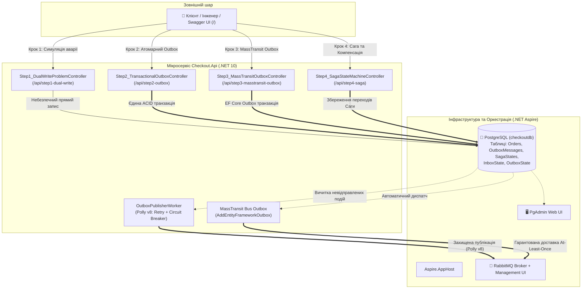
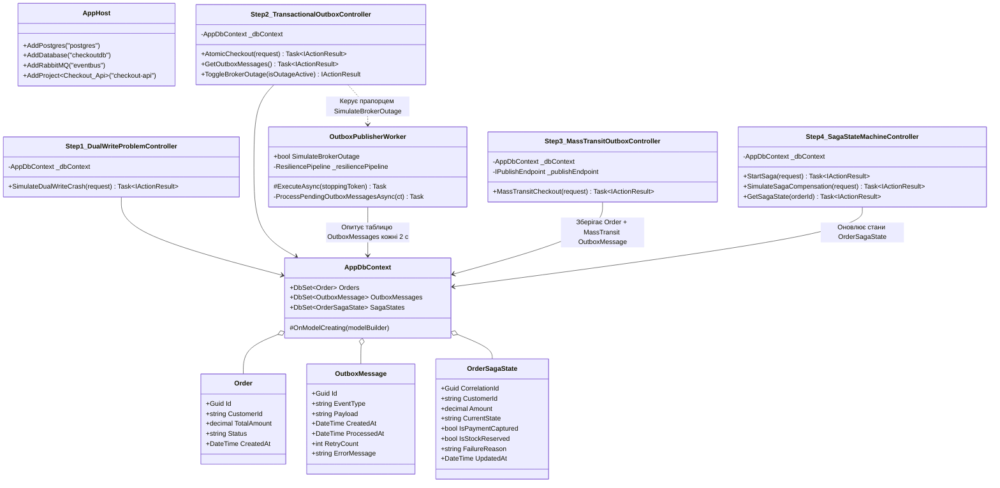
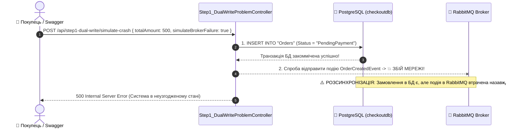
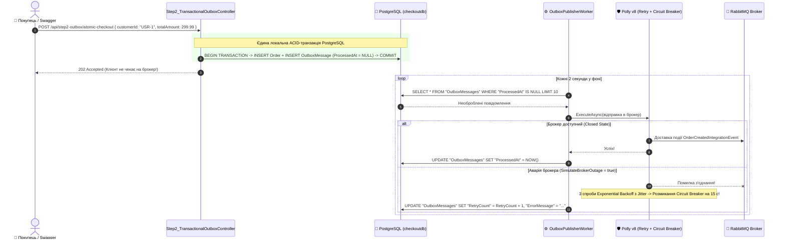
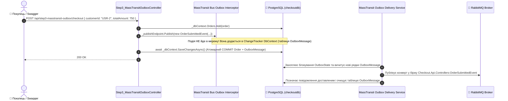
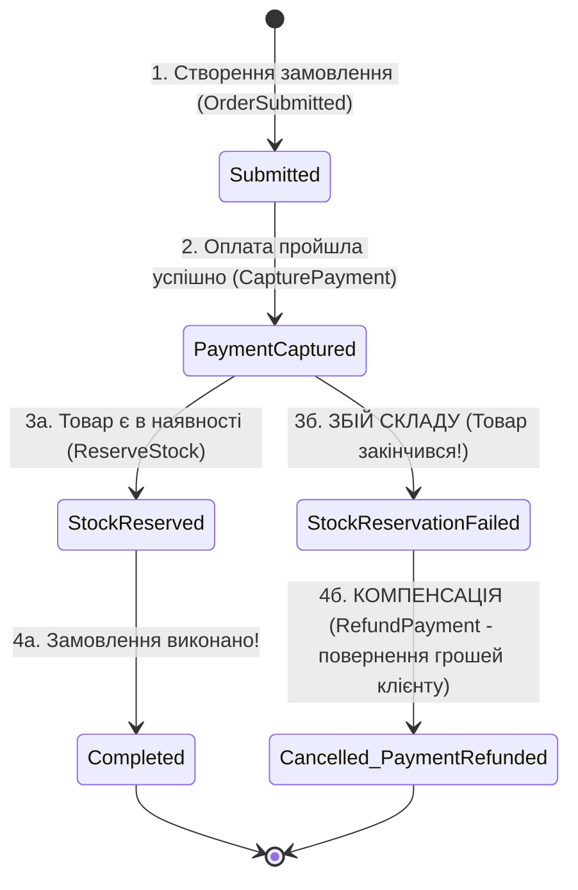

# 07. Архітектура, структура проєктів та рух даних: Transactional Patterns, Outbox & Sagas

> **Повна технічна специфікація патернів надійності розподілених транзакцій на .NET 10 та .NET Aspire: аналіз вразливості `Dual-Write`, реалізація `Transactional Outbox` із конвеєром `Polly v8` (`Retry` + `Circuit Breaker`), промисловий `MassTransit EF Core Outbox` та оркестрація `Saga State Machine` із компенсуючими транзакціями.**

---

## 🏛️ Загальна архітектурна схема модуля



---

## 🌲 Дерево файлової структури модуля

```text
07-Transactional-Patterns-And-Sagas/
├── 07-Transactional-Patterns-And-Sagas.slnx      # Рішення .NET 10 для модуля транзакційних патернів
├── README.md                                     # Посібник користувача зі сценаріями тестування у Swagger
├── STRUCTURE-AND-DATA-FLOW.md                    # ЦЕЙ ДОКУМЕНТ: повна технічна специфікація
│
├── Aspire.AppHost/                               # Оркестратор .NET Aspire
│   ├── Program.cs                                # Підняття PostgreSQL (+PgAdmin), RabbitMQ (+Management) та Checkout.Api
│   ├── Aspire.AppHost.csproj                     # Aspire.Hosting.PostgreSQL + Aspire.Hosting.RabbitMQ
│   └── appsettings.json                          # Конфігурація оркестратора
│
├── Aspire.ServiceDefaults/                       # Спільні стандарти телеметрії
│   ├── Extensions.cs                             # OpenTelemetry, HealthChecks, ServiceDiscovery
│   └── Aspire.ServiceDefaults.csproj             # Пакетні посилання
│
└── Checkout.Api/                                 # Мікросервіс оформлення замовлень (Swagger UI у корені /)
    ├── Program.cs                                # Налаштування EF Core, MassTransit EF Outbox, Polly Worker, Swagger UI
    ├── Checkout.Api.csproj                       # EF Core Npgsql, MassTransit.EntityFrameworkCore, Polly v8, Swashbuckle
    ├── BackgroundServices/
    │   └── OutboxPublisherWorker.cs              # Фоновий сервіс: читає OutboxMessages та публікує через Polly v8
    ├── Controllers/
    │   ├── Step1_DualWriteProblemController.cs   # КРОК 1: Симуляція розсинхронізації між SQL та брокером
    │   ├── Step2_TransactionalOutboxController.cs # КРОК 2: Ручний Transactional Outbox + керування аварією для Polly v8
    │   ├── Step3_MassTransitOutboxController.cs  # КРОК 3: Нативний AddEntityFrameworkOutbox у MassTransit
    │   └── Step4_SagaStateMachineController.cs   # КРОК 4: Життєвий цикл Саги та компенсуючий Rollback
    ├── Data/
    │   └── AppDbContext.cs                       # DbContext: Orders, OutboxMessages, SagaStates + MassTransit Outbox Entities
    └── Entities/
        ├── Order.cs                              # Доменна сутність замовлення
        ├── OutboxMessage.cs                      # Таблиця вихідних подій для кастомного Outbox (Крок 2)
        └── OrderSagaState.cs                     # Сутність стану екземпляра Саги (Крок 4)
```

---

## 🧩 Взаємодія класів та сутностей БД (Dependency Graph)



---

## 🔄 Покроковий рух даних: 4 навчальні етапи

### 📘 КРОК 1: Чому виникає катастрофа Dual-Write?



---

### 📘 КРОК 2: Кастомний Transactional Outbox + Конвеєр стійкості Polly v8



---

### 📘 КРОК 3: Промисловий MassTransit EF Core Outbox (`AddEntityFrameworkOutbox`)



---

### 📘 КРОК 4: Розподілена Сага та Компенсуючі Транзакції (Rollback без блокувань)



---

## 💾 Де та що зберігається (Таблиці PostgreSQL `checkoutdb`)

| Таблиця в PostgreSQL | Хто керує | Ключові колонки | Призначення |
| :--- | :--- | :--- | :--- |
| **`"Orders"`** | `AppDbContext` | `Id`, `CustomerId`, `TotalAmount`, `Status`, `CreatedAt` | Основна бізнес-таблиця замовлень клієнтів |
| **`"OutboxMessages"`** | Кастомний Outbox (Крок 2) | `Id`, `EventType`, `Payload`, `CreatedAt`, `ProcessedAt`, `RetryCount`, `ErrorMessage` | Черга вихідних подій для демонстрації роботи `OutboxPublisherWorker` та `Polly v8` |
| **`"OutboxState"` / `"OutboxMessage"`** | MassTransit EF Outbox (Крок 3) | `OutboxId`, `SequenceNumber`, `MessageId`, `ContentType`, `Body`, `Headers` | Системні таблиці MassTransit для безпечної доставки при горизонтальному масштабуванні |
| **`"InboxState"`** | MassTransit EF Outbox (Крок 3) | `Id`, `MessageId`, `ConsumerId`, `Received`, `Consumed` | Дедуплікація вхідних повідомлень (Idempotent Consumer / Inbox Pattern) |
| **`"SagaStates"`** | Saga Controller (Крок 4) | `CorrelationId` (PK), `CustomerId`, `Amount`, `CurrentState`, `IsPaymentCaptured`, `IsStockReserved`, `FailureReason` | Персистентне збереження поточного стану та історії переходів екземпляра Саги |
