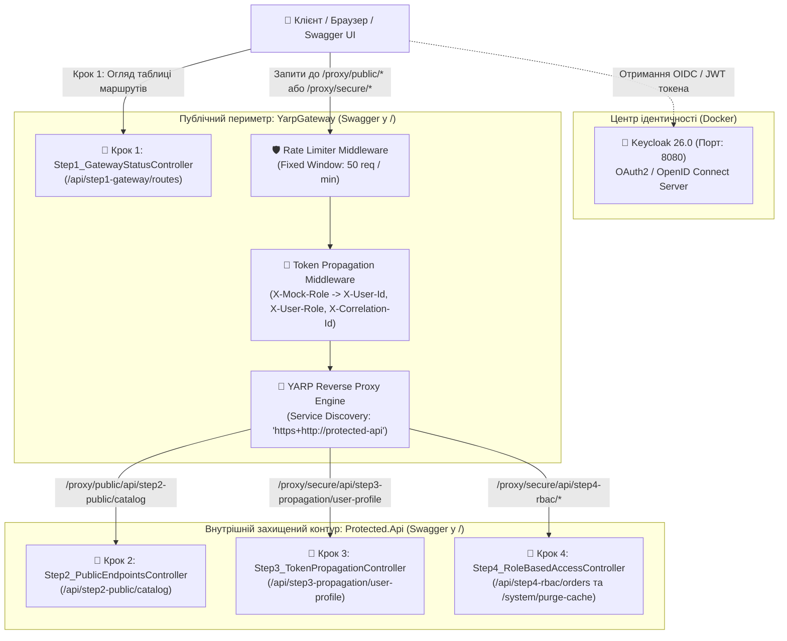

# 08. Покроковий майстер-клас із безпеки мікросервісів: YARP API Gateway, Keycloak, Token Propagation та RBAC (.NET 10 & Aspire)

> **Виробничий посібник із побудови захищеного периметра розподіленої системи на .NET 10:** єдина вхідна точка через зворотний проксі **YARP (Yet Another Reverse Proxy)** та захист від DDoS за допомогою **Rate Limiting** (Крок 1), публічні маршрути каталогу (Крок 2), розвантаження криптографії через патерн **Token & Claim Propagation** (Крок 3), рольове розмежування прав **RBAC** (`User` vs `Admin` — Крок 4) та центральний сервер ідентичності **Keycloak (OAuth2 / OIDC)** у контейнері .NET Aspire.

---

## 🎯 Чому мікросервіси ніколи не виставляють напряму в Інтернет?

Якщо мобільний додаток або фронтенд звертається напряму до 15 внутрішніх мікросервісів:
1. Кожен мікросервіс стає мішенню для прямих DDoS-атак із зовнішньої мережі.
2. Кожен із 15 сервісів змушений самостійно виконувати важку криптографічну перевірку RSA-підпису JWT-токена на кожному внутрішньому виклику.
3. Будь-яка зміна внутрішніх портів чи розбиття одного сервісу на два ламає клієнтські застосунки.

Рішення — винести всю безпеку, лімітування запитів та маршрутизацію на **вхідний шлюз YARP API Gateway**, а внутрішній контур (`Protected.Api`) залишити у приватній мережі:



---

## 🔑 Як працює патерн Gateway Offloading & Token Propagation?

У високонавантажених системах перевірка асиметричного підпису JWT (`RS256`) у кожному з 10 внутрішніх сервісів створює суттєве навантаження на процесор.
Натомість застосовується патерн **Token & Claim Propagation**:
1. Зовнішній клієнт звертається тільки до **YARP Gateway**.
2. Шлюз перевіряє токен на вході, генерує наскрізний `X-Correlation-Id` та записує перевірені атрибути користувача у внутрішні HTTP-заголовки:
   - `X-User-Id: usr_simulated_777`
   - `X-User-Email: dev@mastery.com`
   - `X-User-Role: Admin` (або `User`)
3. Внутрішній мікросервіс `Protected.Api` знаходиться в ізольованій мережі кластера (до нього немає доступу ззовні повз шлюз), тому він миттєво читає ці заголовки без повторної криптографії!

---

## 📂 Склад проєктів та покрокових контролерів

| Проєкт / Контролер | Маршрути (Routes) | Що демонструє |
| :--- | :--- | :--- |
| **`YarpGateway` $\to$ `Step1_GatewayStatusController`** | `GET /api/step1-gateway/routes` | Публічний фасад системи: показує активні маршрути YARP, правила `PathRemovePrefix`, кластери Service Discovery та реквізити Keycloak. |
| **`Protected.Api` $\to$ `Step2_PublicEndpointsController`** | `GET /api/step2-public/catalog`<br>*(або через шлюз: `/proxy/public/api/step2-public/catalog`)* | Відкриті публічні дані вітрини товарів, які доступні анонімним гостям без авторизації, але захищені лімітером запитів на шлюзі. |
| **`Protected.Api` $\to$ `Step3_TokenPropagationController`** | `GET /api/step3-propagation/user-profile`<br>*(або через шлюз: `/proxy/secure/api/step3-propagation/user-profile`)* | Читання прокинутих шлюзом заголовків ідентичності (`X-User-Id`, `X-User-Email`, `X-User-Role`, `X-Correlation-Id`). |
| **`Protected.Api` $\to$ `Step4_RoleBasedAccessController`** | `GET /api/step4-rbac/orders`<br>`DELETE /api/step4-rbac/system/purge-cache` | Рольова авторизація (RBAC): замовлення доступні для ролей `User` та `Admin`, а очищення системного кешу — виключно для ролі `Admin` (інакше `403 Forbidden`). |

---

## 🧪 Покроковий сценарій тестування у Swagger та через YARP Proxy

1. **Запустіть оркестратор AppHost:**
   ```powershell
   dotnet run --project 08-Security-YARP-And-Keycloak/Aspire.AppHost/Aspire.AppHost.csproj
   ```
2. У панелі **Aspire Dashboard** ви побачите:
   * **`yarp-gateway`** — натисніть на URL, щоб відкрити **Swagger UI вхідного шлюзу** (корінь `/`).
   * **`protected-api`** — натисніть на URL, щоб відкрити **Swagger UI внутрішнього сервісу** (корінь `/`).
   * **`keycloak`** — відкрийте `http://localhost:8080/admin` (логін: `admin`, пароль: `admin`) для огляду консолі Identity Provider.

### Крок 1: Досліджуємо конфігурацію шлюзу YARP
1. У Swagger для `yarp-gateway` викличте `GET /api/step1-gateway/routes`.
2. Ознайомтеся з таблицею маршрутів: `/proxy/public/{**catch-all}` та `/proxy/secure/{**catch-all}`, які транслюють запити на логічну адресу Aspire `https+http://protected-api`.

### Крок 2: Тестуємо публічний маршрут через проксі-шлюз
1. Викличте `GET /api/step2-public/catalog` у Swagger `protected-api` (або зверніться через порт шлюзу `yarp-gateway` за адресою `/proxy/public/api/step2-public/catalog`).
2. Ви отримаєте каталог ноутбуків та аксесуарів із рівнем доступу `Anonymous / Public`.

### Крок 3: Тестуємо Token Propagation через YARP Gateway
1. Викличте `GET /api/step3-propagation/user-profile` без заголовків — ви побачите `isAuthenticated: false`, `userId: "guest_anonymous"`.
2. Тепер надішліть запит через шлюз `yarp-gateway` із заголовком `X-Mock-Role: Admin`:
   ```powershell
   curl -H "X-Mock-Role: Admin" http://localhost:<порт-yarp-gateway>/proxy/secure/api/step3-propagation/user-profile
   ```
3. Шлюз YARP автоматично збагатить запит заголовками `X-User-Id: usr_simulated_777`, `X-User-Email: dev@mastery.com`, `X-User-Role: Admin` та `X-Correlation-Id`, а внутрішній сервіс поверне `isAuthenticated: true`!

### Крок 4: Тестуємо RBAC (Розмежування прав `Guest` vs `User` vs `Admin`)
1. Викличте `GET /api/step4-rbac/orders` без ролі — отримаєте **`403 Forbidden`** (`Недостатньо прав доступу`).
2. Викличте через шлюз із заголовком `X-Mock-Role: User` — отримаєте **`200 OK`** зі списком замовлень покупця.
3. Спробуйте викликати критичний ендпоінт `DELETE /proxy/secure/api/step4-rbac/system/purge-cache` із роллю `X-Mock-Role: User` — отримаєте **`403 Forbidden`** (`Потрібні права системного адміністратора Admin`).
4. Змініть заголовок на `X-Mock-Role: Admin` — операція `purge-cache` виконається успішно зі статусом **`200 OK`**!
