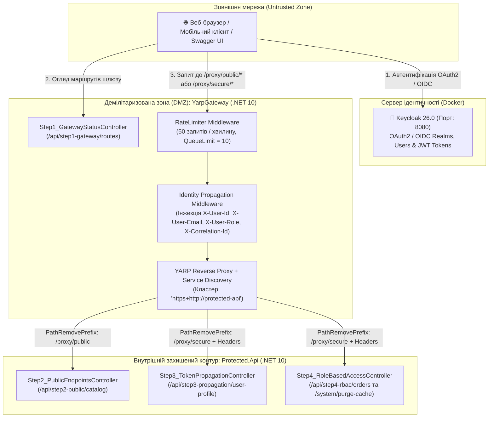
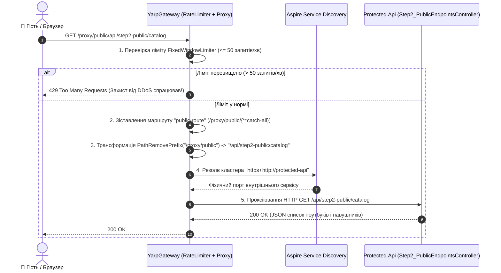
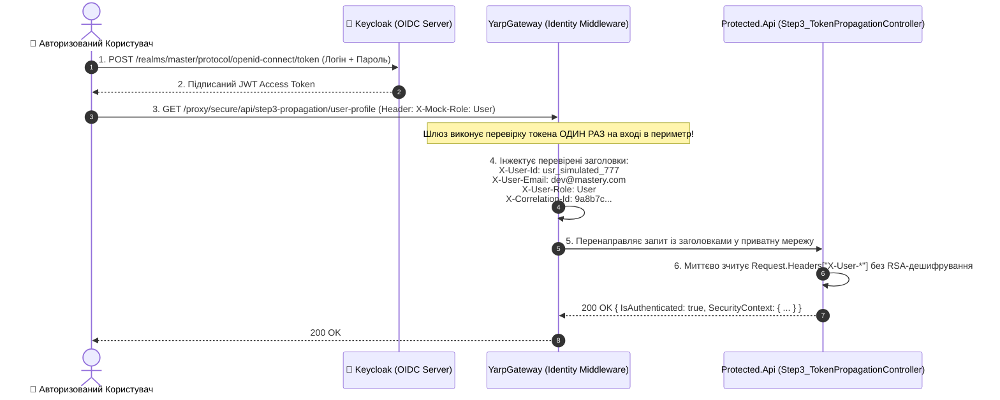
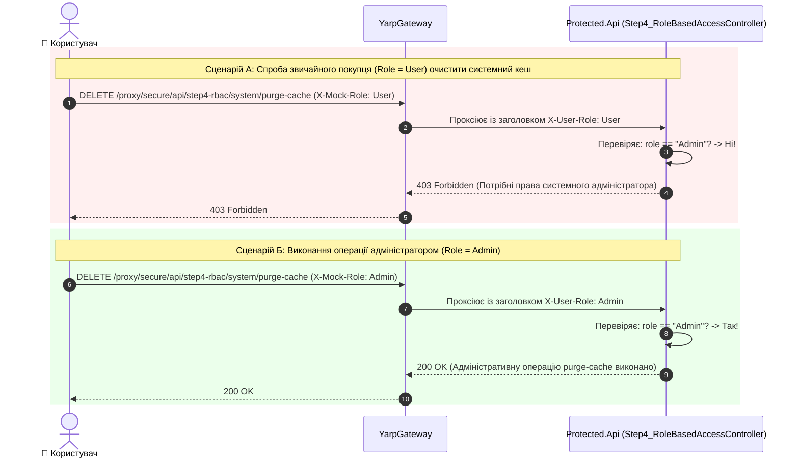

# 08. Архітектура, структура проєктів та рух даних: Security, YARP API Gateway & Keycloak

> **Повна технічна специфікація побудови захищеного периметра мікросервісів на .NET 10 та .NET Aspire: зворотний проксі `YARP` із динамічним `Service Discovery`, сервер автентифікації `Keycloak 26.0` (OAuth2 / OIDC), захист `FixedWindow Rate Limiting`, патерн `Token & Claim Propagation` та рольова авторизація `RBAC`.**

---

## 🏛️ Загальна архітектурна схема та потік безпеки



---

## 🌲 Дерево файлової структури модуля

```text
08-Security-YARP-And-Keycloak/
├── 08-Security-YARP-And-Keycloak.slnx            # Рішення .NET 10 для модуля безпеки та YARP
├── README.md                                     # Посібник користувача з покроковими тестами
├── STRUCTURE-AND-DATA-FLOW.md                    # ЦЕЙ ДОКУМЕНТ: повна технічна специфікація
│
├── Aspire.AppHost/                               # Оркестратор .NET Aspire
│   ├── Program.cs                                # Запуск контейнера Keycloak (8080), Protected.Api та YarpGateway
│   ├── Aspire.AppHost.csproj                     # Aspire.Hosting.AppHost
│   └── appsettings.json                          # Конфігурація оркестратора
│
├── Aspire.ServiceDefaults/                       # Спільні стандарти телеметрії та живучості
│   ├── Extensions.cs                             # OpenTelemetry, HealthChecks, ServiceDiscovery
│   └── Aspire.ServiceDefaults.csproj             # Пакетні посилання
│
├── YarpGateway/                                  # Зовнішній API Gateway (Swagger UI у корені /)
│   ├── Program.cs                                # Налаштування RateLimiter, YARP + ServiceDiscovery, Token Propagation, Swagger
│   ├── YarpGateway.csproj                        # Yarp.ReverseProxy, Microsoft.Extensions.ServiceDiscovery.Yarp, Swashbuckle
│   ├── appsettings.json                          # Конфігурація ReverseProxy: Routes (public-route, secure-route) та Clusters
│   └── Controllers/
│       └── Step1_GatewayStatusController.cs      # КРОК 1: Інспекція маршрутів YARP та параметрів Keycloak
│
└── Protected.Api/                                # Внутрішній захищений мікросервіс (Swagger UI у корені /)
    ├── Program.cs                                # Налаштування контролерів та Swagger UI
    ├── Protected.Api.csproj                      # Swashbuckle, ServiceDefaults, лінк на Docs
    └── Controllers/
        ├── Step2_PublicEndpointsController.cs    # КРОК 2: Публічна вітрина товарів без вимоги авторизації
        ├── Step3_TokenPropagationController.cs   # КРОК 3: Читання прокинутих клеймів ідентичності користувача
        └── Step4_RoleBasedAccessController.cs    # КРОК 4: Перевірка ролей User vs Admin (RBAC)
```

---

## 🧩 Взаємодія класів та конвеєрів безпеки (Dependency Graph)

```mermaid
classDiagram
    class AppHost {
        +AddContainer("keycloak", "quay.io/keycloak/keycloak:26.0")
        +AddProject~Protected_Api~("protected-api")
        +AddProject~YarpGateway~("yarp-gateway")
        +WithReference(protectedApi)
    }

    class YarpGatewayProgram {
        +AddRateLimiter("fixed", 50 per min)
        +AddReverseProxy()
        +AddServiceDiscoveryDestinationResolver()
        +IdentityPropagationMiddleware()
        +MapReverseProxy()
    }

    class Step1_GatewayStatusController {
        -IConfiguration _configuration
        +GetGatewayRoutes() IActionResult
    }

    class Step2_PublicEndpointsController {
        +GetPublicCatalog() IActionResult
    }

    class Step3_TokenPropagationController {
        +GetUserProfile() IActionResult
    }

    class Step4_RoleBasedAccessController {
        +GetUserOrders() IActionResult
        +PurgeSystemCache() IActionResult
    }

    AppHost ..> YarpGatewayProgram : Запускає вхідний шлюз та інжектує адресу protected-api
    AppHost ..> Step2_PublicEndpointsController : Запускає внутрішній сервіс Protected.Api
    YarpGatewayProgram --> Step1_GatewayStatusController : Локальний контролер діагностики шлюзу
    YarpGatewayProgram ==> Step2_PublicEndpointsController : Проксіює /proxy/public/*
    YarpGatewayProgram ==> Step3_TokenPropagationController : Проксіює /proxy/secure/* + заголовки X-User-*
    YarpGatewayProgram ==> Step4_RoleBasedAccessController : Проксіює /proxy/secure/* + заголовки X-User-Role
```

---

## 🔄 Покроковий рух даних: 4 навчальні етапи

### 📘 КРОК 1 та КРОК 2: Маршрутизація YARP, Rate Limiting та Публічні ендпоінти



---

### 📘 КРОК 3: Патерн Token & Claim Propagation (Gateway Offloading)



---

### 📘 КРОК 4: Рольовий контроль доступу (RBAC: `Guest` vs `User` vs `Admin`)



---

## 💾 Таблиця маршрутів, політик та заголовків безпеки

| Елемент конфігурації | Значення в системі | Де налаштовано | Призначення |
| :--- | :--- | :--- | :--- |
| **Маршрут `public-route`** | `/proxy/public/{**catch-all}` | `YarpGateway/appsettings.json` | Відрізає префікс `/proxy/public` і пересилає на `https+http://protected-api` |
| **Маршрут `secure-route`** | `/proxy/secure/{**catch-all}` | `YarpGateway/appsettings.json` | Відрізає префікс `/proxy/secure`, збагачує заголовками ідентичності та пересилає на `protected-api` |
| **Політика Rate Limiting** | `FixedWindowLimiter ("fixed")` | `YarpGateway/Program.cs` | Дозволяє до `50` запитів за `1 хвилину` (черга очікування `10`), при перевищенні повертає `429 Too Many Requests` |
| **Заголовки ідентичності** | `X-User-Id`, `X-User-Email`, `X-User-Role`, `X-Correlation-Id` | `YarpGateway/Program.cs` | Передача перевіреного контексту користувача та трасування у внутрішні мікросервіси |
| **Keycloak IDP** | `quay.io/keycloak/keycloak:26.0` | `Aspire.AppHost/Program.cs` | OAuth2 / OIDC сервер на порту `8080` (`admin` / `admin`) |
