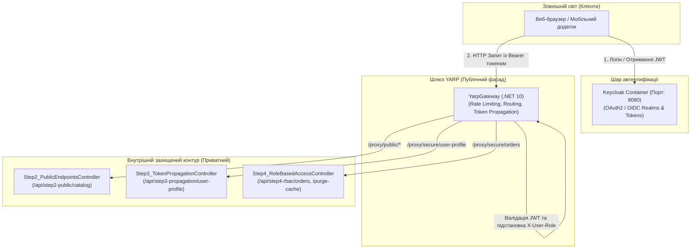

# 📐 Модуль 08: Архітектурна структура та рух даних (Security, YARP & Keycloak)

> **Мета модуля:** Вивчити організацію безпечного контуру мікросервісної системи через центральний шлюз YARP (Yet Another Reverse Proxy), сервер автентифікації Keycloak (OAuth2 / OpenID Connect) та патерн Token/Claim Propagation.

---

## 🏛️ Загальна схема архітектури та потоку даних



---

## 🪜 Покрокова методологія: Від простого до складного

### 🔹 Крок 1: Шлюз YARP та маршрутизація (`Step1_GatewayStatusController`)
- **Маршрут:** `/api/step1-gateway`
- **Концепція:** Зовнішні клієнти не мають знати внутрішні порти та IP-адреси 10 мікросервісів. YARP виступає єдиним публічним фасадом:
  - Зіставлення шляхів (Route Matching).
  - Трансформація URL (Path Remove Prefix).
  - Балансування та переадресація на внутрішні кластери через .NET Aspire Service Discovery (`https+http://protected-api`).

### 🔹 Крок 2: Відкриті публічні ендпоінти (`Step2_PublicEndpointsController`)
- **Маршрут:** `/api/step2-public`
- **Концепція:** Ресурси, що не вимагають авторизації (перегляд каталогу товарів, відкрита вітрина). Проходять крізь шлюз вільно з мінімальним захистом Rate Limiting.

### 🔹 Крок 3: Патерн трансляції особи (`Step3_TokenPropagationController`)
- **Маршрут:** `/api/step3-propagation`
- **Проблема:** Якщо кожен внутрішній мікросервіс буде самостійно декодувати та перевіряти підпис RSA токена на кожному кроці ланцюжка, система витратить до 30% процесорного часу на повторну криптографію.
- **Рішення (Gateway Offloading):**
  - Шлюз YARP перевіряє JWT один раз на вході.
  - Шлюз інжектує перевірені заголовки: `X-User-Id`, `X-User-Email`, `X-User-Role`.
  - Внутрішні сервіси читають ці заголовки миттєво без криптографічних затримок.

### 🔹 Крок 4: Рольовий доступ та привілеї (`Step4_RoleBasedAccessController`)
- **Маршрут:** `/api/step4-rbac`
- **Концепція:** Розподіл прав (RBAC):
  - Звичайний покупець (`User`) має доступ до своїх замовлень.
  - Спроба викликати адміністративний ендпоінт скидання кешу без ролі `Admin` негайно повертає **403 Forbidden**.

---

## 🚀 Як протестувати самостійно

1. **Запуск через .NET CLI:**
   ```powershell
   dotnet run --project 08-Security-YARP-And-Keycloak/Aspire.AppHost/Aspire.AppHost.csproj
   ```
2. **Панель Aspire Dashboard:** `https://localhost:17008`
3. **Консоль Keycloak:** `http://localhost:8080/admin` (admin / admin)
4. **YARP Gateway Swagger:** `http://localhost:порт/swagger`
