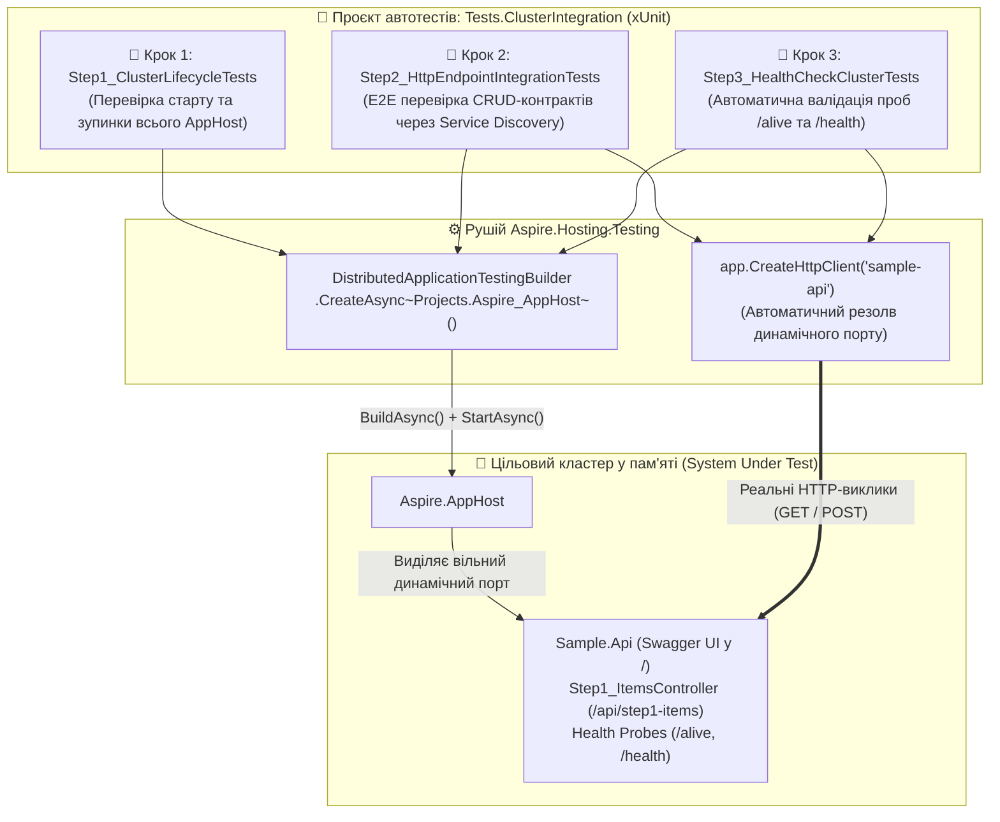

# 09. Покроковий майстер-клас із тестування розподілених систем: `Aspire.Hosting.Testing` & xUnit (.NET 10)

> **Виробничий посібник з автоматизованого інтеграційного та End-to-End (E2E) тестування мікросервісних кластерів на .NET 10:** програмне підняття всього оркестратора `Aspire.AppHost` у пам'яті за допомогою **`DistributedApplicationTestingBuilder`** (Крок 1), виконання реальних HTTP-запитів із автоматичним **Service Discovery** через `app.CreateHttpClient("sample-api")` (Крок 2) та автоматична верифікація хмарних проб живучості `/alive` і `/health` перед релізом (Крок 3).

---

## 🎯 Чому класичні Unit-тести з `Moq` не рятують мікросервіси від падіння у продакшені?

У моноліті достатньо замокати інтерфейс репозиторію через `Moq` чи `NSubstitute`. Але в розподіленій мікросервісній архітектурі 80% аварій трапляються **на стиках між сервісами**:
- Помилка в імені сервісу Service Discovery або відсутній рядок підключення в `AppHost`.
- Неправильна серіалізація JSON-контракту або конфлікт маршрутів контролера.
- Падіння проби готовності `/health` у Kubernetes (`CrashLoopBackOff`).

Раніше для перевірки цих сценаріїв інженерам доводилося вручну писати складні bash-скрипти з `docker-compose up`, чекати вільних портів і боротися з нестабільними (flaky) тестами. Бібліотека **`Aspire.Hosting.Testing`** змінює правила гри:



---

## ⚡ Як працює `DistributedApplicationTestingBuilder` під капотом?

Коли xUnit запускає тест:
1. Виклик `await DistributedApplicationTestingBuilder.CreateAsync<Projects.Aspire_AppHost>()` зчитує справжній граф залежностей вашого `AppHost` — рівно той самий, який використовується при запуску всього рішення!
2. Оркестратор виділяє для кожного мікросервісу **випадковий вільний порт ОС** — жодних помилок `Address already in use`, навіть якщо паралельно запущено 10 тестів!
3. Виклик `app.CreateHttpClient("sample-api")` повертає налаштований `HttpClient`, який автоматично знає призначений порт сервісу `sample-api`.
4. Конструкція `await using var app = await appHost.BuildAsync()` гарантує повне та чисте вивільнення всіх процесів і контейнерів одразу після завершення тесту.

---

## 📂 Склад проєктів, контролерів та тестових класів

| Проєкт / Клас | Тип | Що демонструє |
| :--- | :--- | :--- |
| **`Sample.Api` $\to$ `Step1_ItemsController`** | Web API (Swagger у `/`) | Цільовий мікросервіс каталогу з повним набором CRUD-операцій (`GET /api/step1-items`, `GET /api/step1-items/{id}`, `POST /api/step1-items`, `DELETE /api/step1-items/{id}`). |
| **`Step1_ClusterLifecycleTests`** | xUnit Test Class | **Крок 1:** Перевіряє, що весь `Aspire.AppHost` будується, стартує та штатно зупиняється без винятків конфігурації DI. |
| **`Step2_HttpEndpointIntegrationTests`** | xUnit Test Class | **Крок 2:** Виконує наскрізний сценарій: вичитка початкових елементів (`200 OK`) та створення нового товару через `POST` (`201 Created`) із подальшою перевіркою через `GET`. |
| **`Step3_HealthCheckClusterTests`** | xUnit Test Class | **Крок 3:** Гарантує, що інфраструктурні проби Liveness (`GET /alive`) та Readiness (`GET /health`) повертають `200 OK`. |

---

## 🧪 Як запустити інтеграційні тести або відкрити Swagger вручну

### Варіант А: Автоматичний прогін усіх E2E-тестів кластера (За 2 секунди)
Виконайте команду в терміналі:
```powershell
dotnet test 09-Distributed-Testing/09-Distributed-Testing.slnx
```
Усі 5 інтеграційних тестів (`Step1`, `Step2`, `Step3`) піднімуть кластер у фоні, перевірять API та проби здоров'я і виведуть зелений результат `Passed!`

### Варіант Б: Інтерактивний запуск через Aspire Dashboard та Swagger UI
Якщо ви хочете протестувати `Sample.Api` вручну через браузер:
```powershell
dotnet run --project 09-Distributed-Testing/Aspire.AppHost/Aspire.AppHost.csproj
```
Відкрийте **Aspire Dashboard** і натисніть на посилання `sample-api` — у браузері одразу відкриється **Swagger UI** у корені (`/`), де можна викликати всі методи `Step1_ItemsController`!
