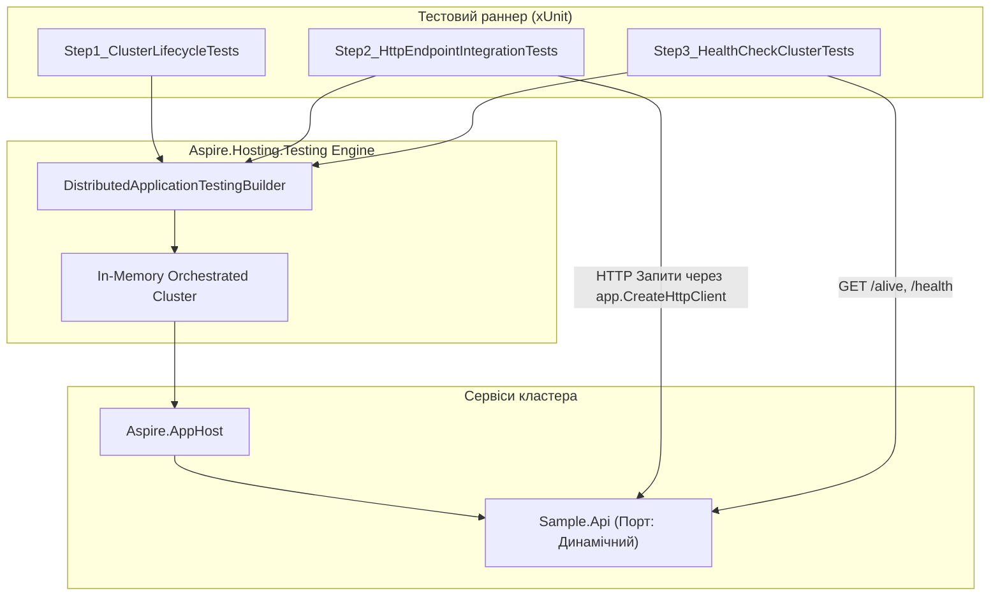

# 📐 Модуль 09: Архітектурна структура та рух даних (Distributed Testing)

> **Мета модуля:** Опанувати автоматизоване тестування розподілених систем за допомогою бібліотеки `Aspire.Hosting.Testing`, що дозволяє запустити весь оркестрований кластер у пам'яті за секунди без попереднього ручного налаштування Docker.

---

## 🏛️ Загальна схема архітектури та тестового процесу



---

## 🪜 Покрокова методологія: Від простого до складного

### 🔹 Крок 1: Життєвий цикл кластера (`Step1_ClusterLifecycleTests`)
- **Концепція:** Перевірка того, що AppHost та всі його ресурси піднімаються без конфліктів конфігурації чи заблокованих портів.
- **Механізм:** Виклик `CreateAsync<Projects.Aspire_AppHost>()` $\to$ `BuildAsync()` $\to$ `StartAsync()` $\to$ `StopAsync()`.

### 🔹 Крок 2: Інтеграційні HTTP-тести з резолвом імен (`Step2_HttpEndpointIntegrationTests`)
- **Концепція:** Замість захардкодженного `http://localhost:5000` використовується фабрика `app.CreateHttpClient("sample-api")`.
- **Сценарій:** Створення сутності через `POST /api/step1-items` $\to$ перевірка коду 201 Created $\to$ вичитка створеного об'єкта через `GET /api/step1-items/{id}`.

### 🔹 Крок 3: Автоматизована перевірка здоров'я Probes (`Step3_HealthCheckClusterTests`)
- **Концепція:** Валідація готовності сервісу до роботи у хмарі:
  - Liveness Probe (`GET /alive`) повертає 200 OK.
  - Readiness Probe (`GET /health`) повертає 200 OK.

---

## 🚀 Як запустити тести самостійно

```powershell
dotnet test 09-Distributed-Testing/09-Distributed-Testing.slnx
```
Всі тести виконуються ізольовано та паралельно.
