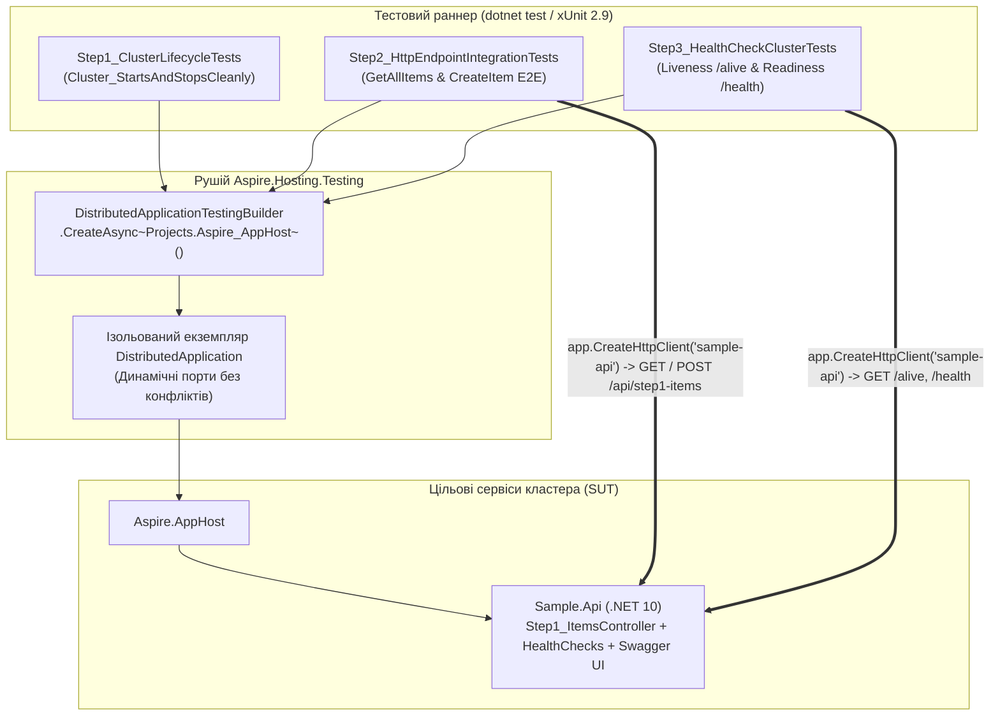
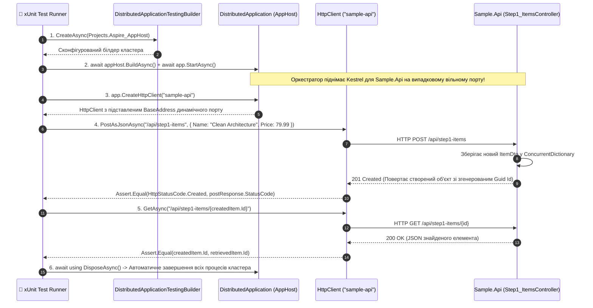
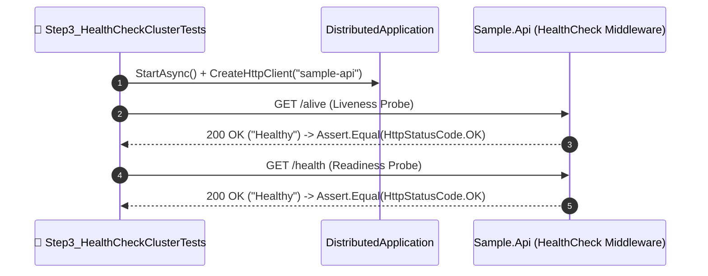

# 09. Архітектура, структура проєктів та рух даних: Distributed Testing (`Aspire.Hosting.Testing`)

> **Повна технічна специфікація автоматизованого інтеграційного тестування мікросервісних кластерів на .NET 10 за допомогою `Aspire.Hosting.Testing` та `xUnit`: програмний життєвий цикл оркестратора, динамічний розподіл портів, клієнтський Service Discovery та верифікація проб живучості.**

---

## 🏛️ Загальна архітектурна схема тестового конвеєра



---

## 🌲 Дерево файлової структури модуля

```text
09-Distributed-Testing/
├── 09-Distributed-Testing.slnx                   # Рішення .NET 10 для модуля розподіленого тестування
├── README.md                                     # Посібник користувача із запуску автотестів та Swagger
├── STRUCTURE-AND-DATA-FLOW.md                    # ЦЕЙ ДОКУМЕНТ: повна технічна специфікація
│
├── Aspire.AppHost/                               # Оркестратор кластера .NET Aspire
│   ├── Program.cs                                # Реєстрація цільового мікросервісу builder.AddProject<Projects.Sample_Api>("sample-api")
│   ├── Aspire.AppHost.csproj                     # Aspire.Hosting.AppHost
│   └── appsettings.json                          # Конфігурація хоста
│
├── Aspire.ServiceDefaults/                       # Спільні стандарти мікросервісів
│   ├── Extensions.cs                             # Налаштування OpenTelemetry, ServiceDiscovery та ендпоінтів /alive, /health
│   └── Aspire.ServiceDefaults.csproj             # Пакетні посилання
│
├── Sample.Api/                                   # Цільовий сервіс під тестуванням (Swagger UI у корені /)
│   ├── Program.cs                                # Конфігурація DI, Controllers, HealthChecks та Swagger UI
│   ├── Sample.Api.csproj                         # Swashbuckle, посилання на ServiceDefaults та Docs
│   └── Controllers/
│       └── Step1_ItemsController.cs              # CRUD-контролер каталогу (/api/step1-items) з потокобезпечним сховищем
│
└── Tests.ClusterIntegration/                     # Інтеграційний тестовий проєкт (xUnit + Aspire.Hosting.Testing)
    ├── Tests.ClusterIntegration.csproj           # Aspire.Hosting.Testing, xunit, посилання на Aspire.AppHost
    ├── Step1_ClusterLifecycleTests.cs            # КРОК 1: Тест ініціалізації, запуску та чистої зупинки кластера
    ├── Step2_HttpEndpointIntegrationTests.cs     # КРОК 2: E2E HTTP-тести читання та створення елементів через Service Discovery
    └── Step3_HealthCheckClusterTests.cs          # КРОК 3: Перевірка готовності інфраструктурних проб /alive та /health
```

---

## 🧩 Взаємодія класів тестового стенду та цільового API (Dependency Graph)

```mermaid
classDiagram
    class DistributedApplicationTestingBuilder {
        +CreateAsync~TEntryPoint~() Task~IDistributedApplicationTestingBuilder~
        +BuildAsync() Task~DistributedApplication~
    }

    class DistributedApplication {
        +StartAsync() Task
        +StopAsync() Task
        +CreateHttpClient(resourceName) HttpClient
        +DisposeAsync() ValueTask
    }

    class Step1_ClusterLifecycleTests {
        +Cluster_StartsAndStopsCleanly_WithoutExceptions() Task
    }

    class Step2_HttpEndpointIntegrationTests {
        +GetAllItems_ReturnsSuccessAndInitialData() Task
        +CreateItem_ReturnsCreatedAndCanBeRetrieved() Task
    }

    class Step3_HealthCheckClusterTests {
        +LivenessEndpoint_Returns200Healthy() Task
        +ReadinessEndpoint_Returns200Healthy() Task
    }

    class Step1_ItemsController {
        -ConcurrentDictionary Items
        +GetAll() IActionResult
        +GetById(id) IActionResult
        +Create(request) IActionResult
        +Delete(id) IActionResult
    }

    Step1_ClusterLifecycleTests --> DistributedApplicationTestingBuilder : Створює тестовий хост
    Step2_HttpEndpointIntegrationTests --> DistributedApplicationTestingBuilder : Створює тестовий хост
    Step3_HealthCheckClusterTests --> DistributedApplicationTestingBuilder : Створює тестовий хост

    DistributedApplicationTestingBuilder ..> DistributedApplication : Будує ізольований кластер
    DistributedApplication ==> Step1_ItemsController : Направляє запити HttpClient("sample-api")
```

---

## 🔄 Покроковий рух даних під час виконання E2E-тестів (Data Flow)

### 📘 КРОК 1 та КРОК 2: Підняття кластера в пам'яті та перевірка ланцюжка `POST` $\to$ `GET`



---

### 📘 КРОК 3: Автоматична верифікація проб живучості (`/alive` та `/health`)



---

## 💾 Порівняння підходів до тестування мікросервісів

| Критерій | Класичні Unit-тести з `Moq` | Ручний `docker-compose` у CI/CD | **`Aspire.Hosting.Testing`** |
| :--- | :--- | :--- | :--- |
| **Реальність топології** | Низька (тестуються ізольовані класи з фейками). | Висока, але потребує дублювання YAML-файлів. | **100% реальна топологія** з того ж самого C# `AppHost.cs`! |
| **Конфлікти портів** | Відсутні (немає мережі). | Постійні помилки зайнятих портів при паралельному запуску. | **Повна ізоляція:** кожен тест отримує власні динамічні порти. |
| **Зручність дебагу** | Легко (`F5` у Visual Studio). | Складно підключитися дебагером до зовнішнього контейнера. | **Ідеально:** ставте Breakpoint прямо в контролері API і тисніть `Debug Test`! |
