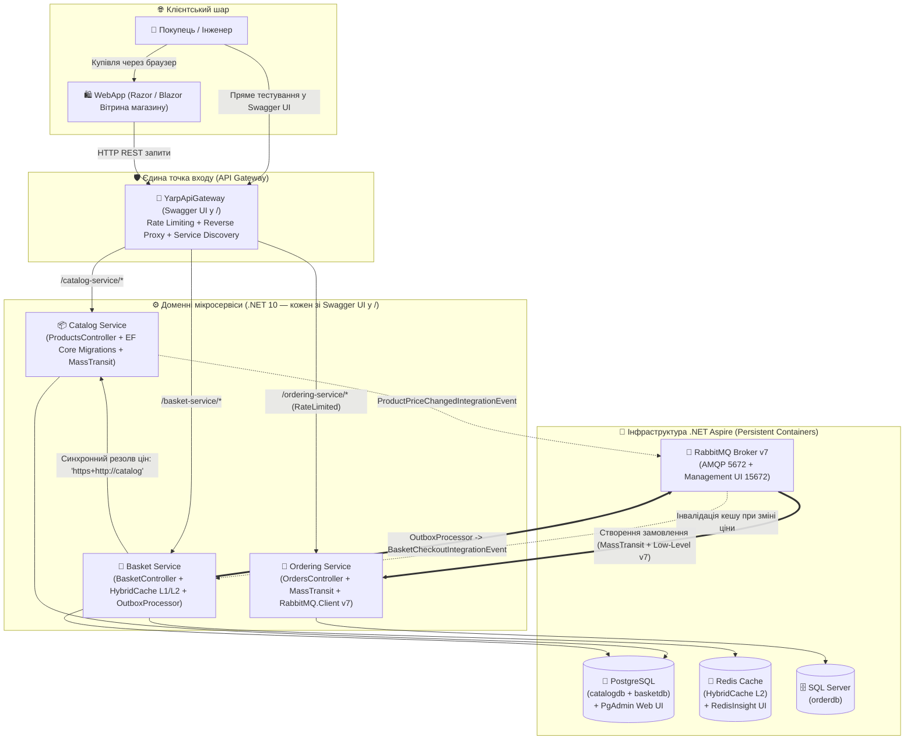

# 10. Distributed eShop Platform (.NET 10 & Aspire Capstone)

> **Фінальний синтез курсу мікросервісної архітектури (Capstone Project):** повнофункціональна еталонна платформа електронної комерції **eShop**, у якій об'єднано всі технології та патерни з модулів **01–09**. Кожен мікросервіс (`YarpApiGateway`, `Catalog`, `Basket`, `Ordering`) відкривається одразу в інтерактивному **Swagger UI** у корені (`/`), а клієнтська вітрина **`WebApp`** надає готовий графічний інтерфейс для покупців.

---

## 🏛️ Генеральна архітектурна схема платформи eShop



---

## 🧩 Матриця синтезу: як усі 9 модулів курсу працюють разом у eShop

| Модуль курсу | Технологія / Патерн | Де і як саме реалізовано в `10-Distributed-eShop-Platform` |
| :---: | :--- | :--- |
| **01** | **Aspire Fundamentals & Migrations** | `AspireApp.AppHost` оркеструє PostgreSQL, SQL Server, Redis, RabbitMQ та 5 проєктів з `.WithDataVolume()`, `.WithLifetime(ContainerLifetime.Persistent)` та `.WaitFor()`. Автоматичне накатування міграцій через `app.UseMigration()`. |
| **02** | **Centralized Caching (Redis & HybridCache)** | `Basket` використовує двошаровий **.NET 10 `HybridCache`** (L1 RAM + L2 Redis) поверх PostgreSQL (`basketdb`). При зміні ціни товару в `Catalog` подія автоматично оновлює ціни в кошиках і скидає кеш! |
| **03** | **RabbitMQ Low-Level (`RabbitMQ.Client v7`)** | У `Basket` та `Ordering` зареєстровано довгоживучий `IConnection` v7, а фоновий воркер `BasketCheckoutEventHandlerWithoutMassTransit` демонструє низькорівневе прослуховування черги паралельно з шиною. |
| **04** | **Event-Driven MassTransit** | Спільна бібліотека `Shared.Messaging` визначає події `ProductPriceChangedIntegrationEvent` та `BasketCheckoutIntegrationEvent`, які доставляються через шину MassTransit. |
| **05** | **Synchronous Service Discovery** | `Basket` звертається до `Catalog` через типізований `CatalogApiClient` за віртуальною адресою `https+http://catalog` без жодного захардкодженого порту. |
| **06** | **Observability & OpenTelemetry** | `AspireApp.ServiceDefaults` підключено до всіх сервісів: наскрізний W3C `TraceId` від `WebApp` крізь `YarpApiGateway` до баз даних і черг RabbitMQ, метрики та проби `/alive` і `/health`. |
| **07** | **Transactional Outbox** | При оформленні замовлення (`POST /api/basket/checkout`) кошик не публікує подію напряму в брокер, а атомарно записує `OutboxMessage` у PostgreSQL, який асинхронно відправляється фоновим `OutboxProcessor`! |
| **08** | **YARP API Gateway & Rate Limiting** | `YarpApiGateway` ізолює внутрішні сервіси, трансформує маршрути `/catalog-service/*`, `/basket-service/*`, `/ordering-service/*` та захищає замовлення лімітером `FixedWindowLimiter`. |
| **09** | **Distributed Testing Ready** | Чиста модульна архітектура з `AppHost` дозволяє піднімати весь eShop-кластер у інтеграційних тестах. |

---

## 🧭 Усі сервіси відкриваються одразу в Swagger UI (`/`)

Коли ви запускаєте платформу, у панелі **Aspire Dashboard** кожен API-сервіс має пряме посилання, яке відкриває **Swagger UI** без потреби дописувати `/swagger`:

| Сервіс у Aspire Dashboard | Контролер | Основні REST Endpoints у Swagger UI (`/`) |
| :--- | :--- | :--- |
| **`yarpapigateway`** | `GatewayStatusController` | • `GET /api/gateway/routes` — огляд таблиці маршрутів YARP та правил Rate Limiting.<br>• Проксі-маршрути: `/catalog-service/*`, `/basket-service/*`, `/ordering-service/*`. |
| **`catalog`** | `ProductsController` | • `GET /api/products` — усі товари.<br>• `GET /api/products/{id}` — товар за ID.<br>• `POST /api/products` — створити товар.<br>• `PUT /api/products/{id}` — оновити ціну товару (тригерить подію `ProductPriceChangedIntegrationEvent`!).<br>• `DELETE /api/products/{id}` — видалити товар.<br>• `GET /api/products/search/{query}` — пошук товарів. |
| **`basket`** | `BasketController` | • `GET /api/basket/{userName}` — отримати кошик із `HybridCache`.<br>• `POST /api/basket` — додати товари в кошик (підтягує актуальні назви й ціни з `Catalog`).<br>• `POST /api/basket/checkout` — оформити замовлення через **Transactional Outbox**.<br>• `DELETE /api/basket/{userName}` — очистити кошик. |
| **`ordering`** | `OrdersController` | • `GET /orders` та `GET /api/orders` — список усіх створених замовлень у SQL Server.<br>• `GET /orders/{userName}` — історія замовлень конкретного покупця.<br>• `POST /orders` — ручне створення замовлення. |
| **`webapp`** | Веб-вітрина покупця | Повноцінний веб-інтерфейс інтернет-магазину eShop (каталог, кошик, оформлення замовлення). |

---

## 🧪 Наскрізний сценарій перевірки всієї платформи (End-to-End)

1. **Запустіть оркестратор eShop:**
   ```powershell
   dotnet run --project 10-Distributed-eShop-Platform/AspireApp/AspireApp.AppHost/AspireApp.AppHost.csproj
   ```
2. **Крок 1 — Перевірка каталогу (`catalog`):**
   * Відкрийте Swagger сервісу `catalog` і викличте `GET /api/products`. Скопіюйте `id` будь-якого товару з початкового сідингу.
3. **Крок 2 — Наповнення кошика з кешуванням (`basket`):**
   * Відкрийте Swagger сервісу `basket` і викличте `POST /api/basket` для користувача `"alex"` із цим `productId`.
   * Сервіс `Basket` синхронно звернеться до `Catalog` через Service Discovery (`https+http://catalog`), дізнається ціну та назву товару і збереже кошик у PostgreSQL та **Redis HybridCache**.
4. **Крок 3 — Реактивний перерахунок кошика при зміні ціни в каталозі:**
   * У Swagger сервісу `catalog` викличте `PUT /api/products/{id}` і змініть ціну товару.
   * `Catalog` опублікує `ProductPriceChangedIntegrationEvent` у RabbitMQ $\to$ `Basket` зловить подію в `ProductPriceChangedEventHandler`, оновить ціну в БД та інвалідує кеш.
   * Викличте `GET /api/basket/alex` — у кошику вже нова ціна!
5. **Крок 4 — Оформлення замовлення через Transactional Outbox (`basket` $\to$ `ordering`):**
   * У Swagger сервісу `basket` викличте `POST /api/basket/checkout`.
   * Кошик атомарно запише подію в таблицю `OutboxMessages` та очистить кошик.
   * Фоновий `OutboxProcessor` доставить подію в RabbitMQ, сервіс `Ordering` збереже замовлення в **SQL Server**, і ви побачите його через `GET /orders/alex` у Swagger сервісу `ordering`!
