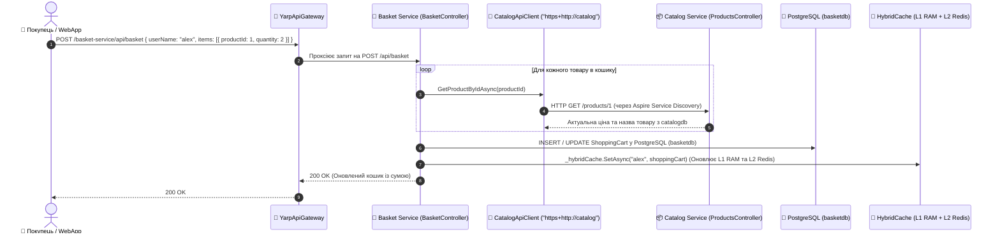
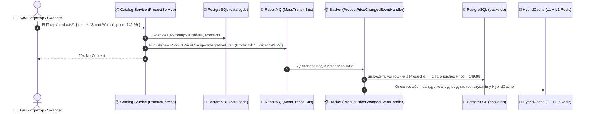
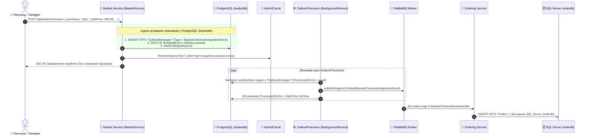

# 10. Архітектура, структура проєктів та рух даних: Distributed eShop Platform (Capstone)

> **Повна технічна специфікація фінального проекту курсу — розподіленої платформи електронної комерції `eShop` на .NET 10 та .NET Aspire: об'єднання шлюзу `YARP`, `PostgreSQL`, `SQL Server`, `Redis HybridCache`, `RabbitMQ.Client v7`, `MassTransit`, `Transactional Outbox` та веб-вітрини `WebApp`.**

---

## 🌲 Дерево файлової структури платформи eShop

```text
10-Distributed-eShop-Platform/
├── Distributed-eShop-Platform.slnx               # Головне рішення .NET 10 для всієї платформи eShop
├── README.md                                     # Огляд платформи та наскрізний сценарій тестування у Swagger
├── STRUCTURE-AND-DATA-FLOW.md                    # ЦЕЙ ДОКУМЕНТ: повна технічна специфікація
│
├── AspireApp/
│   ├── AspireApp.AppHost/                        # Оркестратор усього кластера .NET Aspire
│   │   ├── AppHost.cs                            # PostgreSQL (+PgAdmin), Redis (+RedisInsight), SQL Server, RabbitMQ, 5 сервісів
│   │   └── AspireApp.AppHost.csproj              # Пакетні посилання Aspire Hosting
│   └── AspireApp.ServiceDefaults/                # Єдині стандарти телеметрії OpenTelemetry та HealthChecks
│       └── Extensions.cs                         # W3C Tracing, Metrics, ServiceDiscovery, /alive та /health
│
├── Shared.Messaging/                             # Спільна бібліотека інтеграційних подій та розширень шини
│   ├── Events/
│   │   ├── IntegrationEvent.cs                   # Базовий клас події (EventId, OccurredOn)
│   │   ├── BasketCheckoutIntegrationEvent.cs     # Подія оформлення замовлення з кошика
│   │   └── ProductPriceChangedIntegrationEvent.cs # Подія зміни ціни товару в каталозі
│   └── Extensions/
│       └── MassTransitExtentions.cs              # Уніфікована реєстрація MassTransit + RabbitMQ для всіх мікросервісів
│
├── YarpApiGateway/                               # Вхідний шлюз платформи (Swagger UI у корені /)
│   ├── Program.cs                                # YARP Reverse Proxy + ServiceDiscovery + FixedWindow RateLimiter + Swagger
│   ├── appsettings.json                          # Маршрути /catalog-service/*, /basket-service/*, /ordering-service/*
│   └── Controllers/
│       └── GatewayStatusController.cs            # Діагностика маршрутів та кластерів шлюзу (/api/gateway/routes)
│
├── Catalog/                                      # Мікросервіс каталогу товарів (PostgreSQL + Swagger UI у /)
│   ├── Program.cs                                # Налаштування Npgsql, MassTransit, міграцій та Swagger UI
│   ├── Controllers/
│   │   └── ProductsController.cs                 # REST-контролер (/api/products) з публікацією подій при зміні ціни
│   ├── Data/
│   │   └── CatalogDbContext.cs                   # EF Core контекст таблиці Products та авто-сідинг товарів
│   └── Services/
│       └── ProductService.cs                     # Бізнес-логіка управління каталогом та відправки подій у шину
│
├── Basket/                                       # Мікросервіс кошика покупця (Redis HybridCache + Outbox + Swagger UI у /)
│   ├── Program.cs                                # HybridCache (L1+L2), Npgsql (basketdb), CatalogApiClient, OutboxProcessor
│   ├── ApiClients/
│   │   └── CatalogApiClient.cs                   # Синхронний HTTP-клієнт до "https+http://catalog"
│   ├── Controllers/
│   │   └── BasketController.cs                   # REST-контролер кошика (/api/basket) та оформлення Checkout
│   ├── Data/
│   │   ├── BasketDbContext.cs                    # EF Core контекст: ShoppingCarts, ShoppingCartItems, OutboxMessages
│   │   └── Processors/
│   │       └── OutboxProcessor.cs                # Фоновий воркер: вичитує OutboxMessages і публікує в RabbitMQ
│   ├── EventHandlers/
│   │   └── ProductPriceChangedEventHandler.cs    # Консьюмер MassTransit: оновлює ціну в кошиках при зміні в каталозі
│   └── Services/
│       └── BasketService.cs                      # Робота з HybridCache та атомарним записом у Transactional Outbox
│
├── Ordering/                                     # Мікросервіс замовлень (SQL Server + MassTransit + RabbitMQ v7 + Swagger UI у /)
│   ├── Program.cs                                # SQL Server (orderdb), MassTransit, RabbitMQ.Client v7, Swagger UI
│   ├── Controllers/
│   │   └── OrdersController.cs                   # REST-контролер перегляду та створення замовлень (/orders, /api/orders)
│   ├── Data/
│   │   └── OrderDbContext.cs                     # EF Core контекст таблиці Orders у SQL Server
│   ├── EventHandlers/
│   │   ├── BasketCheckoutEventHandler.cs         # Консьюмер MassTransit для створення замовлення
│   │   └── BasketCheckoutEventHandlerWithoutMassTransit.cs # Низькорівневий консьюмер на чистому RabbitMQ.Client v7
│   └── Services/
│       └── OrderService.cs                       # Збереження та вибірка замовлень із бази даних
│
└── WebApp/                                       # Клієнтська веб-вітрина магазину
    ├── Program.cs                                # Підключення YarpApiClient через Aspire Service Discovery
    └── ApiClients/
        └── YarpApiClient.cs                      # Взаємодія вітрини з усіма сервісами через єдиний шлюз YarpApiGateway
```

---

## 🧩 Взаємодія класів та мікросервісів (Dependency Graph)

```mermaid
classDiagram
    class AppHost {
        +AddPostgres("postgres")
        +AddRedis("cache")
        +AddSqlServer("sqlserver")
        +AddRabbitMQ("rabbitmq")
        +AddProject~Catalog~("catalog")
        +AddProject~Basket~("basket")
        +AddProject~Ordering~("ordering")
        +AddProject~YarpApiGateway~("yarpapigateway")
        +AddProject~WebApp~("webapp")
    }

    class GatewayStatusController {
        +GetGatewayRoutes() IActionResult
    }

    class ProductsController {
        -ProductService _productService
        +GetProducts() Task~IActionResult~
        +GetProductById(id) Task~IActionResult~
        +CreateProduct(product) Task~IActionResult~
        +UpdateProduct(id, updatedProduct) Task~IActionResult~
        +DeleteProduct(id) Task~IActionResult~
        +SearchProducts(query) Task~IActionResult~
    }

    class BasketController {
        -BasketService _basketService
        +GetBasket(userName) Task~IActionResult~
        +UpdateBasket(shoppingCart) Task~IActionResult~
        +DeleteBasket(userName) Task~IActionResult~
        +CheckoutBasket(checkout) Task~IActionResult~
    }

    class OutboxProcessor {
        -IServiceProvider _serviceProvider
        -IPublishEndpoint _publishEndpoint
        #ExecuteAsync(stoppingToken) Task
    }

    class ProductPriceChangedEventHandler {
        -BasketService _basketService
        +Consume(ConsumeContext~ProductPriceChangedIntegrationEvent~) Task
    }

    class OrdersController {
        -OrderService _orderService
        +GetOrders() Task~IActionResult~
        +GetOrdersByUser(userName) Task~IActionResult~
        +CreateOrder(order) Task~IActionResult~
    }

    class BasketCheckoutEventHandler {
        -OrderService _orderService
        +Consume(ConsumeContext~BasketCheckoutIntegrationEvent~) Task
    }

    GatewayStatusController ..> ProductsController : YARP маршрутизує /catalog-service/*
    GatewayStatusController ..> BasketController : YARP маршрутизує /basket-service/*
    GatewayStatusController ..> OrdersController : YARP маршрутизує /ordering-service/*

    BasketController --> ProductsController : CatalogApiClient ("https+http://catalog")
    ProductsController ..> ProductPriceChangedEventHandler : Публікує ProductPriceChangedIntegrationEvent
    BasketController --> OutboxProcessor : Записує OutboxMessage у транзакції БД
    OutboxProcessor ..> BasketCheckoutEventHandler : Публікує BasketCheckoutIntegrationEvent у RabbitMQ
    BasketCheckoutEventHandler --> OrdersController : Зберігає Order у SQL Server
```

---

## 🔄 Покроковий рух даних у ключових бізнес-процесах (Data Flow)

### 1. Додавання товару в кошик (Service Discovery + HybridCache + PostgreSQL)



---

### 2. Реактивна синхронізація цін між `Catalog` та `Basket` (Event-Driven Cache Invalidation)



---

### 3. Надійне оформлення замовлення через Transactional Outbox (`Basket` $\to$ `RabbitMQ` $\to$ `Ordering`)



---

## 💾 Карта сховищ даних та інфраструктури платформи eShop

| Сервіс | СУБД / Сховище | Назва ресурсу в Aspire | Таблиці / Ключі | Призначення |
| :--- | :--- | :--- | :--- | :--- |
| **`Catalog`** | PostgreSQL (Docker) | `catalogdb` | Таблиця `"Products"` | Зберігання асортименту товарів, описів, категорій та актуальних цін |
| **`Basket` (L1/L2 Cache)** | Redis + In-Memory | `cache` (+ `RedisInsight`) | Ключ: `{userName}` | Миттєве читання активних кошиків покупців через `.NET 10 HybridCache` |
| **`Basket` (Persistence)** | PostgreSQL (Docker) | `basketdb` | `"ShoppingCarts"`, `"ShoppingCartItems"`, `"OutboxMessages"` | Довготривале зберігання кошиків та таблиця `Transactional Outbox` для гарантованої відправки замовлень |
| **`Ordering`** | MS SQL Server (Docker) | `orderdb` | Таблиця `"Orders"` | Історія оформлених замовлень, адрес доставки та сум до сплати |
| **`Shared.Messaging`** | RabbitMQ v7 (Docker) | `rabbitmq` (+ Management UI) | Exchanges: `BasketCheckoutIntegrationEvent`, `ProductPriceChangedIntegrationEvent` | Асинхронна подієва шина між `Catalog`, `Basket` та `Ordering` |
