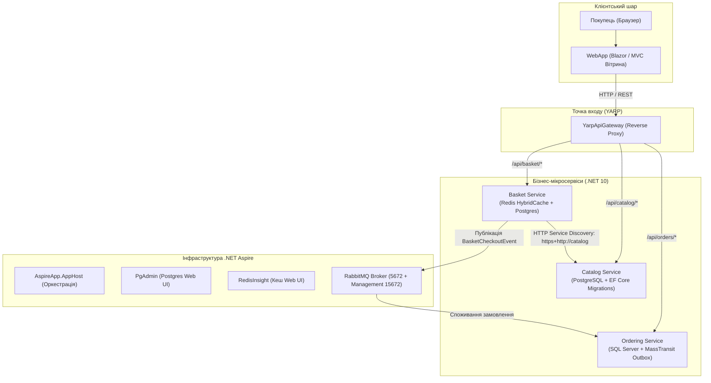

# 📐 Модуль 10: Архітектурна структура та рух даних (Distributed eShop Platform)

> **Мета модуля:** Об'єднати всі технології та патерни з модулів 01–09 у єдину промислову еталонну e-commerce платформу **eShop** на .NET 10 та .NET Aspire.

---

## 🏛️ Генеральна архітектурна схема платформи eShop



---

## 🧩 Як синтезовано всі попередні 9 модулів у Capstone

| # | Технологія / Модуль | Як реалізовано в eShop Platform |
| :---: | :--- | :--- |
| **01** | **Aspire Fundamentals & Migrations** | `AppHost` оркеструє всі сервіси, контейнери мають `.WithDataVolume()` та `.WithLifetime(Persistent)`. Автоматичне накатування міграцій `app.UseMigration()`. |
| **02** | **Centralized Caching (Redis)** | У `Basket Service` підключено новий **.NET 10 HybridCache** поверх Redis з fallback на PostgreSQL при тривалому зберіганні. Панель **RedisInsight** у Aspire. |
| **03** | **RabbitMQ Low-Level** | В `Ordering` та `Basket` використовується свіжий `RabbitMQ.Client v7` (`IConnection`) для низькорівневих сценаріїв доставки безпосередньо через асинхронні канали. |
| **04** | **Event-Driven MassTransit** | Інтеграційні події `BasketCheckoutEvent` та `OrderCreatedIntegrationEvent` передаються через MassTransit bus зі спільними контрактами `Shared.Messaging`. |
| **05** | **Service Discovery (Transport)** | Зв'язок `Basket` $\to$ `Catalog` налаштовано через віртуальну Aspire-адресу `https+http://catalog` без хардкоду localhost та портів. |
| **06** | **Observability & OpenTelemetry** | `AspireApp.ServiceDefaults` підключено в кожен мікросервіс: спільні траси W3C, збір метрик та дворежимні перевірки `/alive` та `/health`. |
| **07** | **Transactional Outbox & Sagas** | `OutboxProcessor` у `Basket` та `Ordering` гарантує At-Least-Once доставку подій без ризику Dual-Write при падінні бази чи мережі. |
| **08** | **API Gateway (YARP)** | `YarpApiGateway` ізолює внутрішній контур, маршрутизує запити до відповідних сервісів та керує заголовками ідентичності. |
| **09** | **Distributed Testing Ready** | Архітектура готова до наскрізного підняття кластера через `DistributedApplicationTestingBuilder`. |

---

## 🧭 REST API Контролери та Swagger UI сервісів

Усі мікросервіси переведено з Minimal API на класичні типізовані `[ApiController]` контролери з повною підтримкою Swagger UI у корені сервісу (`c.RoutePrefix = string.Empty`):

| Сервіс | Контролер | Основні Endpoints | Swagger UI |
| :--- | :--- | :--- | :--- |
| **Catalog** | `ProductsController` | `GET /api/products`, `GET /api/products/{id}`, `POST /api/products`, `PUT /api/products/{id}`, `DELETE /api/products/{id}`, `GET /api/products/search/{query}` | `http://localhost:<catalog-port>/` |
| **Basket** | `BasketController` | `GET /api/basket/{userName}`, `POST /api/basket`, `POST /api/basket/checkout`, `DELETE /api/basket/{userName}` | `http://localhost:<basket-port>/` |
| **Ordering** | `OrdersController` | `GET /orders`, `GET /orders/{userName}`, `POST /orders`, `GET /api/orders` | `http://localhost:<ordering-port>/` |

---

## 🚀 Запуск платформи eShop

```powershell
dotnet run --project 10-Distributed-eShop-Platform/AspireApp/AspireApp.AppHost/AspireApp.AppHost.csproj
```
Панель Aspire Dashboard автоматично відкриється у браузері.
Звідти в один клік доступні:
- **WebApp Вітрина:** візуальний інтерфейс магазину
- **PgAdmin:** менеджер баз даних PostgreSQL
- **RedisInsight:** візуалізатор ключів кешу Redis
- **RabbitMQ Management:** черги та обмінники брокера
