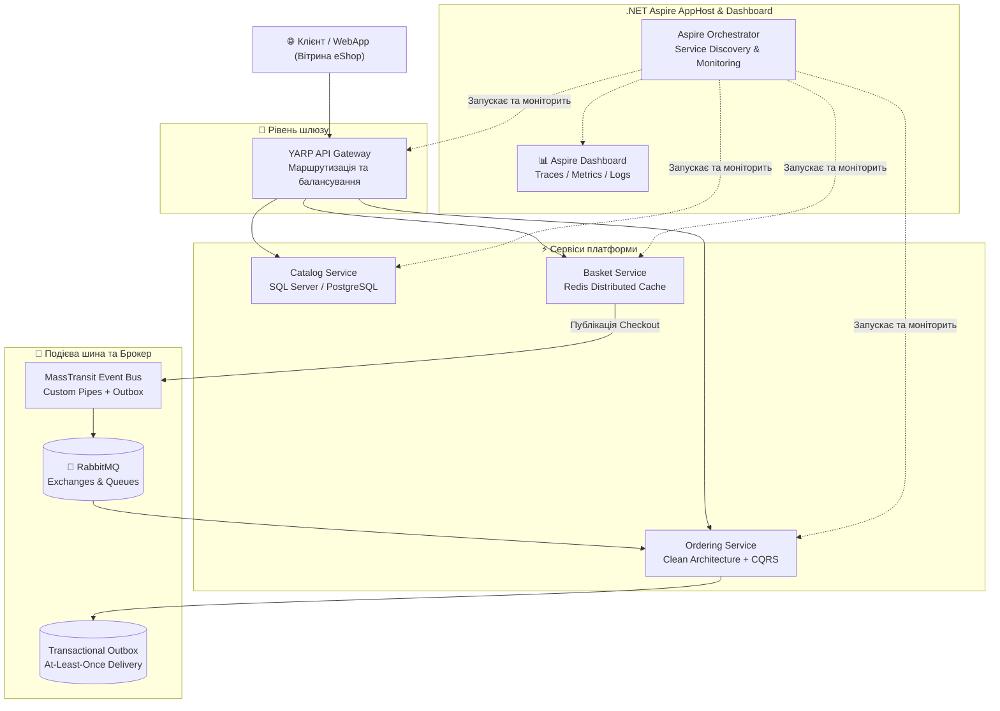

# 🌐 Microservices-Aspire-Mastery (.NET 10)

[](https://dotnet.microsoft.com/)
[](https://learn.microsoft.com/dotnet/aspire/)
[](https://www.rabbitmq.com/)
[](https://masstransit.io/)
[](https://redis.io/)
[](https://microsoft.github.io/reverse-proxy/)
[](LICENSE)

> **Повний практичний курс та виробничий стенд з мікросервісної архітектури на .NET 10 та .NET Aspire.**  
> Поєднує як глибоку ручну конфігурацію брокера повідомлень (MassTransit + RabbitMQ) на низькому рівні, так і сучасну cloud-ready оркестрацію сервісів через .NET Aspire, патерн Transactional Outbox, зворотний проксі YARP, стійкість Polly та розподілене трасування.

---

## 🏛️ Архітектурна карта платформи eShop & Aspire



---

## 📚 Модулі та структура курсу

| Модуль | Назва | Зміст та технології |
| :---: | :--- | :--- |
| **01** | **[Custom MassTransit & RabbitMQ](01-Custom-MassTransit-And-RabbitMQ)** | Ручна детальна збірка MassTransit без автоматичної магії: створення топологій брокера (Fanout/Direct/Topic), черги, Dead-Letter Exchanges, обробка помилок та повторні спроби (Retry Policies). |
| **02** | **[Aspire Fundamentals & Dashboard](02-Aspire-Fundamentals-And-Dashboard)** | Оркестрація мікросервісів у коді C#: проєкт AppHost, ServiceDefaults, Redis кеш, підключення контейнерів через Aspire, Service Discovery та інтерактивний Dashboard. |
| **03** | **[Distributed eShop Architecture](03-Distributed-eShop-Architecture)** | Повнофункціональна масштабована система: Catalog API, кошик Basket API на Redis, Ordering API на базі Clean Architecture, спільні контракти подій та зворотний проксі YARP Gateway. |
| **04** | **[Transactional Outbox & Resilience](04-Transactional-Outbox-And-Resilience)** | Надійність на рівні Enterprise: усунення проблеми подвійного запису через Transactional Outbox, ідемпотентність споживачів та налаштування політик Polly (Exponential backoff, Jitter, Circuit Breaker). |
| **05** | **[Observability, Tracing & Health](05-Observability-Tracing-And-Health)** | Наскрізне розподілене трасування (OpenTelemetry + W3C TraceContext) крізь HTTP та RabbitMQ, візуалізація спанів у Jaeger/Dashboard та дворівневі Health Checks (Liveness/Readiness). |

---

## ⚡ Швидкий старт

### Вимоги:
- **.NET SDK 10.0** або новіший (`dotnet --version`)
- **Docker Desktop** (для підняття контейнерів RabbitMQ, Redis, PostgreSQL)

### Клонування та збірка:
```bash
git clone https://github.com/MrTomkaYurii/Microservices-Aspire-Mastery.git
cd Microservices-Aspire-Mastery

# Зібрати всі рішення
dotnet build
```

---

## 👨‍💻 Авторство та ліцензія
- **Автор:** [MrTomkaYurii](https://github.com/MrTomkaYurii)
- **Ліцензія:** MIT
