# 🌐 Microservices-Aspire-Mastery (.NET 10)

[](https://dotnet.microsoft.com/)
[](https://learn.microsoft.com/dotnet/aspire/)
[](https://www.rabbitmq.com/)
[](https://masstransit.io/)
[](https://grpc.io/)
[](https://redis.io/)
[](https://microsoft.github.io/reverse-proxy/)
[](https://www.keycloak.org/)
[](LICENSE)

> **Повний практичний курс та виробничий стенд з мікросервісної архітектури на .NET 10 та .NET Aspire.**  
> Від низькорівневих механізмів брокерів та кешу до шин повідомлень, gRPC, централізованого логування, патернів надійності, Keycloak та еталонної платформи eShop. Усі API-сервіси відкриваються одразу в інтерактивному **Swagger UI** у корені (`/`).

---

## 🏛️ Генеральна архітектурна дорожня карта

```mermaid
flowchart TD
    subgraph Fundamentals ["Блок 1: Фундамент мікросервісів"]
        M1["01. Aspire-Fundamentals & DbMigrations<br/>(Оркестрація, Service Discovery, безпечні міграції БД з WaitForCompletion)"]
        M2["02. Centralized-Caching-Redis<br/>(IMemoryCache -> IDistributedCache -> HybridCache L1/L2 -> Redis Pub/Sub)"]
    end

    subgraph Communication ["Блок 2: Мережева взаємодія та брокери"]
        M3["03. RabbitMQ-LowLevel<br/>(Свіжий RabbitMQ.Client v7: Direct, Fanout, Topic, QoS Prefetch, DLX, Ack/Nack)"]
        M4["04. Event-Driven-MassTransit<br/>(Сервісна шина: Pub/Sub, Request/Response, Retry Policies, Fault & Error Queues)"]
        M5["05. Synchronous-Transport-gRPC<br/>(Високошвидкісний бінарний gRPC HTTP/2: Unary, Server Streaming, Service Discovery)"]
    end

    subgraph EnterpriseCore ["Блок 3: Надійність, безпека та тестування"]
        M6["06. Observability-And-Centralized-Logging<br/>(Liveness/Readiness, W3C TraceContext, OpenTelemetry Metrics, Serilog + Seq)"]
        M7["07. Transactional-Patterns-And-Sagas<br/>(Dual-Write Problem, Custom Outbox + Polly v8, MassTransit EF Outbox, Saga State Machine)"]
        M8["08. Security-YARP-And-Keycloak<br/>(Шлюз YARP, контейнер Keycloak OAuth2/OIDC, Token Propagation, RBAC)"]
        M9["09. Distributed-Testing<br/>(E2E автотести кластера в пам'яті через Aspire.Hosting.Testing та xUnit)"]
    end

    subgraph Capstone ["Блок 4: Еталонний синтез"]
        M10["10. Distributed-eShop-Platform<br/>(Повноцінний eShop, куди інтегровано ВСІ попередні 9 технологій)"]
    end

    Fundamentals --> Communication
    Communication --> EnterpriseCore
    EnterpriseCore --> Capstone
```



---

## 📚 План робіт та структура модулів

| Модуль | Назва | Склад проєктів та стек | Ключові концепції та сценарій |
| :---: | :--- | :--- | :--- |
| **01** | **[01-Aspire-Fundamentals-And-DbMigrations](01-Aspire-Fundamentals-And-DbMigrations)** | `AppHost`<br>`ServiceDefaults`<br>`Catalog.Api`<br>`DbMigrator`<br>`Client.Web`<br>PostgreSQL | **Основи .NET Aspire & безпечні міграції:**<br>• Проєкт оркестрації `AppHost`, автоматичний Service Discovery (`https+http://catalog-api`).<br>• Інтерактивний Aspire Dashboard.<br>• **Патерн DbMigrator:** виділений воркер міграцій EF Core з `.WaitForCompletion(migrator)` для запобігання race conditions при масштабуванні. |
| **02** | **[02-Centralized-Caching-Redis](02-Centralized-Caching-Redis)** | `AppHost`<br>`Basket.Api`<br>`Pricing.Api`<br>Redis + RedisInsight | **Централізоване кешування (4 покрокові етапи):**<br>• Крок 1: `IMemoryCache` (RAM) $\to$ Крок 2: `IDistributedCache` (Redis) $\to$ Крок 3: **.NET 10 HybridCache** (L1 + L2 + Stampede Guard).<br>• Крок 4: Зміна цін у `Pricing.Api` миттєво інвалідує кеш усіх реплік `Basket.Api` через `Redis Pub/Sub` (`subscriber.SubscribeAsync`). |
| **03** | **[03-RabbitMQ-LowLevel](03-RabbitMQ-LowLevel)** | `AppHost`<br>`Sender.Api`<br>`Receiver.Worker`<br>RabbitMQ v7 + Management | **Низькорівнева механіка RabbitMQ (без шин, 4 кроки):**<br>• Сучасний асинхронний `RabbitMQ.Client v7` (`IConnection` vs `IChannel`).<br>• Покрокові контролери: Direct (`Step1`), Fanout (`Step2`), Topic (`Step3`) та Dead Letter Exchange / TTL / Poison Messages (`Step4`).<br>• Надійність доставки: `BasicQosAsync` (Prefetch), `BasicAckAsync`, `BasicNackAsync`. |
| **04** | **[04-Event-Driven-MassTransit](04-Event-Driven-MassTransit)** | `AppHost`<br>`Order.Api`<br>`Warehouse.Worker`<br>`Contracts`<br>RabbitMQ + MassTransit | **Event-Driven архітектура через MassTransit:**<br>• Чому шина потрібна поверх брокера: автоматична топологія (kebab-case), типізовані події та конверти метаданих.<br>• **Pub/Sub:** `IPublishEndpoint` та `IConsumer<OrderCreatedEvent>`.<br>• **Request/Response:** `IRequestClient<CheckStockRequest>` без блокування потоків.<br>• Політики повторів (`UseMessageRetry`), черги `_error` та компенсаційний `IConsumer<Fault<OrderCreatedEvent>>`. |
| **05** | **[05-Synchronous-Transport-gRPC](05-Synchronous-Transport-gRPC)** | `AppHost`<br>`Inventory.Grpc`<br>`Order.Client.Api`<br>Protobuf + gRPC | **Високошвидкісний транспорт: gRPC vs REST:**<br>• Коли асинхронний брокер надлишковий: синхронна перевірка наявності та резервування товарів.<br>• `.proto` контракти, бінарна серіалізація HTTP/2, Unary RPC та Server Streaming RPC (`IServerStreamWriter`).<br>• Інтеграція gRPC клієнта з Aspire Service Discovery (`https+http://inventory-grpc`). |
| **06** | **[06-Observability-And-Centralized-Logging](06-Observability-And-Centralized-Logging)** | `AppHost`<br>`Orders.Api`<br>Seq + OTLP + OpenTelemetry | **Централізоване логування та спостережуваність (4 кроки):**<br>• Крок 1: Дворежимні Health Checks (`/alive` Liveness vs `/health` Readiness).<br>• Крок 2: Наскрізний `TraceId`, ієрархія Spans та Baggage за стандартом W3C TraceContext.<br>• Крок 3: Метрики OpenTelemetry (`Counter`, `Histogram`, `ObservableGauge`).<br>• Крок 4: Структуроване семантичне логування Serilog у контейнер **Seq**. |
| **07** | **[07-Transactional-Patterns-And-Sagas](07-Transactional-Patterns-And-Sagas)** | `AppHost`<br>`Checkout.Api`<br>PostgreSQL + RabbitMQ + Polly v8 | **Патерни надійності та розподілені транзакції (4 кроки):**<br>• Крок 1: Симуляція катастрофи Dual-Write.<br>• Крок 2: Кастомний **Transactional Outbox** та фоновий воркер із конвеєром стійкості **Polly v8** (Retry + Exponential Backoff + Circuit Breaker).<br>• Крок 3: Промисловий `AddEntityFrameworkOutbox` у MassTransit.<br>• Крок 4: **Saga Pattern** із компенсуючими транзакціями (Rollback без блокувань). |
| **08** | **[08-Security-YARP-And-Keycloak](08-Security-YARP-And-Keycloak)** | `AppHost`<br>`YarpGateway`<br>`Protected.Api`<br>Keycloak Docker Container | **Безпека, YARP API Gateway та Identity (4 кроки):**<br>• Запуск контейнера **Keycloak** (OAuth2 / OIDC) у .NET Aspire.<br>• Крок 1: Єдина точка входу YARP та Rate Limiting.<br>• Крок 2: Публічні маршрути каталогу.<br>• Крок 3: Патерн **Token & Claim Propagation** (Gateway Offloading).<br>• Крок 4: Рольова авторизація **RBAC** (`User` vs `Admin`). |
| **09** | **[09-Distributed-Testing](09-Distributed-Testing)** | `AppHost`<br>`Sample.Api`<br>`Tests.ClusterIntegration`<br>`Aspire.Hosting.Testing` | **Інтеграційне тестування розподілених систем (3 кроки):**<br>• Запуск усього кластера в пам'яті через xUnit та `DistributedApplicationTestingBuilder`.<br>• Крок 1: Тест життєвого циклу кластера (`StartAsync` / `StopAsync`).<br>• Крок 2: E2E перевірка CRUD-операцій через `app.CreateHttpClient("sample-api")`.<br>• Крок 3: Автоматична верифікація проб `/alive` та `/health`. |
| **10** | **[10-Distributed-eShop-Platform](10-Distributed-eShop-Platform)** | `AspireApp.AppHost`<br>`YarpApiGateway`<br>`Catalog`, `Basket`, `Ordering`<br>`WebApp` | **Фінальний шедевр (Capstone):**<br>Повнофункціональний e-commerce стенд, куди **інтегровано всі попередні 9 технологій**: YARP Gateway, Catalog (PostgreSQL + Migrations + MassTransit), Basket (Redis HybridCache + Outbox + RabbitMQ v7), Ordering (SQL Server + MassTransit + Low-Level Consumer), наскрізний моніторинг та Blazor WebApp. |

---

## ⚡ Швидкий старт

### Вимоги:
- **.NET SDK 10.0** або новіший (`dotnet --version`)
- **Docker Desktop** (для підняття контейнерів інфраструктури)

### Збірка та запуск:
```bash
git clone https://github.com/MrTomkaYurii/Microservices-Aspire-Mastery.git
cd Microservices-Aspire-Mastery

# Зібрати всі рішення
dotnet build Microservices-Aspire-Mastery.slnx
```

---

## 👨‍💻 Авторство та ліцензія
- **Автор:** [MrTomkaYurii](https://github.com/MrTomkaYurii)
- **Ліцензія:** MIT
