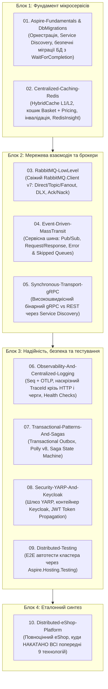

# 🌐 Microservices-Aspire-Mastery (.NET 10)

[](https://dotnet.microsoft.com/)
[](https://learn.microsoft.com/dotnet/aspire/)
[](https://www.rabbitmq.com/)
[](https://masstransit.io/)
[](https://grpc.io/)
[](https://redis.io/)
[](https://microsoft.github.io/reverse-proxy/)
[](https://www.keycloak.org/)
[](LICENSE)

> **Повний практичний курс та виробничий стенд з мікросервісної архітектури на .NET 10 та .NET Aspire.**  
> Від низькорівневих механізмів брокерів та кешу до шин повідомлень, gRPC, централізованого логування, паттернів надійності, Keycloak та еталонної платформи eShop.

---

## 🏛️ Генеральна архітектурна дорожня карта



---

## 📚 План робіт та структура модулів

| Модуль | Назва | Склад проєктів та стек | Ключові концепції та сценарій |
| :---: | :--- | :--- | :--- |
| **01** | **[01-Aspire-Fundamentals-And-DbMigrations](01-Aspire-Fundamentals-And-DbMigrations)** | `AppHost`<br>`ServiceDefaults`<br>`Catalog.Api`<br>`DbMigrator`<br>`Client.Web`<br>PostgreSQL | **Основи .NET Aspire & безпечні міграції:**<br>• Проєкт оркестрації `AppHost`, автоматичний Service Discovery (`https+http://catalogapi`).<br>• Інтерактивний Aspire Dashboard.<br>• **Паттерн DbMigrator:** виділений воркер міграцій EF Core з `.WaitForCompletion(migrator)` для запобігання race conditions при масштабуванні. |
| **02** | **[02-Centralized-Caching-Redis](02-Centralized-Caching-Redis)** | `AppHost`<br>`Basket.Api`<br>`Pricing.Api`<br>Redis + RedisInsight | **Централізоване кешування:**<br>• **.NET 10 HybridCache** (L1 In-Memory + L2 Redis).<br>• Зв'язка двох сервісів: зміна цін у `Pricing.Api` провокує інвалідацію кешу кошика в `Basket.Api` та перерахунок счёта.<br>• Захист від *Cache Stampede*, аналіз ключів та пам'яті через RedisInsight. |
| **03** | **[03-RabbitMQ-LowLevel](03-RabbitMQ-LowLevel)** | `AppHost`<br>`Sender.Api`<br>`Receiver.Worker`<br>RabbitMQ v7 + Management | **Низькорівнева механіка RabbitMQ (без шин):**<br>• Сучасний асинхронний `RabbitMQ.Client v7` (`IChannel`).<br>• Топології: Direct, Fanout, Topic exchanges та routing keys.<br>• Надійність доставки: `BasicAckAsync`, `BasicNackAsync`, `Requeue`, Dead Letter Exchange (DLX). |
| **04** | **[04-Event-Driven-MassTransit](04-Event-Driven-MassTransit)** | `AppHost`<br>`Order.Api`<br>`Notification.Worker`<br>`Warehouse.Api`<br>RabbitMQ + MassTransit | **Event-Driven архітектура через MassTransit:**<br>• Чому шина потрібна поверх брокера: автоматична топологія (kebab-case), типізовані події.<br>• **Pub/Sub:** `IPublishEndpoint` та `IConsumer<OrderCreatedEvent>`.<br>• **Request/Response:** `IRequestClient<CheckStockRequest, StockResponse>`.<br>• Черги `_error` та `_skipped`, конфігурація Retry-політик. |
| **05** | **[05-Synchronous-Transport-gRPC](05-Synchronous-Transport-gRPC)** | `AppHost`<br>`Inventory.Grpc`<br>`Order.Api`<br>Protobuf + gRPC | **Високошвидкісний транспорт: gRPC vs REST:**<br>• Коли асинхронний брокер надлишковий: синхронна перевірка наявності товарів.<br>• `.proto` контракти, бінарна серіалізація HTTP/2.<br>• Інтеграція gRPC клієнта з Aspire Service Discovery (`https+http://inventory-grpc`). |
| **06** | **[06-Observability-And-Centralized-Logging](06-Observability-And-Centralized-Logging)** | `AppHost`<br>`Gateway` $\to$ `Orders.Api` $\to$ `Worker`<br>Seq + OTLP + OpenTelemetry | **Централізоване логування та трасування:**<br>• Контейнер **Seq** в Aspire AppHost, семантичне логування Serilog.<br>• Наскрізний `TraceId` крізь HTTP-запити та повідомлення RabbitMQ (W3C TraceContext).<br>• Кастомні метрики `Meter` та дворежимні Health Checks (`/alive`, `/health`). |
| **07** | **[07-Transactional-Patterns-And-Sagas](07-Transactional-Patterns-And-Sagas)** | `AppHost`<br>`Checkout.Api`<br>`Saga.Worker`<br>PostgreSQL + RabbitMQ | **Паттерни надійності та розподілені транзакції:**<br>• Проблема Dual-Write.<br>• **Transactional Outbox:** порівняння ручного воркера та вбудованого `AddEntityFrameworkOutbox` в MassTransit.<br>• **Saga State Machine (MassTransit Automatous):** ланцюжок Замовлення $\to$ Оплата $\to$ Склад $\to$ Доставка з компенсаціями при відмові.<br>• Стійкість через **Polly v8** (Circuit Breaker, Fallback). |
| **08** | **[08-Security-YARP-And-Keycloak](08-Security-YARP-And-Keycloak)** | `AppHost`<br>`YarpGateway`<br>`Protected.Api`<br>Keycloak Docker Container | **Безпека та Identity:**<br>• Запуск **Keycloak** у .NET Aspire.<br>• YARP Gateway як точка входу: перевірка JWT-токена, трансляція клеймів користувача у внутрішній контур (Token Propagation). |
| **09** | **[09-Distributed-Testing](09-Distributed-Testing)** | `AppHost`<br>Тестовий проєкт xUnit<br>`Aspire.Hosting.Testing` | **Інтеграційне тестування розподілених систем:**<br>• Запуск усього кластера (контейнери, API, воркери) в пам'яті через xUnit за 2 секунди.<br>• E2E перевірка ланцюжка: виклик API $\to$ брокер $\to$ стан у базі даних. |
| **10** | **[10-Distributed-eShop-Platform](10-Distributed-eShop-Platform)** | `AspireApp.AppHost`<br>Усі мікросервіси eShop<br>YARP, Blazor WebApp | **Финальний шедевр (Capstone):**<br>Повнофункціональний e-commerce стенд, куди **накатані всі попередні 9 технологій**: YARP + Keycloak, Catalog (gRPC + REST), Basket (Redis HybridCache), Ordering (MassTransit Outbox + Saga), наскрізний моніторинг. Жодного хардкоду `localhost` — чиста оркестрація Aspire. |

---

## ⚡ Швидкий старт

### Вимоги:
- **.NET SDK 10.0** або новіший (`dotnet --version`)
- **Docker Desktop** (для підняття контейнерів)

### Збірка та запуск:
```bash
git clone https://github.com/MrTomkaYurii/Microservices-Aspire-Mastery.git
cd Microservices-Aspire-Mastery

# Зібрати всі рішення
dotnet build Microservices-Aspire-Mastery.slnx
```

---

## 👨‍💻 Авторство та ліцензія
- **Автор:** [MrTomkaYurii](https://github.com/MrTomkaYurii)
- **Ліцензія:** MIT
